# ZL-Volt 光伏电站全生命周期管理平台

面向光伏电站 **建设 + 运维** 全生命周期的业务管理平台演示项目。以中来股份（JOLYWOOD）品牌风格呈现，把 CRM、PM、OA、SRM 与供应链、财务结算、资金管理串成一条可跑通、可展示的业务链。

> 演示版零依赖：只需 JDK 17 + Maven，内置 H2 内存库与 MQTT Broker，**不需要 Docker / MySQL / Redis**，一条命令即可启动。

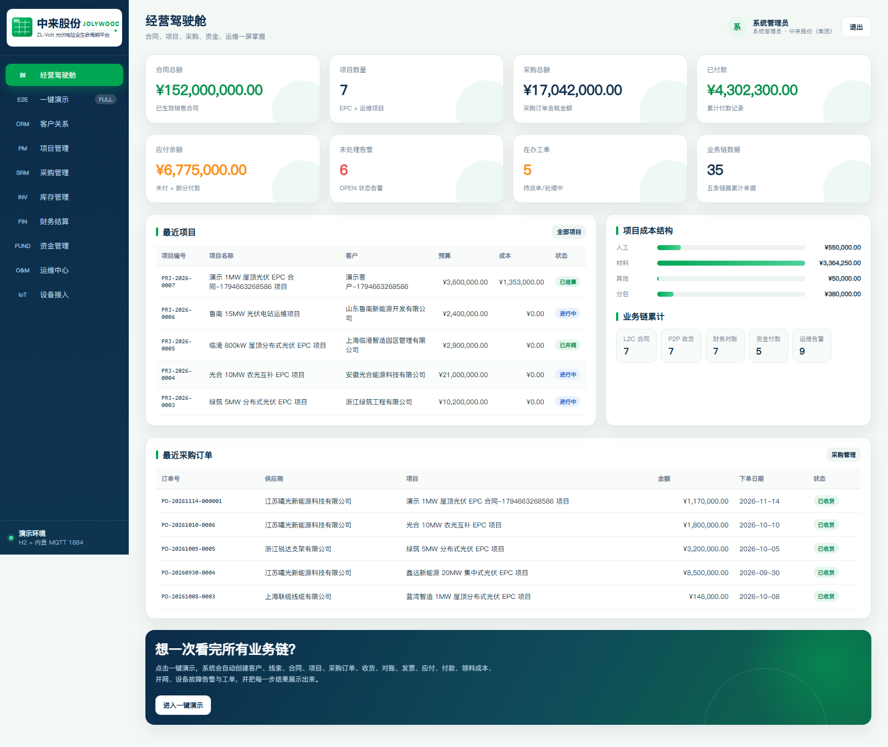

---

## 目录

- [项目简介](#项目简介)
- [界面预览](#界面预览)
- [核心业务链](#核心业务链)
- [系统架构](#系统架构)
- [技术栈](#技术栈)
- [快速开始](#快速开始)
- [演示账号](#演示账号)
- [三步体验完整业务链](#三步体验完整业务链)
- [IoT 与 MQTT](#iot-与-mqtt)
- [API 速览](#api-速览)
- [数据与假数据](#数据与假数据)
- [目录结构](#目录结构)
- [文档](#文档)
- [生产化路线](#生产化路线)
- [说明](#说明)

---

## 项目简介

光伏 EPC 与运维企业的核心痛点，是「合同—项目—采购—收货—对账—发票—付款—成本—运维」这条链路被切散在多个系统里，金额与数量对不上。ZL-Volt 用一套统一的单据流和状态机把它们收拢：

- **L2C**：客户 → 线索 → 商机 → 投标 → 销售合同 → 项目立项
- **P2P**：采购申请 → 采购订单 → 发货 → 收货入库 → 供应商对账 → 发票 → 三单匹配 → 应付 → 付款
- **项目交付**：WBS → 里程碑 → 进度 → 变更签证 → 材料/人工/分包成本归集 → 并网 → 结算
- **运维**：电站 → 设备 → MQTT 遥测 → 告警 → 工单 → 处理闭环
- **经营分析**：合同额、采购额、项目成本、预算执行率、毛利、资金余额、告警与工单

演示版内置 **一键全链路演示**：点击一次按钮，自动真实写入 22 个业务步骤的数据，并把每一步结果、单号和金额展示出来。

---

## 界面预览

### 登录与经营驾驶舱

| 登录页 | 经营驾驶舱（一键演示后） |
|---|---|
| 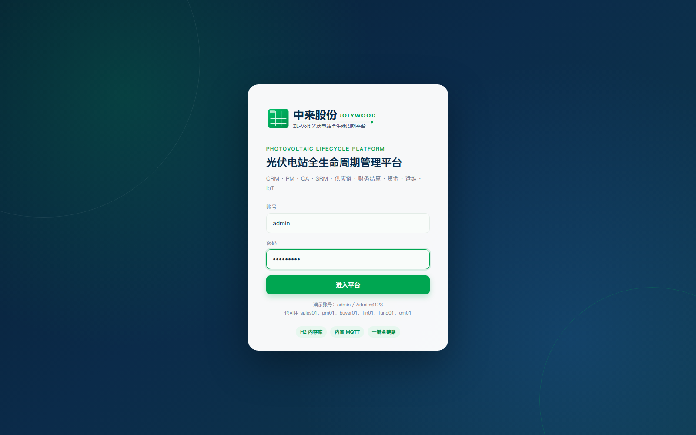 |  |

### 一键演示

一次点击跑通 L2C → P2P → 成本归集 → 并网 → IoT 告警 → 工单 → 结算。

| 演示入口 | 22 步执行结果 |
|---|---|
| 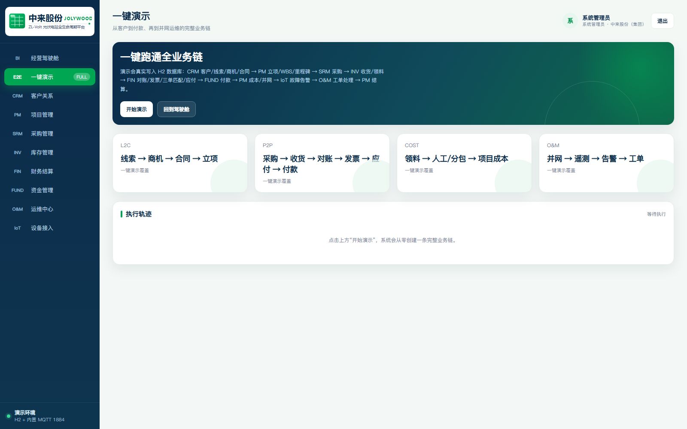 | 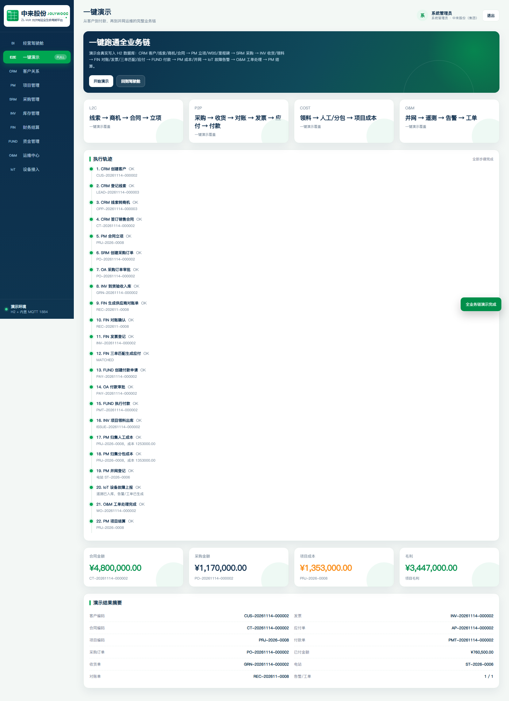 |

### 业务模块

| CRM 客户关系 | PM 项目管理 |
|---|---|
| 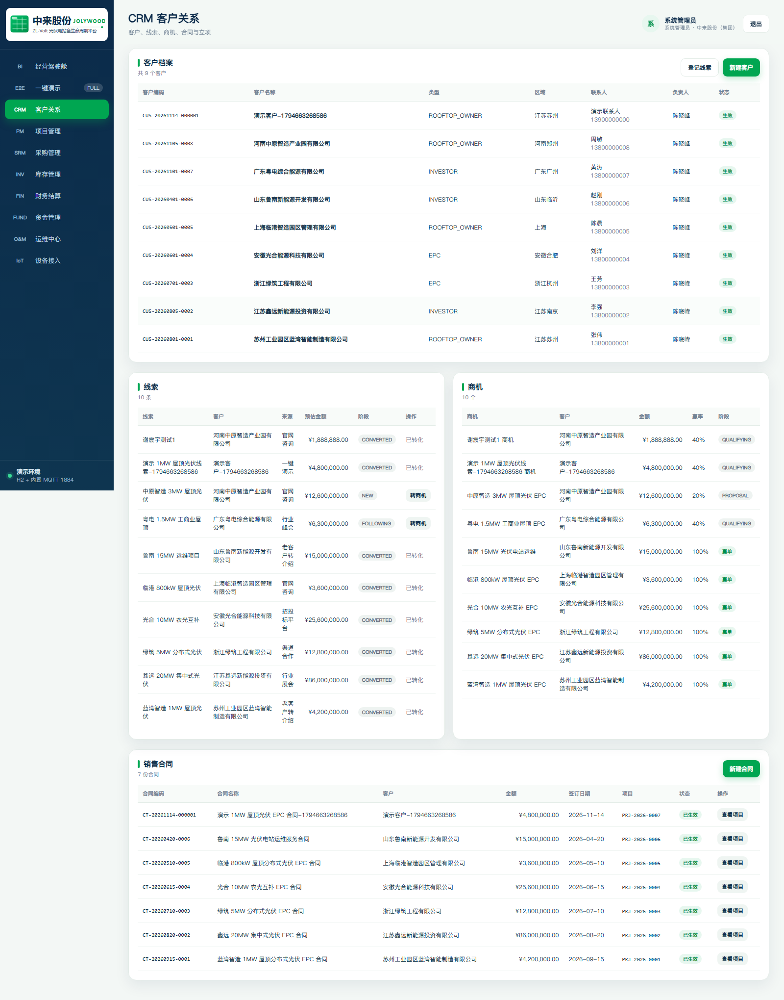 | 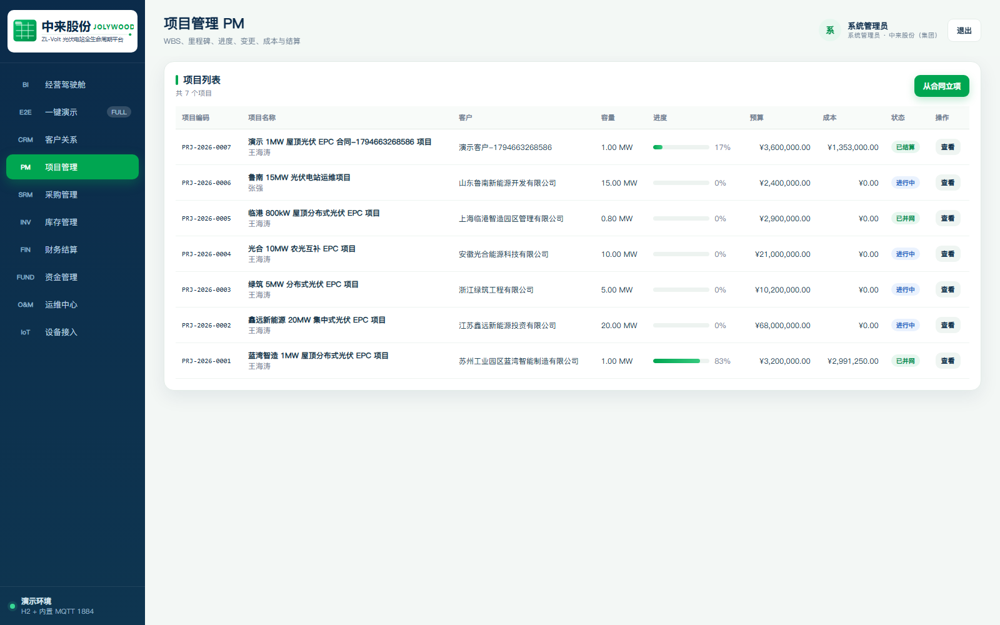 |

| SRM 采购管理 | 库存管理 |
|---|---|
| 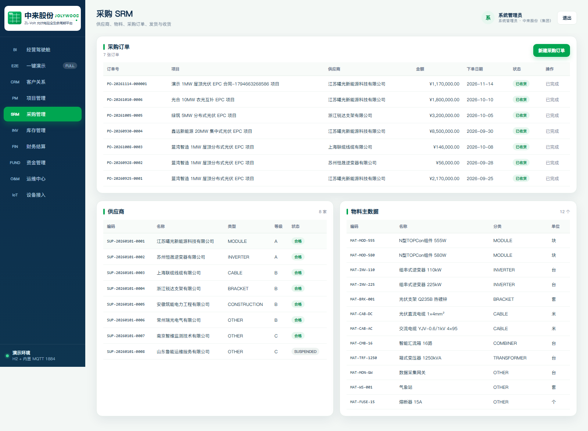 | 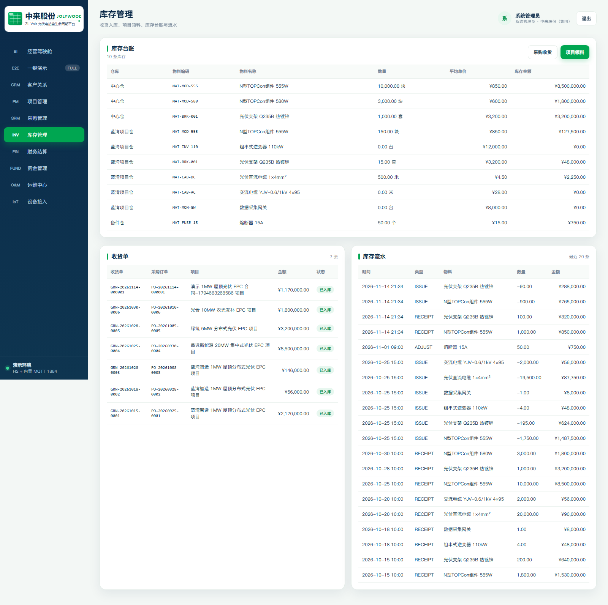 |

| 财务结算 | 资金管理 |
|---|---|
| 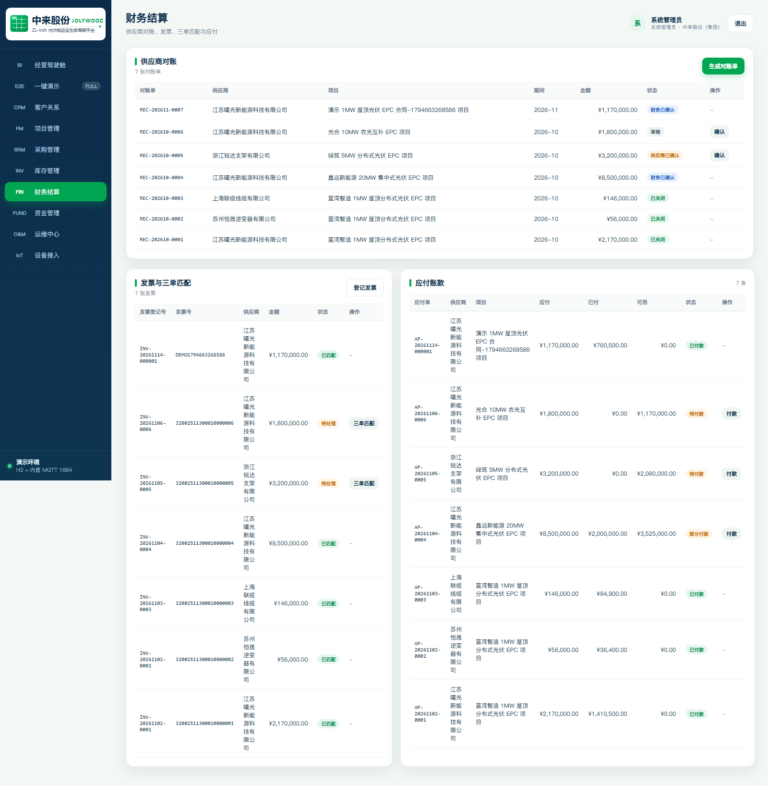 | 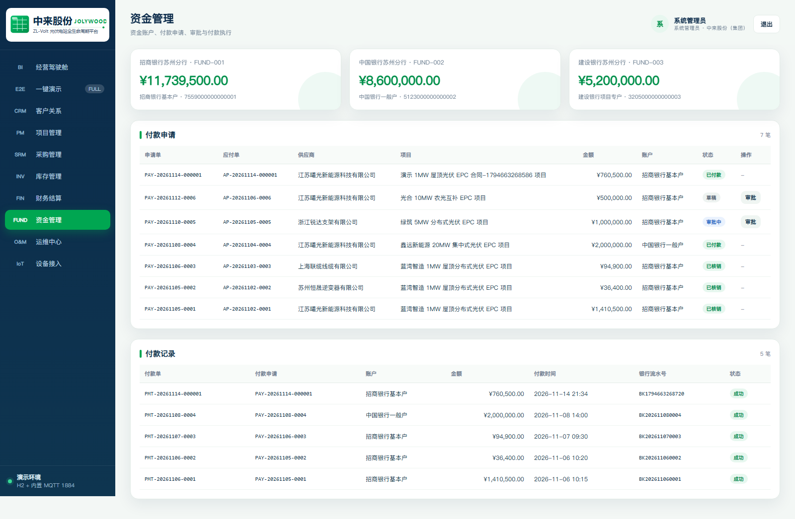 |

| 运维中心 | 设备接入与 IoT |
|---|---|
| 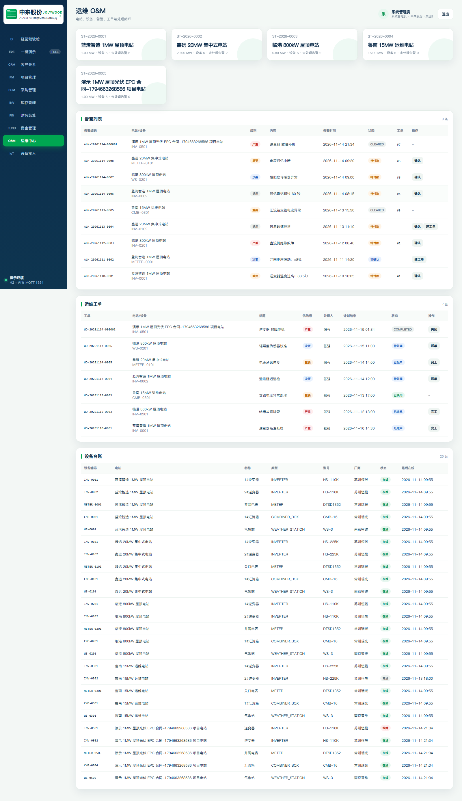 | 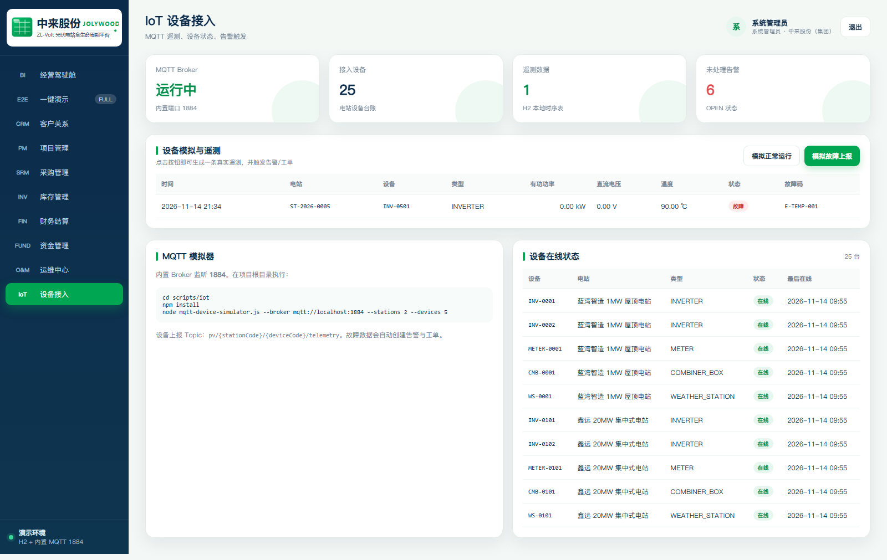 |

---

## 核心业务链

### L2C 线索到合同

```text
客户建档 → 线索登记 → 商机转化 → 投标 → 销售合同 → 项目立项 → WBS / 里程碑
```

关键点：商机赢单后才能转合同；合同生效后按合同金额、客户、项目经理生成项目，并初始化 WBS 与里程碑。

### P2P 采购到付款

```text
采购订单(审批/发货) → 收货入库(移动加权平均) → 供应商对账 → 发票登记
        → 三单匹配(订单/收货/发票) → 应付单 → 付款申请(审批) → 付款执行 → 核销
```

关键规则：

- 收货数量不能超过订单数量，收货金额不能超过订单金额
- 对账数量 = 收货数量，差异必须为 0 才能确认
- 发票金额不能超过对账金额
- 应付可用余额 = 应付金额 − 已付 − 预付款核销 − 质保金
- 付款金额不能超过应付可用余额；付款成功后扣减资金账户余额

### 项目交付与成本

材料领用按移动加权平均价结转到项目材料成本；人工、分包、机械、其他费用按成本类型归集；变更签证审批后调整预算与工期；并网与结算推进项目状态机。

### 结算与毛利

```text
项目总成本 = 材料成本 + 人工 + 分包 + 机械 + 其他
毛利       = 合同额 − 项目总成本
```

### 运维与 IoT

设备通过 MQTT 上报遥测（功率、温度、电压、电流、发电量），平台落库并更新设备状态；温度超阈值或设备故障时自动生成告警，并可一键转工单、派单、完工、关闭。

---

## 系统架构

### 演示版（本仓库，开箱即用）

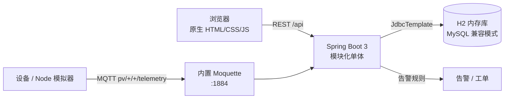

- 后端按业务域拆包：`auth / crm / pm / srm / inv / fin / fund / om / iot / report / demo`
- 数据库直接复用生产 MySQL 的 DDL 与种子数据，启动时自动转换为 H2 方言
- 前端为原生 HTML + CSS + JS 单页应用，无构建步骤

### 生产版设计（微服务）

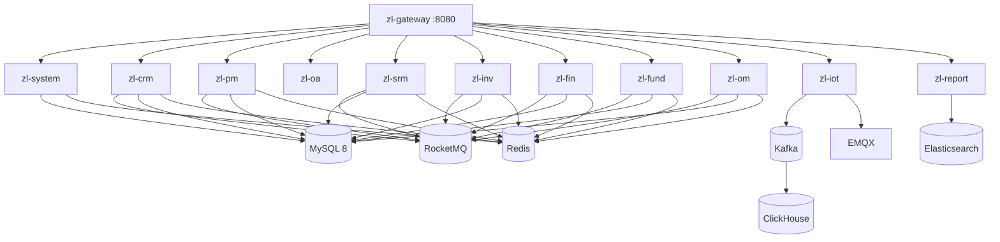

`deploy/docker-compose-dev.yml` 已提供 MySQL、Redis、ZooKeeper、RocketMQ、EMQX，以及 `full` profile 下的 Kafka、Elasticsearch、Kibana、ClickHouse、MinIO。

---

## 技术栈

| 层次 | 演示版 | 生产版设计 |
|---|---|---|
| 后端 | Spring Boot 3.2、Java 17、Spring JDBC | Spring Cloud Alibaba、Spring Boot 3、MyBatis-Plus |
| 数据库 | H2 内存库（MySQL 兼容模式） | MySQL 8 |
| 缓存/锁 | — | Redis 7 |
| 消息 | — | RocketMQ 5、Kafka 3 |
| 注册/配置 | — | ZooKeeper 3.8、Nacos |
| 搜索/分析 | 内存模糊搜索 | Elasticsearch 8、ClickHouse 24 |
| IoT | 内置 Moquette Broker（MQTT 3.1.1） | EMQX 5、Kafka、ClickHouse |
| 工作流 | 轻量状态机 | Flowable |
| 文件 | — | MinIO |
| 前端 | 原生 HTML / CSS / JS | Vue 3 + Vite（可替换） |
| 部署 | `java -jar` | Docker Compose / Kubernetes |

---

## 快速开始

### 环境要求

- JDK 17+
- Maven 3.8+
- 可选：Node.js 18+（仅 MQTT 模拟器需要）

无需 Docker、无需 MySQL、无需 Redis。

### 启动

```bash
git clone <your-repo-url>
cd ZLVoltManagement

mvn clean package -DskipTests
java -jar target/zl-volt-demo-1.0.0.jar
```

或直接：

```bash
mvn spring-boot:run
```

启动成功后访问：

| 入口 | 地址 |
|---|---|
| 平台首页 | http://localhost:18080 |
| H2 控制台 | http://localhost:18080/h2-console |
| MQTT Broker | `mqtt://localhost:1884` |

> H2 控制台 JDBC URL：`jdbc:h2:mem:zlvolt`，用户名 `sa`，密码留空。

> 演示版每次启动都会重建内存库并重新加载种子数据（`zl.demo.reset-on-start=true`），重启即重置。

---

## 演示账号

| 账号 | 密码 | 角色 |
|---|---|---|
| admin | Admin@123 | 系统管理员 |
| gm01 | Test@123 | 总经理（大额审批） |
| sales01 | Test@123 | 销售 |
| pm01 | Test@123 | 项目经理 |
| buyer01 | Test@123 | 采购 |
| wh01 | Test@123 | 仓库 |
| fin01 | Test@123 | 财务 |
| fund01 | Test@123 | 资金 |
| om01 | Test@123 | 运维 |

> 种子密码使用 `{noop}` 明文前缀，仅用于本地演示；生产必须改为 BCrypt 并强制修改初始密码。

---

## 三步体验完整业务链

### 第一步：登录

打开 http://localhost:18080 ，使用 `admin / Admin@123` 进入经营驾驶舱。

### 第二步：一键演示

左侧菜单点击 **一键演示 → 开始演示**，系统会自动完成 22 个步骤：

```text
1  创建客户                12 财务：三单匹配并生成应付
2  登记线索                13 资金：创建付款申请
3  线索转商机              14 资金：付款审批
4  商机转销售合同          15 资金：付款执行 + 账户扣减
5  项目立项 + WBS + 里程碑 16 库存：项目领料出库
6  创建采购订单            17 项目：材料成本归集
7  采购订单审批            18 项目：人工/分包成本归集
8  采购订单发货            19 项目：并网
9  收货入库                20 运维：设备故障告警
10 供应商对账生成          21 运维：工单处理闭环
11 对账确认 + 登记发票     22 项目：结算
```

演示完成后会展示结果摘要。一次典型运行结果：

| 指标 | 金额 |
|---|---|
| 合同金额 | ¥4,800,000.00 |
| 采购金额 | ¥1,170,000.00 |
| 项目成本 | ¥1,353,000.00 |
| 毛利 | ¥3,447,000.00 |
| 已付金额 | ¥709,500.00 |
| 告警 / 工单 | 1 / 1 |

### 第三步：逐模块查看

依次打开 CRM、PM、SRM、库存、财务、资金、O&M、设备接入，可以看到刚才演示产生的单据已经真实落库，并且上下游单号互相关联。

---

## IoT 与 MQTT

演示版内置 Moquette Broker，监听 `1884` 端口，订阅主题：

```text
pv/{stationCode}/{deviceCode}/telemetry
```

遥测报文示例：

```json
{
  "deviceCode": "DEV-000001",
  "powerKw": 96.5,
  "temperature": 41.2,
  "voltage": 612.4,
  "current": 158.3,
  "energyKwh": 15234.5,
  "status": "RUNNING",
  "ts": 1763088000000
}
```

### 使用 Node 模拟器

```bash
cd scripts/iot
npm install

# 每 5 秒上报一次，2 个电站 × 5 台设备
node mqtt-device-simulator.js --broker mqtt://localhost:1884 --stations 2 --devices 5

# 订阅模式，观察平台收到的报文
node mqtt-device-simulator.js --mode subscribe --broker mqtt://localhost:1884
```

模拟器会按正弦曲线生成功率数据，并按 `--fault-rate` 概率制造高温/停机故障，触发平台的告警规则与自动工单。

### 页面内模拟

也可以直接在 **设备接入** 页面点击「模拟故障上报」，无需任何外部工具即可看到告警与工单生成。

---

## API 速览

所有接口统一返回 `{ code, message, data }`。除登录外，需要在请求头携带 `Authorization: Bearer <token>`。

| 模块 | 方法与路径 | 说明 |
|---|---|---|
| 认证 | `POST /api/auth/login` | 登录获取 Token |
| | `GET /api/auth/me` | 当前用户 |
| 驾驶舱 | `GET /api/reports/dashboard` | 经营指标 |
| | `GET /api/reports/project-cost` | 项目成本分析 |
| | `GET /api/search?keyword=` | 全局搜索 |
| CRM | `GET/POST /api/crm/customers` | 客户 |
| | `GET/POST /api/crm/leads` | 线索 |
| | `POST /api/crm/leads/{id}/convert` | 线索转商机 |
| | `GET/POST /api/crm/contracts` | 销售合同 |
| PM | `GET /api/pm/projects` | 项目列表 |
| | `GET /api/pm/projects/{id}` | 项目详情（WBS/里程碑/成本） |
| | `POST /api/pm/projects/from-contract/{contractId}` | 合同立项 |
| | `POST /api/pm/projects/{id}/costs` | 成本归集 |
| | `POST /api/pm/projects/{id}/grid-connection` | 并网 |
| | `POST /api/pm/projects/{id}/settle` | 结算 |
| SRM | `GET /api/srm/suppliers` / `GET /api/srm/materials` | 供应商 / 物料 |
| | `GET/POST /api/srm/purchase-orders` | 采购订单 |
| | `POST /api/srm/purchase-orders/{id}/approve` | 订单审批 |
| | `POST /api/srm/purchase-orders/{id}/deliver` | 发货 |
| 库存 | `GET /api/inv/stocks` | 库存台账 |
| | `POST /api/inv/receipts` | 收货入库 |
| | `POST /api/inv/issues` | 项目领料 |
| | `GET /api/inv/movements` | 库存流水 |
| 财务 | `POST /api/fin/reconciliations/generate` | 生成对账单 |
| | `POST /api/fin/reconciliations/{id}/confirm` | 对账确认 |
| | `POST /api/fin/invoices` | 登记发票 |
| | `POST /api/fin/invoices/{id}/match` | 三单匹配 |
| | `GET /api/fin/payables` | 应付单 |
| 资金 | `GET /api/fund/accounts` | 资金账户 |
| | `POST /api/fund/payment-requests` | 付款申请 |
| | `POST /api/fund/payment-requests/{id}/approve` | 付款审批 |
| | `POST /api/fund/payment-requests/{id}/pay` | 付款执行 |
| 运维 | `GET /api/om/stations` / `GET /api/om/devices` | 电站 / 设备 |
| | `GET /api/om/alarms` / `POST /api/om/alarms/{id}/ack` | 告警确认 |
| | `GET/POST /api/om/work-orders` | 工单 |
| | `POST /api/om/work-orders/{id}/close` | 关闭工单 |
| IoT | `POST /api/iot/telemetry` | 上报遥测 |
| | `POST /api/iot/simulate` | 页面模拟上报 |
| | `GET /api/iot/status` | 接入状态 |
| 演示 | `POST /api/demo/run` | 一键全链路演示 |

---

## 数据与假数据

- **9 个业务库、41 张核心表**：`db/mysql/01_schema.sql`
- **种子数据**：`db/mysql/02_seed.sql`
  - 8 客户、8 线索、8 商机、6 合同、7 项目
  - 8 供应商、12 物料、6 采购订单、6 收货单
  - 6 对账单、6 发票、6 应付、6 付款申请、3 资金账户
  - 4 电站、20 设备、8 告警、6 工单
- **英雄项目** `PRJ-2026-0001`（蓝湾智造 1MW 屋顶分布式 EPC）金额完全勾稽：

```text
采购订单总额   = 2,372,000.00
预付款 30%     =   711,600.00
质保金 5%      =   118,600.00
实际付款       = 1,541,800.00
项目材料成本   = 2,311,250.00
项目总成本     = 2,991,250.00
项目预算       = 3,200,000.00（执行率 93.48%）
合同额         = 4,200,000.00
毛利           = 1,208,750.00（毛利率 28.78%）
```

演示版启动时，`H2DemoInitializer` 会读取上述 MySQL DDL/Seed，自动转换为 H2 可执行语句后加载。相关规则与校验见 [测试方案](docs/02-test-plan.md) 第 4 章。

---

## 目录结构

```text
ZLVoltManagement/
├─ pom.xml
├─ README.md
├─ assets/
│  └─ logo.svg                       # 中来股份风格 Logo
├─ docs/
│  ├─ 01-spec.md                     # 需求规格说明书（104 条需求 / 20 条业务规则）
│  ├─ 02-test-plan.md                # 测试方案与 146 条用例
│  └─ screenshots/                   # README 截图
├─ db/
│  ├─ mysql/
│  │  ├─ 01_schema.sql               # 9 库 41 表
│  │  └─ 02_seed.sql                 # 假数据
│  └─ clickhouse/
│     └─ 01_schema.sql               # 遥测原始表 / 5 分钟聚合 / 日发电量
├─ deploy/
│  ├─ docker-compose-dev.yml         # MySQL/Redis/ZK/RocketMQ/EMQX（full: Kafka/ES/CH/MinIO）
│  └─ rocketmq/broker.conf
├─ scripts/iot/
│  ├─ mqtt-device-simulator.js       # 设备遥测模拟器
│  ├─ mqtt-to-kafka-clickhouse.js    # MQTT → Kafka → ClickHouse 桥接
│  └─ package.json
└─ src/main/
   ├─ java/com/zlvolt/
   │  ├─ ZlVoltApplication.java
   │  ├─ auth/        # 登录、Token、拦截器
   │  ├─ common/      # 统一响应、异常、Map 工具、单号生成
   │  ├─ config/      # H2 初始化、MyBatis 风格 JDBC 配置
   │  ├─ crm/         # 客户、线索、商机、合同
   │  ├─ pm/          # 项目、WBS、里程碑、成本、并网、结算
   │  ├─ srm/         # 供应商、物料、采购订单
   │  ├─ inv/         # 收货、领料、库存、流水
   │  ├─ fin/         # 对账、发票、三单匹配、应付
   │  ├─ fund/        # 账户、付款申请、审批、付款
   │  ├─ om/          # 电站、设备、告警、工单
   │  ├─ iot/         # 遥测、告警规则、内置 MQTT
   │  ├─ report/      # 驾驶舱、成本分析、搜索
   │  └─ demo/        # 一键全链路演示
   └─ resources/
      ├─ application.yml
      ├─ db/          # classpath 下的 schema/seed/演示扩展表
      └─ static/      # index.html / app.js / styles.css / logo.svg
```

---

## 文档

| 文档 | 内容 |
|---|---|
| [需求规格说明书](docs/01-spec.md) | 系统边界、角色权限、104 条功能需求、20 条业务规则、数据模型、API、MQTT、微服务设计与验收标准 |
| [测试方案与用例](docs/02-test-plan.md) | 测试策略、146 条用例、假数据方案、五条链路 E2E、手把手验证步骤、API 速查 |

---

## 生产化路线

演示版刻意保持「单体 + 内存库 + 内置 MQTT」，目的是让业务链能在一台机器上直接跑通。迁移到生产建议按以下顺序推进：

1. 拆分服务：先拆 `zl-iot`、`zl-report` 这类读多写少、边界清晰的模块，再拆交易域
2. 替换存储：H2 → MySQL 8，接入 Redis 做缓存/分布式锁/幂等
3. 接入消息：RocketMQ 承载业务事件（订单审批、对账确认、付款成功），Kafka 承载 IoT 遥测
4. 报表分离：遥测与经营分析写 ClickHouse，列表与全局搜索接 Elasticsearch
5. 流程引擎：审批流从状态机迁移到 Flowable，保留现有业务状态字段
6. 安全加固：BCrypt 密码、JWT/OAuth2、操作审计、数据行级权限
7. 部署：`deploy/docker-compose-dev.yml` 起中间件，服务镜像化后上 Kubernetes

---

## 说明

- 本项目为**演示与学习用途**，不是可直接上线的生产系统。
- 「中来股份 / JOLYWOOD」标识仅用于界面风格演示，相关商标归其权利人所有。
- 种子数据中的客户、供应商、项目、金额均为虚构，不涉及真实商业信息。
- 演示账号密码明文（`{noop}`）仅为本地体验便利，请勿用于任何公开环境。

---

如果这个项目对你有帮助，欢迎 Star。
