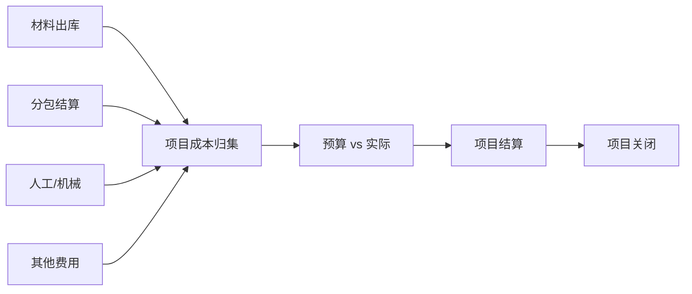
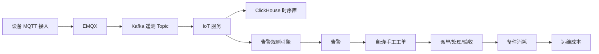
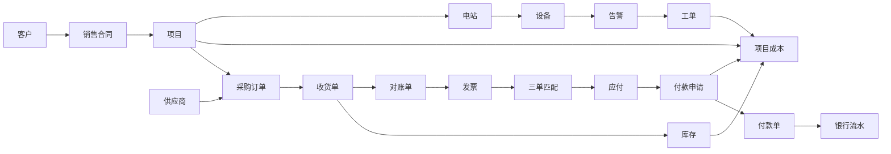
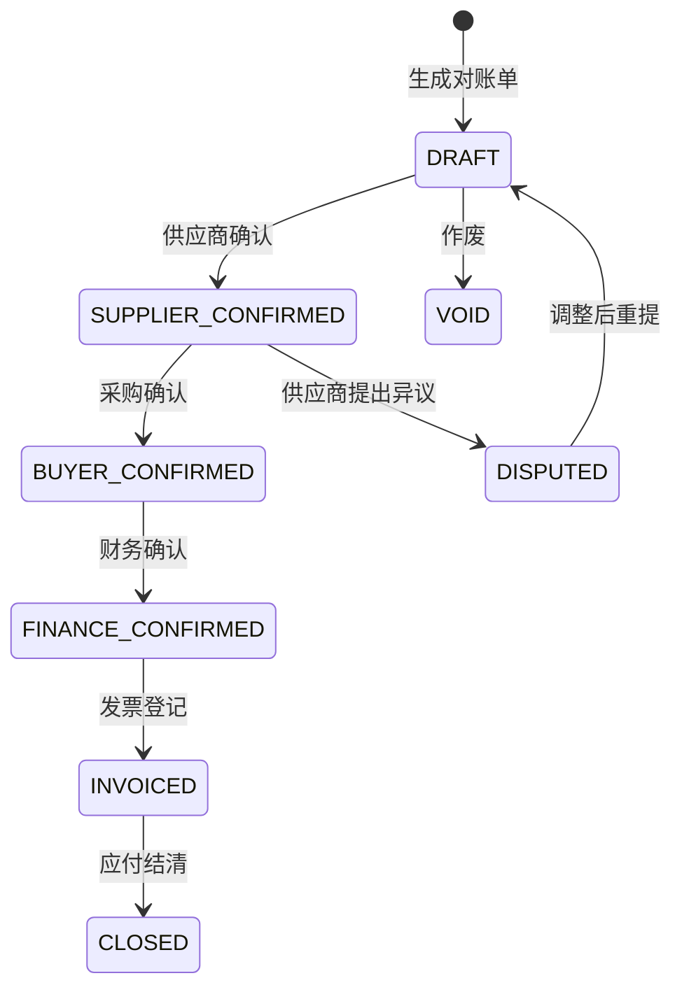
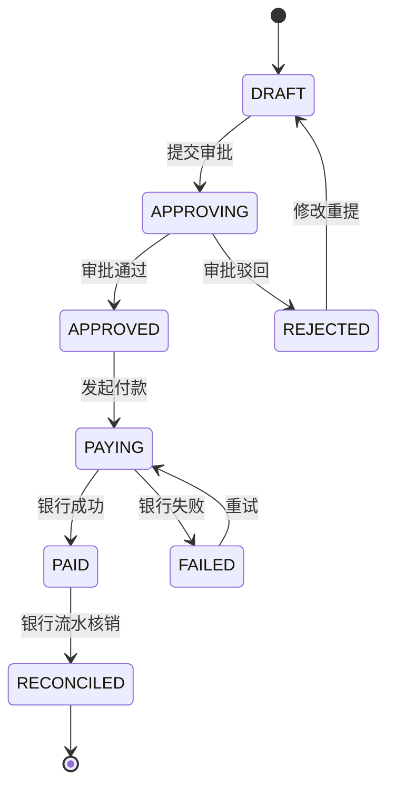
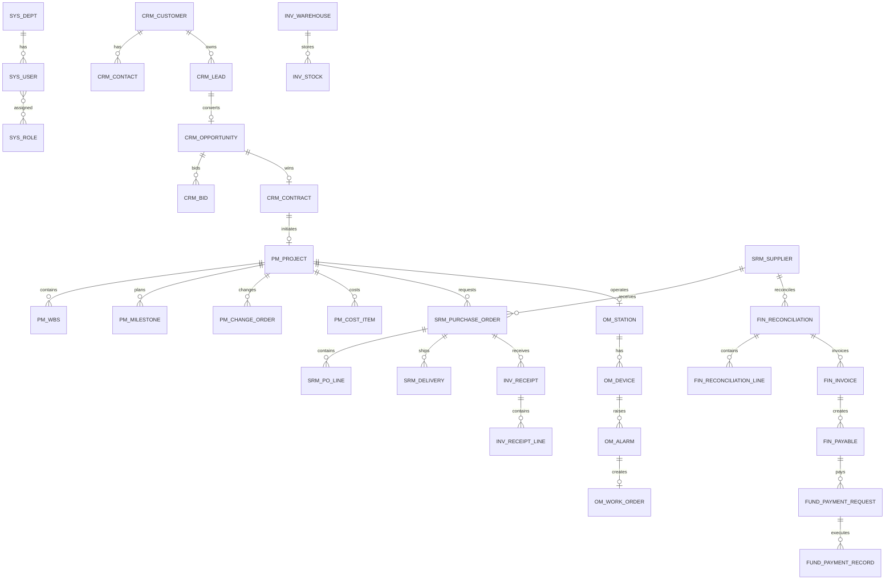
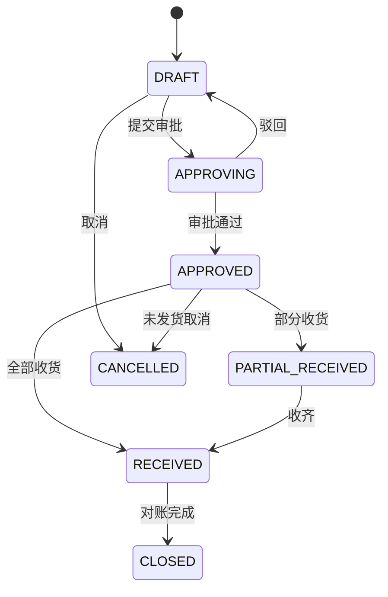
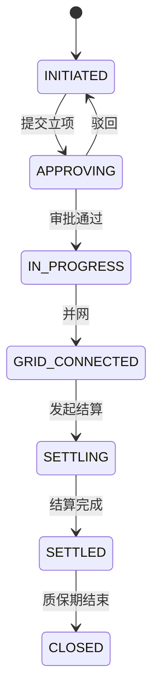
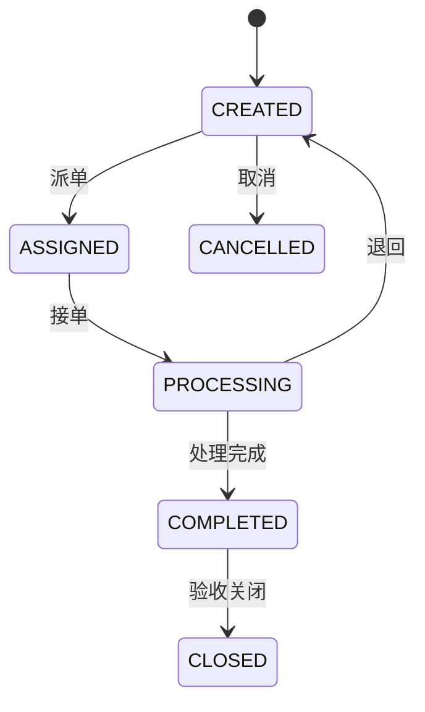
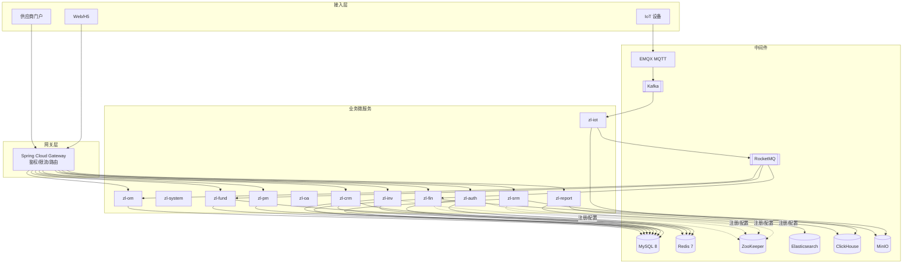

# 中来股份光伏电站全生命周期管理平台
## 需求规格说明书（Spec）

| 项目 | 内容 |
|---|---|
| 文档编号 | ZL-VOLT-SPEC-001 |
| 版本 | V1.0 |
| 状态 | 评审稿 |
| 编制日期 | 2026-11-14 |
| 系统代号 | ZL-Volt |
| 系统全称 | 中来股份光伏电站全生命周期管理平台 |
| 技术栈 | Spring Boot 3 / Spring Cloud / MySQL / Redis / RocketMQ / Kafka / ZooKeeper / Elasticsearch / ClickHouse / MQTT |
| 适用读者 | 产品、研发、测试、财务、供应链、运维、面试评审 |

### 文档修订记录

| 版本 | 日期 | 修订人 | 修订说明 |
|---|---|---|---|
| V1.0 | 2026-11-14 | ZL-Volt 项目组 | 首版，覆盖业务、功能、数据、接口、架构、非功能与验收标准 |

### 0. 阅读指南（面试/评审重点）

这份 Spec 不是“功能清单”，而是一份能直接指导开发的业务蓝图。阅读时建议按以下顺序抓住主线：

1. **先看第 4 章业务主流程**：理解光伏 EPC 的 L2C（线索到合同）、P2P（采购到付款）、项目交付、项目结算、运维告警五条链路如何串起来。
2. **再看第 5 章功能需求和第 6 章业务规则**：重点是对账、三单匹配、预付款核销、质保金、项目成本归集、付款审批阈值，这些是 HR 所说“懂业务”的核心。
3. **然后看第 7 章数据设计**：核心单据如何关联，状态机如何流转，金额和数量如何保持一致。
4. **最后看第 8~10 章**：接口、事件、MQTT、微服务与中间件如何落地。

> 一句话总结系统定位：**以光伏电站项目为中心，把“商机—合同—采购—收货—对账—开票—付款—成本—结算—运维”串成一条可追溯、可对账、可审计的业务链。**

---

## 1. 项目背景与目标

### 1.1 行业背景

光伏电站业务同时具备“工程项目”和“制造业供应链”双重属性：

- **项目侧**：电站从前期开发、投标、EPC 建设、并网验收到长期运维，周期长、参与方多、变更频繁。
- **供应链侧**：组件、逆变器、支架、线缆、箱变等物料金额大、交期长，采购、到货、对账、开票、付款环环相扣。
- **资金侧**：EPC 项目普遍存在预付款、进度款、质保金，供应商对账和付款审批直接影响到项目现金流。
- **运维侧**：并网后进入 20~25 年运营期，设备告警、巡检、工单、备件消耗形成持续的数据流。

传统做法是 CRM、项目管理、OA、SRM、财务系统各自独立，导致：

- 合同、项目、采购订单、入库单、对账单、发票、付款单之间靠 Excel 手工关联；
- 项目成本归集滞后，项目经理看不到实时毛利；
- 供应商对账周期长，财务重复核对；
- 设备告警与运维工单脱节，备件成本无法回到电站。

### 1.2 建设目标

建设一套**自研一体化**的光伏电站全生命周期管理平台，内置 CRM、PM、OA、SRM 能力，并打通供应链、财务结算、资金管理与 IoT 运维：

| 目标 | 说明 | 衡量指标 |
|---|---|---|
| 业务在线 | 线索、合同、项目、采购、库存、对账、付款、工单全部在线 | 核心单据在线率 100% |
| 业财一体 | 采购入库自动生成对账依据，对账确认自动生成应付 | 采购到付款链路可追溯率 100% |
| 成本可视 | 材料、人工、分包、其他费用按项目/WBS 归集 | 项目成本 T+0 可查 |
| 资金可控 | 付款申请与资金计划、应付余额、预算联动 | 超付/重复付款为 0 |
| 运维闭环 | 设备遥测 → 告警 → 工单 → 备件 → 成本 | 严重告警 2 小时内响应 |
| 数据驱动 | 统一报表、搜索、时序分析 | 管理层驾驶舱 T+0 |

### 1.3 范围边界

**本期包含（In Scope）**

- 光伏 EPC 项目全生命周期：线索、商机、投标、合同、立项、WBS、进度、变更、验收、并网、结算、关闭。
- 供应链：供应商准入、物料、采购需求、询比价、采购订单、发货、收货、入库、出库、库存。
- 财务结算：供应商对账、发票登记、三单匹配、应付账款、预付款核销、质保金、项目成本归集、项目结算。
- 资金管理：资金账户、资金计划、付款申请、付款审批、付款执行、银行流水、资金台账。
- 运维：电站档案、设备台账、告警、工单、巡检、备件、发电量。
- IoT：MQTT 设备接入、遥测、告警规则、时序存储与分析。
- 平台能力：组织权限、审批流、消息通知、文件、审计、搜索、报表。

**本期不包含（Out of Scope）**

- 总账、明细账、财务报表等完整会计核算（通过接口对接用友/金蝶）。
- 银行银企直连真实扣款（本期用模拟银行流水/文件导入，预留接口）。
- 税务发票真伪查验（预留第三方查验接口）。
- 电力现货交易、碳资产、绿证交易。
- 人事薪酬、考勤、行政办公。
- 原生移动 App（本期提供响应式 H5）。

### 1.4 假设与约束

| 编号 | 假设/约束 |
|---|---|
| AS-01 | 组织为集团—事业部—部门三级，支持多法人主体，本期以中来股份及新能源事业部为示例。 |
| AS-02 | 一个销售合同原则上对应一个 EPC 项目；一个项目可拆多个 WBS 和采购订单。 |
| AS-03 | 供应商对账以“已验收合格入库数量”为依据，不以防伪签收或物流签收为依据。 |
| AS-04 | 金额统一使用人民币，精度 DECIMAL(18,2)；税率使用 DECIMAL(6,4)，如 0.1300。 |
| AS-05 | 业务单据只允许作废/红冲，不允许物理删除；所有关键操作留审计日志。 |
| AS-06 | 供应商为外部用户，只能访问自己的订单、发货、对账、发票和付款进度。 |
| AS-07 | 本期 IoT 设备以逆变器、电表、汇流箱、箱变、气象站为主，协议统一为 MQTT JSON。 |
| AS-08 | 开发环境使用 Docker Compose；生产环境使用 Kubernetes，支持水平扩容。 |
| AS-09 | 时间统一存储为 DATETIME（Asia/Shanghai），对外接口使用 ISO-8601 或 `yyyy-MM-dd HH:mm:ss`。 |
| AS-10 | 本系统为参考光伏行业业务场景设计的企业级演示/学习项目，品牌与 Logo 仅用于项目演示。 |

---

## 2. 术语表

| 术语 | 英文/缩写 | 说明 |
|---|---|---|
| EPC | Engineering Procurement Construction | 工程总承包，负责设计、采购、施工 |
| O&M | Operation & Maintenance | 电站运维 |
| CRM | Customer Relationship Management | 客户关系管理 |
| PM | Project Management | 项目管理 |
| OA | Office Automation | 审批与协同办公 |
| SRM | Supplier Relationship Management | 供应商关系管理 |
| L2C | Lead to Cash | 线索到回款 |
| P2P | Procure to Pay | 采购到付款 |
| WBS | Work Breakdown Structure | 工作分解结构，项目成本归集的最小单元 |
| PO | Purchase Order | 采购订单 |
| ASN | Advance Shipping Notice | 供应商发货通知 |
| GRN | Goods Receipt Note | 收货单/入库单 |
| RFQ | Request for Quotation | 询价单 |
| AP | Accounts Payable | 应付账款 |
| AR | Accounts Receivable | 应收账款 |
| 三单匹配 | Three-way Match | 采购订单、收货单、发票三者数量/金额匹配 |
| 对账单 | Reconciliation Statement | 供应商与采购方按周期核对供货数量与金额的单据 |
| 预付款 | Advance Payment | 合同签订后按比例先付的款项，后续冲抵应付 |
| 质保金 | Retention Money | 预留的质量保证金，质保期满后支付 |
| 变更签证 | Change Order | 施工过程中的范围、数量、费用变更确认 |
| 并网 | Grid Connection | 电站接入电网开始发电 |
| PR | Performance Ratio | 系统效率/性能比，衡量电站发电性能 |
| 等效利用小时 | Equivalent Full-load Hours | 发电量折算到满功率运行小时数 |
| 消缺 | Defect Elimination | 验收后遗留缺陷的整改 |
| 告警 | Alarm | 设备越限、故障、离线等异常事件 |
| 工单 | Work Order | 运维任务的载体，含派单、处理、验收、成本 |
| 设备影子 | Device Shadow | 设备最新状态与期望状态的缓存模型 |
| 时序数据 | Time-series Data | 按时间顺序采集的遥测数据 |

---

## 3. 用户角色与权限

### 3.1 角色清单

| 角色编码 | 角色名称 | 主要职责 | 典型菜单 |
|---|---|---|---|
| ADMIN | 系统管理员 | 组织、用户、角色、字典、参数、审计 | 系统管理 |
| GM | 总经理 | 重大项目/大额付款审批、经营驾驶舱 | 审批中心、驾驶舱 |
| SALES | 销售/商务 | 客户、线索、商机、投标、销售合同 | CRM |
| PM | 项目经理 | 立项、WBS、进度、变更、验收、结算 | PM、审批中心 |
| SITE | 现场工程师 | 进度填报、材料进场、现场签证 | PM（现场） |
| BUYER | 采购员/采购经理 | 采购需求、询比价、采购订单、供应商 | SRM、库存 |
| WAREHOUSE | 仓库管理员 | 到货验收、入库、出库、盘点 | 库存 |
| FINANCE | 财务（应付/成本） | 对账、发票、三单匹配、应付、成本、结算 | 财务结算 |
| FUND | 资金主管 | 资金计划、付款审批、付款执行、银行流水 | 资金管理 |
| OM | 运维工程师/值班员 | 电站、设备、告警、工单、巡检、备件 | 运维中心 |
| SUPPLIER | 供应商（外部） | 接单、发货、对账、开票、查询付款 | 供应商门户 |

### 3.2 数据权限规则

| 数据范围 | 规则 |
|---|---|
| 全部 | ADMIN、GM、FINANCE、FUND 可查看全公司业务数据 |
| 本部门 | 部门负责人可查看本部门及下级部门数据 |
| 本人 | SALES 只看自己负责的客户/商机/合同；PM 只看自己负责的项目 |
| 项目成员 | 项目成员可查看所属项目的 WBS、进度、采购、成本（脱敏） |
| 供应商 | SUPPLIER 只能查看 `supplier_id` 等于自己的订单、发货、对账、发票、付款 |
| 财务敏感 | 银行账号、付款流水仅 FINANCE/FUND/ADMIN 可见，其他角色脱敏 |

### 3.3 功能权限矩阵（摘要）

| 功能 | ADMIN | GM | SALES | PM | BUYER | WAREHOUSE | FINANCE | FUND | OM | SUPPLIER |
|---|---|---|---|---|---|---|---|---|---|---|
| 客户/线索/商机 | 读 | 读 | 读写 | 读 | - | - | 读 | - | - | - |
| 销售合同 | 读 | 读 | 读写 | 读 | 读 | - | 读 | 读 | - | - |
| 项目立项/WBS | 读 | 审批 | 读 | 读写 | 读 | - | 读 | - | 读 | - |
| 采购订单 | 读 | 审批 | - | 读 | 读写 | 读 | 读 | 读 | - | 读自己的 |
| 收货/入库 | 读 | - | - | 读 | 读 | 读写 | 读 | - | 读 | 读自己的 |
| 对账/发票/应付 | 读 | 审批 | - | 读 | 读 | - | 读写 | 读 | - | 读写自己的 |
| 付款申请/执行 | 读 | 审批 | - | 读 | - | - | 读 | 读写 | - | 读自己的 |
| 运维工单 | 读 | 读 | - | 读 | - | - | - | - | 读写 | - |
| 系统管理 | 读写 | - | - | - | - | - | - | - | - | - |

---

## 4. 业务主流程

### 4.1 L2C：线索到合同


关键点：

- 线索来源包括展会、官网、老客户转介绍、渠道合作、招投标平台。
- 商机阶段按“初步接触—需求确认—方案报价—投标—谈判—赢单/输单”管理，赢率用于销售预测。
- 投标记录标书编号、投标日期、投标金额、保证金、结果。
- 销售合同明确合同金额、税率、付款节点（预付款/到货/并网/质保）、质保期、违约责任。
- 合同生效后发起项目立项，审批通过自动创建项目档案，并把合同金额带入项目预算。

### 4.2 P2P：采购到付款（核心链路）


关键点：

- **需求来源**：项目 WBS 或运维备件需求，必须带项目、WBS、需求日期。
- **询比价**：至少 3 家供应商报价；金额超过阈值转招标。
- **采购订单**：明确物料、数量、单价、税率、交期、收货仓库、付款条款。
- **收货**：仓库按 PO 收货，质检合格数量才可入库；不合格走退货/换货。
- **对账**：按供应商 + 项目 + 期间汇总已入库数量，与 PO 单价核对，生成对账单。
- **开票**：供应商按对账单开票，财务登记发票并做三单匹配。
- **应付**：对账确认 + 发票匹配通过后生成应付账款。
- **付款**：付款申请必须关联应付，校验预付款、质保金、资金计划余额后执行。
- **核销**：银行流水回写付款单，应付余额减少，预付款按规则冲抵。

### 4.3 项目交付：立项到并网


关键点：

- 项目立项必须关联销售合同，明确项目类型（集中式/工商业分布式/户用）、装机容量、地点、项目经理。
- WBS 分解到“设备采购、土建、安装、电气、调试、并网、其他”，作为成本归集维度。
- 里程碑包括：开工、基础完成、组件安装完成、电气安装完成、调试完成、并网、竣工验收。
- 变更签证记录变更原因、工程量、费用增减、工期影响，必须走审批。
- 并网后进入质保期和运维期，项目状态转为“已并网/运维中”。

### 4.4 项目结算与成本归集



成本归集口径：

| 成本类型 | 来源 | 归集时点 | 说明 |
|---|---|---|---|
| 材料成本 | 库存出库单 | 出库审核 | 按移动加权平均单价 × 出库数量 |
| 分包成本 | 分包结算单 | 结算审批通过 | 按分包合同和结算金额 |
| 人工成本 | 项目人工/外包工时 | 月度确认 | 本期可用工时×费率模拟 |
| 机械成本 | 机械台班/租赁结算 | 月度确认 | 按台班或租赁合同 |
| 其他费用 | 费用报销/签证 | 审批通过 | 差旅、临时设施、检测等 |

项目结算：

1. 项目完工/并网后发起结算，锁定成本；
2. 财务核对合同收入、成本、毛利、未付应付款；
3. 结算审批通过后项目状态转为“已结算”；
4. 质保金到期后释放，项目最终关闭。

### 4.5 运维与 IoT



关键点：

- 逆变器、电表、汇流箱、箱变、气象站通过 MQTT 上报遥测。
- EMQX 规则引擎把消息桥接到 Kafka，IoT 服务做校验、补全、告警判断。
- 原始遥测写入 ClickHouse；告警写入 MySQL 并发送 RocketMQ 事件。
- 严重告警自动生成工单，按电站/设备/值班组派单。
- 工单消耗备件，出库成本归集到电站运维成本。

### 4.6 端到端单据链



---

## 5. 功能需求

优先级定义：**P0** = 首版必须交付；**P1** = 首版应交付；**P2** = 后续增强。

### 5.1 系统管理（SYS）

| 编号 | 功能 | 说明 | 优先级 | 验收要点 |
|---|---|---|---|---|
| FR-SYS-001 | 组织管理 | 集团—事业部—部门树，支持多法人主体 | P0 | 可维护组织树，停用部门不可选 |
| FR-SYS-002 | 用户管理 | 用户新增、停用、重置密码、绑定部门/角色/供应商 | P0 | 用户与角色、供应商正确关联 |
| FR-SYS-003 | 角色与权限 | RBAC + 数据范围（全部/部门/本人/项目/供应商） | P0 | 越权访问返回 403 |
| FR-SYS-004 | 菜单与按钮权限 | 菜单、按钮、接口三级权限 | P0 | 无权限菜单不可见，接口不可调用 |
| FR-SYS-005 | 字典与参数 | 单据状态、物料分类、付款方式等统一字典 | P0 | 字典变更无需改代码 |
| FR-SYS-006 | 审计日志 | 记录登录、增删改、审批、导出、付款等操作 | P0 | 可按用户/模块/时间检索 |
| FR-SYS-007 | 认证与令牌 | 账号密码登录、JWT 访问令牌/刷新令牌、退出 | P0 | Token 过期/刷新/注销正确 |
| FR-SYS-008 | 文件中心 | 合同、发票、验收单等附件上传下载 | P1 | 文件类型/大小限制，防越权下载 |
| FR-SYS-009 | 消息通知 | 站内信、邮件、短信、企业微信（预留） | P1 | 审批/告警/付款通知可达 |
| FR-SYS-010 | 定时任务 | 对账提醒、资金计划、告警升级、报表汇总 | P1 | 任务可配置、可重跑、幂等 |

### 5.2 CRM（客户关系）

| 编号 | 功能 | 说明 | 优先级 | 验收要点 |
|---|---|---|---|---|
| FR-CRM-001 | 客户档案 | 客户名称、类型、统一社会信用代码、区域、等级、负责人 | P0 | 客户编码唯一，支持停用 |
| FR-CRM-002 | 联系人 | 一个客户多个联系人，主联系人唯一 | P0 | 主联系人变更正确 |
| FR-CRM-003 | 线索管理 | 线索登记、分配、跟进、转商机/无效 | P0 | 线索阶段可追溯 |
| FR-CRM-004 | 商机管理 | 商机金额、容量、赢率、预计签约日期、阶段 | P0 | 商机转投标/合同可追溯 |
| FR-CRM-005 | 投标管理 | 标书编号、投标日期、保证金、投标金额、结果 | P1 | 投标结果回写商机 |
| FR-CRM-006 | 销售合同 | 合同金额、税率、付款节点、质保期、附件 | P0 | 合同审批通过才能立项 |
| FR-CRM-007 | 客户 360 | 汇总客户合同、项目、回款、工单、联系人 | P1 | 一屏查看客户全貌 |
| FR-CRM-008 | 合同变更/续签 | 变更金额、付款条款、补充协议 | P1 | 变更留痕，不覆盖原合同 |
| FR-CRM-009 | 销售漏斗 | 按阶段/负责人/区域统计商机金额和赢率 | P2 | 数据与商机列表一致 |

### 5.3 PM（项目管理）

| 编号 | 功能 | 说明 | 优先级 | 验收要点 |
|---|---|---|---|---|
| FR-PM-001 | 项目立项 | 关联合同，填写项目类型、容量、地点、经理、预算 | P0 | 审批通过自动创建项目 |
| FR-PM-002 | WBS 与预算 | 树形 WBS，支持预算金额和责任人 | P0 | 子项预算汇总等于父项 |
| FR-PM-003 | 里程碑计划 | 开工、基础、安装、调试、并网、验收 | P0 | 计划/实际日期可对比 |
| FR-PM-004 | 进度填报 | 按 WBS/日报/周报填报进度和形象进度 | P0 | 进度不能超过 100% |
| FR-PM-005 | 现场管理 | 人员进场、材料进场、施工日志、照片 | P1 | 与项目关联可追溯 |
| FR-PM-006 | 变更签证 | 变更原因、工程量、金额、工期影响、审批 | P0 | 未审批变更不计入成本 |
| FR-PM-007 | 验收与并网 | 验收单、消缺清单、并网日期、并网容量 | P0 | 并网后项目状态自动更新 |
| FR-PM-008 | 项目成本 | 材料、人工、分包、机械、其他费用归集 | P0 | 成本 = 各来源汇总，可下钻 |
| FR-PM-009 | 项目结算 | 收入、成本、毛利、未付应付、质保金 | P0 | 结算后成本锁定 |
| FR-PM-010 | 项目看板 | 进度、成本、采购、回款、风险 | P1 | 数据 T+0 |

### 5.4 OA（审批流）

| 编号 | 功能 | 说明 | 优先级 | 验收要点 |
|---|---|---|---|---|
| FR-OA-001 | 流程定义 | BPMN 流程建模，支持条件分支、会签、或签 | P0 | 流程发布/停用生效 |
| FR-OA-002 | 审批发起 | 立项、采购、合同、付款、变更、结算发起审批 | P0 | 业务单据与流程实例绑定 |
| FR-OA-003 | 待办/已办 | 我的待办、已办、抄送、发起 | P0 | 审批后待办消失 |
| FR-OA-004 | 审批规则 | 按金额、组织、项目类型路由审批人 | P0 | 阈值命中正确审批链 |
| FR-OA-005 | 加签/转办/委托 | 支持加签、转办、委托代理 | P1 | 操作留痕 |
| FR-OA-006 | 审批回调 | 审批通过/驳回回调业务服务更新状态 | P0 | 回调幂等，状态一致 |
| FR-OA-007 | 审批留痕 | 审批意见、耗时、附件 | P0 | 全链路可追溯 |

### 5.5 SRM（供应商关系与采购）

| 编号 | 功能 | 说明 | 优先级 | 验收要点 |
|---|---|---|---|---|
| FR-SRM-001 | 供应商准入 | 资质、营业执照、银行账户、业绩、现场考察 | P0 | 准入通过才能下单 |
| FR-SRM-002 | 供应商档案 | 分类、等级、联系人、付款条件、黑名单 | P0 | 停用/黑名单不可下单 |
| FR-SRM-003 | 物料主数据 | 组件、逆变器、支架、线缆、箱变等分类 | P0 | 物料编码唯一 |
| FR-SRM-004 | 采购需求 | 项目/WBS 发起，含需求日期、数量、预算单价 | P0 | 需求可合并/拆分 |
| FR-SRM-005 | 询比价 | 邀请供应商报价，比价后定标 | P1 | 至少 3 家报价（可配置） |
| FR-SRM-006 | 招标 | 招标项目、标书、开标、评标、定标 | P2 | 与询比价结果可追溯 |
| FR-SRM-007 | 采购订单 | 多物料、多交期、付款条款、收货仓库 | P0 | 审批通过才能发货/收货 |
| FR-SRM-008 | 订单变更 | 数量、价格、交期变更需审批 | P0 | 变更留版本，不改历史 |
| FR-SRM-009 | 发货协同 | 供应商创建 ASN，填写物流、批次、数量 | P0 | 发货数量不超过订单未发量 |
| FR-SRM-010 | 供应商门户 | 供应商接单、发货、对账、开票、查付款 | P0 | 数据严格隔离 |
| FR-SRM-011 | 供应商绩效 | 交付及时率、质量合格率、价格竞争力 | P2 | 评分可追溯 |
| FR-SRM-012 | 黑名单 | 质量/诚信问题拉黑，禁止新订单 | P1 | 黑名单校验生效 |

### 5.6 库存（INV）

| 编号 | 功能 | 说明 | 优先级 | 验收要点 |
|---|---|---|---|---|
| FR-INV-001 | 仓库管理 | 中心仓、项目仓、备件仓 | P0 | 仓库与项目/组织关联 |
| FR-INV-002 | 到货验收 | 按 PO 收货，记录合格/不合格数量 | P0 | 超收受容差控制 |
| FR-INV-003 | 入库 | 合格品入库，生成库存流水 | P0 | 库存数量/金额正确 |
| FR-INV-004 | 出库/领料 | 项目领料、运维备件领用、其他出库 | P0 | 出库不能超过可用库存 |
| FR-INV-005 | 库存台账 | 实时库存、批次、库龄、移动加权平均价 | P0 | 数量金额账实相符 |
| FR-INV-006 | 盘点 | 全盘/抽盘，盘盈盘亏调整 | P1 | 盘点差异需审批 |
| FR-INV-007 | 批次/序列号 | 组件批次、逆变器序列号追溯 | P1 | 可追溯到项目/电站 |
| FR-INV-008 | 安全库存 | 低于安全库存预警 | P1 | 预警可订阅 |

### 5.7 财务结算（FIN）

| 编号 | 功能 | 说明 | 优先级 | 验收要点 |
|---|---|---|---|---|
| FR-FIN-001 | 供应商对账 | 按供应商+项目+期间汇总入库，生成对账单 | P0 | 数量、单价、金额可核对 |
| FR-FIN-002 | 对账确认 | 供应商提交、采购确认、财务确认 | P0 | 确认后锁定，不可改数 |
| FR-FIN-003 | 发票登记 | 发票号码、代码、金额、税额、税率、附件 | P0 | 发票号唯一，防重复 |
| FR-FIN-004 | 发票查验 | 对接税务查验接口（预留） | P2 | 查验结果留痕 |
| FR-FIN-005 | 三单匹配 | PO、GRN、发票数量/金额比对 | P0 | 差异超容差阻断付款 |
| FR-FIN-006 | 应付账款 | 对账+发票生成应付，记录已付/未付/预抵 | P0 | 应付余额 = 应付-已付-预抵 |
| FR-FIN-007 | 预付款 | 预付款登记、核销、余额 | P0 | 核销不超预付款余额 |
| FR-FIN-008 | 质保金 | 按合同比例预留，到期释放 | P0 | 质保金不参与普通付款 |
| FR-FIN-009 | 项目成本归集 | 材料/分包/人工/机械/其他 | P0 | 成本可按项目/WBS 汇总 |
| FR-FIN-010 | 项目结算 | 收入、成本、毛利、应付、质保金 | P0 | 结算金额与财务一致 |
| FR-FIN-011 | 应收/回款 | 客户回款登记、核销、账龄 | P1 | 回款与合同/发票关联 |
| FR-FIN-012 | 财务报表 | 应付账龄、项目毛利、供应商对账汇总 | P1 | 可导出 Excel |

### 5.8 资金管理（FUND）

| 编号 | 功能 | 说明 | 优先级 | 验收要点 |
|---|---|---|---|---|
| FR-FUND-001 | 资金账户 | 银行账户、余额、状态 | P0 | 账户余额与流水一致 |
| FR-FUND-002 | 资金计划 | 按月/项目/供应商编制资金计划 | P0 | 计划额度控制付款 |
| FR-FUND-003 | 付款申请 | 关联应付，选择付款类型、金额、账户 | P0 | 金额不超应付可用余额 |
| FR-FUND-004 | 付款审批 | 按金额阈值路由审批 | P0 | 超阈值必须总经理审批 |
| FR-FUND-005 | 付款执行 | 生成付款单，记录银行流水号 | P0 | 重复提交幂等 |
| FR-FUND-006 | 银行流水 | 导入/模拟流水，自动匹配付款单 | P1 | 匹配成功回写付款状态 |
| FR-FUND-007 | 资金台账 | 账户余额、收付款、可用余额 | P0 | 实时/准实时 |
| FR-FUND-008 | 资金预警 | 余额不足、计划超支、大额付款 | P1 | 预警可订阅 |

### 5.9 运维（OM）

| 编号 | 功能 | 说明 | 优先级 | 验收要点 |
|---|---|---|---|---|
| FR-OM-001 | 电站档案 | 电站名称、容量、地址、并网日期、客户 | P0 | 与项目关联 |
| FR-OM-002 | 设备台账 | 逆变器、电表、汇流箱、箱变、气象站 | P0 | 设备序列号唯一 |
| FR-OM-003 | 告警管理 | 告警接收、分级、确认、清除 | P0 | 严重告警自动建单 |
| FR-OM-004 | 工单管理 | 创建、派单、接单、处理、验收、关闭 | P0 | SLA 超时提醒 |
| FR-OM-005 | 巡检管理 | 巡检计划、巡检项、缺陷、复检 | P1 | 巡检记录可追溯 |
| FR-OM-006 | 备件管理 | 备件库存、领用、消耗、退库 | P1 | 备件成本回到电站 |
| FR-OM-007 | 发电量 | 日/月发电量、等效小时、PR | P1 | 与电表数据一致 |
| FR-OM-008 | 运维结算 | 按合同/电站/期间生成运维结算 | P2 | 与运维合同关联 |

### 5.10 IoT 物联网（IOT）

| 编号 | 功能 | 说明 | 优先级 | 验收要点 |
|---|---|---|---|---|
| FR-IOT-001 | 设备接入 | MQTT 用户名/密码或证书认证 | P0 | 非法设备无法连接 |
| FR-IOT-002 | 遥测采集 | 电压、电流、功率、温度、发电量等 | P0 | 数据完整、时间准确 |
| FR-IOT-003 | 设备影子 | 最新状态、在线/离线、期望值 | P1 | 离线判定准确 |
| FR-IOT-004 | 告警规则 | 阈值、持续时间、越限次数、分级 | P0 | 规则命中生成告警 |
| FR-IOT-005 | 指令下发 | 远程复位、限功率、开关机（预留） | P2 | 指令有回执、可审计 |
| FR-IOT-006 | 时序存储 | ClickHouse 原始数据 + 聚合数据 | P0 | 查询 P95 < 2s |
| FR-IOT-007 | 数据质量 | 缺失、重复、乱序、异常值处理 | P1 | 可观测数据质量指标 |

### 5.11 报表与搜索（RPT）

| 编号 | 功能 | 说明 | 优先级 | 验收要点 |
|---|---|---|---|---|
| FR-RPT-001 | 经营驾驶舱 | 合同额、项目数、采购额、回款、付款、告警 | P0 | 数据 T+0 |
| FR-RPT-002 | 项目成本报表 | 预算/实际/偏差，按项目/WBS/成本类型 | P0 | 与成本明细一致 |
| FR-RPT-003 | 供应链报表 | 采购金额、到货及时率、对账/开票/付款进度 | P1 | 可按供应商/项目筛选 |
| FR-RPT-004 | 资金报表 | 资金计划执行、账户余额、应付账龄 | P1 | 与资金台账一致 |
| FR-RPT-005 | 运维报表 | 发电量、PR、告警数、工单 SLA、备件成本 | P1 | 与运维数据一致 |
| FR-RPT-006 | 全局搜索 | 客户、合同、项目、供应商、物料、工单 | P1 | ES 搜索结果相关 |
| FR-RPT-007 | 导出 | Excel/CSV 导出，带权限和审计 | P1 | 大数据量异步导出 |

### 5.12 集成与消息（INT）

| 编号 | 功能 | 说明 | 优先级 | 验收要点 |
|---|---|---|---|---|
| FR-INT-001 | 业务事件总线 | RocketMQ 发布/订阅业务事件 | P0 | 事件可重放、幂等 |
| FR-INT-002 | 财务系统对接 | 凭证、应付、付款推送用友/金蝶（预留） | P2 | 接口可配置 |
| FR-INT-003 | 银企直连 | 付款指令、回单、余额查询（预留） | P2 | 签名、对账、重试 |
| FR-INT-004 | 发票查验 | 税务平台发票查验（预留） | P2 | 查验结果留痕 |
| FR-INT-005 | 消息通知 | 站内信、邮件、短信、企微 | P1 | 模板可配置 |
| FR-INT-006 | 单点登录 | OAuth2/OIDC 对接集团门户（预留） | P2 | 登录态一致 |

---

## 6. 关键业务规则

> 本章是系统“懂业务”的核心。所有规则必须可配置、可追溯、可测试，禁止硬编码在 Controller 中。

### BR-01 审批金额阈值

| 单据 | 金额区间（含税） | 审批链 |
|---|---|---|
| 采购订单 | < 50 万 | 采购经理 |
| 采购订单 | 50 万 ~ 200 万 | 采购经理 → 采购总监 → 财务经理 |
| 采购订单 | > 200 万 | 采购经理 → 采购总监 → 财务总监 → 总经理 |
| 付款申请 | < 20 万 | 资金主管 |
| 付款申请 | 20 万 ~ 100 万 | 资金主管 → 财务经理 |
| 付款申请 | > 100 万 | 资金主管 → 财务经理 → 财务总监 → 总经理 |
| 项目立项 | 全部 | 项目经理 → 部门负责人 → 财务 → 总经理 |
| 变更签证 | 增加金额 > 10 万 | 项目经理 → 部门负责人 → 财务 → 总经理 |

规则：

- 阈值走 `sys_dict`/`oa_rule` 配置，按法人主体可覆盖。
- 审批中金额变更需重新发起审批，原审批实例作废。
- 审批人缺席时按“委托代理”规则转交，不能自动跳过。

### BR-02 供应商准入

- 供应商必须完成准入审批后才能被采购订单引用。
- 准入材料：营业执照、开户许可证/银行账户、纳税人资格、质量体系证书、近三年业绩、廉洁承诺。
- 状态：`PENDING`（待准入）→ `QUALIFIED`（合格）→ `SUSPENDED`（暂停）→ `BLACKLIST`（黑名单）。
- 黑名单供应商不可新建订单；已存在未完成订单可继续履约，但不可新增。

### BR-03 采购订单变更

- 已审批订单的数量、单价、交期变更必须走变更审批。
- 变更生成新版本，历史版本只读；已收货数量不可超过变更后数量。
- 单价变更影响未收货部分；已收货部分按原价对账。
- 订单取消：未发货可取消；已发货需走退货/索赔流程。

### BR-04 收货容差

- 收货数量 ≤ 订单未收数量 × (1 + 收货容差率)，默认容差率 0.5%，可配置。
- 超出容差必须采购经理审批，否则拒收。
- 质检不合格数量不计入可入库数量，进入退货/换货流程。
- 收货单审核后生成库存流水，并发布 `goods-received` 事件。

### BR-05 供应商对账规则

对账维度：**供应商 + 项目 + 对账期间**。

对账数量来源：

```text
对账数量 = Σ 已审核收货单的合格入库数量 - Σ 已确认退货数量
对账金额 = Σ (对账数量 × 采购订单含税单价)
```

差异处理：

| 差异类型 | 判定 | 处理 |
|---|---|---|
| 数量差异 | ABS(对账数量 - 收货数量) > 0 | 以收货单为准，供应商需确认 |
| 单价差异 | ABS(对账单价 - PO 单价) > 0.01 | 以 PO 为准；价格变更需有审批 |
| 金额差异 | ABS(对账金额 - 收货金额) > 0.01 | 生成差异行，财务复核 |
| 税额差异 | ABS(发票税额 - 对账税额) > 0.01 | 退回供应商重开或调整 |

对账状态机：



- 财务确认后对账单锁定，任何数量/金额调整必须红冲后重开。
- 对账单确认后发布 `reconciliation-confirmed` 事件，生成应付账款。

### BR-06 三单匹配（Three-way Match）

匹配对象：**采购订单（PO） + 收货单（GRN） + 发票（Invoice）**。

匹配规则：

| 维度 | 容差 | 处理 |
|---|---|---|
| 数量 | 发票数量 ≤ 对账数量 × (1 + 1%) | 超出阻断，转异常处理 |
| 单价 | 发票单价与 PO 单价差异 ≤ 0.01 | 超出阻断 |
| 金额 | 发票金额与对账金额差异 ≤ 0.5% | 超出阻断 |
| 税额 | 发票税额与对账税额差异 ≤ 0.01 | 超出阻断 |
| 供应商 | 必须一致 | 不一致阻断 |
| 项目 | 必须一致 | 不一致阻断 |

匹配结果：

- `MATCHED`：自动生成应付，进入付款流程。
- `MISMATCH`：进入异常队列，财务处理（退回重开/差异审批/部分付款）。
- `PARTIAL`：部分匹配，仅匹配部分生成应付。

### BR-07 预付款规则

- 预付款比例由合同/订单付款条款决定，默认 30%，可配置。
- 预付款必须关联采购订单/合同，登记后进入预付款台账。
- 应付生成后，预付款按 FIFO 自动核销；核销金额不得超过应付余额和预付款余额。
- 预付款未核销余额在供应商维度可查，供应商停用时必须清理。

### BR-08 质保金规则

- 质保金比例默认 5%，质保期默认 12 个月，按合同配置。
- 质保金从应付中预留，不进入普通付款申请。
- 质保期满且无未关闭质量问题，释放质保金，生成新的应付。
- 质保期内发生维修费用，可从质保金中扣除。

### BR-09 付款规则

付款前校验（全部通过才允许提交）：

1. 应付状态为 `OPEN`/`PARTIAL`，且未冻结；
2. 付款金额 ≤ 应付可用余额 = 应付金额 - 已付金额 - 预付款抵扣 - 质保金；
3. 付款申请金额 ≤ 资金计划可用额度（若启用了计划控制）；
4. 收款账户与供应商档案一致；
5. 三单匹配通过（或差异已审批）；
6. 发票已登记且未重复付款；
7. 付款申请幂等键未重复。

付款状态机：



### BR-10 项目成本归集规则

```text
项目总成本 = 材料成本 + 分包成本 + 人工成本 + 机械成本 + 其他费用

材料成本 = Σ 项目领料出库金额（移动加权平均单价 × 数量）
分包成本 = Σ 分包结算审批金额
人工成本 = Σ 项目工时 × 费率
机械成本 = Σ 机械台班/租赁结算金额
其他费用 = Σ 项目费用报销/签证审批金额
```

- 成本必须归集到项目 + WBS + 成本类型。
- 材料出库即计入成本；退料冲减成本。
- 变更签证审批通过后计入对应 WBS。
- 项目结算后成本锁定，后续调整走“结算调整单”。

### BR-11 项目结算规则

- 结算条件：项目已并网/完工，验收完成，成本已归集，供应商应付已确认。
- 结算内容：合同收入、项目总成本、毛利、毛利率、未付应付、质保金、变更增减。
- 结算审批通过后：项目状态 `SETTLED`，成本锁定，生成结算快照。
- 结算后发现差异，走结算调整，不直接修改历史结算。

### BR-12 变更签证规则

- 变更必须关联项目、WBS、变更原因、工程量、费用增减、工期影响。
- 变更金额 > 10 万或工期影响 > 7 天，必须走总经理审批。
- 未审批变更不得计入项目成本，不得作为付款依据。
- 变更审批通过后，更新项目预算和成本预测。

### BR-13 库存计价规则

- 采用**移动加权平均法**：

```text
新平均单价 = (原库存金额 + 本次入库金额) / (原库存数量 + 本次入库数量)
出库金额 = 出库数量 × 当前平均单价
```

- 库存数量不允许为负；出库前校验可用库存（现存量 - 锁定数量）。
- 入库单价以采购订单含税单价为准，运费按规则分摊（可选）。
- 盘点差异计入“待处理财产损溢”，审批后调整库存。

### BR-14 工单 SLA 规则

| 告警级别 | 响应时限 | 解决时限 | 升级规则 |
|---|---|---|---|
| CRITICAL | 30 分钟 | 4 小时 | 超时升级至运维经理/总经理 |
| MAJOR | 2 小时 | 24 小时 | 超时升级至运维经理 |
| MINOR | 8 小时 | 72 小时 | 超时提醒 |
| WARNING | 24 小时 | 7 天 | 不升级 |

- 严重告警自动创建工单，按电站值班组派单。
- 工单关闭必须填写处理结果、备件消耗、现场照片。
- SLA 超时写审计日志并发送通知。

### BR-15 告警规则

- 规则维度：设备类型 + 指标 + 比较符 + 阈值 + 持续时长 + 越限次数。
- 示例：逆变器温度 > 85℃ 持续 5 分钟 → MAJOR；日间（辐照度 > 50W/m²）直流电压 = 0 且交流功率 = 0 且状态非 STANDBY，持续 10 分钟 → CRITICAL（疑似停机）。
- 同一设备同一规则在抑制窗口（默认 30 分钟）内只生成一条告警。
- 告警恢复后自动清除，或人工确认后清除。

### BR-16 数据权限

- 所有列表查询必须带数据权限拦截器，禁止只在前端隐藏。
- 供应商接口通过 `supplier_id` 强制过滤，禁止信任前端传参。
- 导出、打印、报表同样受数据权限约束。
- 跨项目查看成本需具备 `finance:cost:view` 权限。

### BR-17 单号规则

| 单据 | 规则 | 示例 |
|---|---|---|
| 客户 | CUS-{yyyyMMdd}-{4位} | CUS-20260915-0001 |
| 线索 | LEAD-{yyyyMMdd}-{4位} | LEAD-20260901-0001 |
| 商机 | OPP-{yyyyMMdd}-{4位} | OPP-20260905-0001 |
| 合同 | CT-{yyyyMMdd}-{4位} | CT-20260915-0001 |
| 项目 | PRJ-{yyyy}-{4位} | PRJ-2026-0001 |
| 采购订单 | PO-{yyyyMMdd}-{4位} | PO-20260925-0001 |
| 收货单 | GRN-{yyyyMMdd}-{4位} | GRN-20261015-0001 |
| 出库单 | ISSUE-{yyyyMMdd}-{4位} | ISSUE-20261020-0001 |
| 对账单 | REC-{yyyyMM}-{4位} | REC-202610-0001 |
| 发票 | INV-{yyyyMMdd}-{4位} | INV-20261102-0001 |
| 应付 | AP-{yyyyMMdd}-{4位} | AP-20261102-0001 |
| 付款申请 | PAY-{yyyyMMdd}-{4位} | PAY-20261105-0001 |
| 工单 | WO-{yyyyMMdd}-{4位} | WO-20261110-0001 |
| 告警 | ALM-{yyyyMMdd}-{4位} | ALM-20261110-0001 |

实现：Redis `INCR zl:seq:{prefix}:{date}`，TTL 2 天，失败降级数据库序列表；单号全局唯一索引兜底。

### BR-18 幂等规则

- 所有写接口要求 `X-Request-Id`（或 `requestId` 字段），Redis `SETNX` 10 分钟 + 数据库唯一索引双保险。
- 消息消费按 `eventId` 幂等，消费记录表唯一索引。
- 付款、入库、对账确认等资金/库存敏感操作必须幂等。
- 重复请求返回第一次结果，不重复扣款/扣库存。

### BR-19 金额与税率

- 金额字段统一 `DECIMAL(18,2)`，税率 `DECIMAL(6,4)`，数量 `DECIMAL(18,4)`。
- 含税金额 = 不含税金额 × (1 + 税率)，四舍五入到分。
- 行金额汇总与单据总金额必须一致，差异控制在 0.01 以内。
- 前端展示千分位，后端传输不使用浮点数。

### BR-20 单据删除与作废

- 业务单据禁止物理删除，使用逻辑删除 + 状态 `VOID`。
- 已审核/已确认单据只能红冲或作废，不能修改。
- 作废必须填写原因并走审批（资金/库存单据）。
- 所有删除/作废操作写审计日志。

---

## 7. 领域模型与数据设计

### 7.1 服务与数据库划分

采用“按业务域拆分服务 + 每服务独立库”的原则，禁止跨库 JOIN，跨域查询通过 API/事件/宽表解决。

| 微服务 | 端口 | 数据库 | 核心职责 |
|---|---|---|---|
| zl-gateway | 8080 | - | 统一入口、鉴权、限流、路由 |
| zl-auth | 8101 | zl_system | 登录、令牌、权限校验 |
| zl-system | 8102 | zl_system | 组织、用户、角色、字典、审计 |
| zl-crm | 8103 | zl_crm | 客户、线索、商机、投标、合同 |
| zl-pm | 8104 | zl_pm | 项目、WBS、进度、变更、成本、结算 |
| zl-oa | 8105 | zl_oa | 审批流、待办、流程实例 |
| zl-srm | 8106 | zl_srm | 供应商、物料、采购、发货 |
| zl-inv | 8107 | zl_inv | 仓库、库存、收货、出库、盘点 |
| zl-fin | 8108 | zl_fin | 对账、发票、三单匹配、应付、成本 |
| zl-fund | 8109 | zl_fund | 资金账户、计划、付款、流水 |
| zl-om | 8110 | zl_om | 电站、设备、告警、工单、巡检 |
| zl-iot | 8111 | zl_iot + ClickHouse | MQTT/Kafka 接入、遥测、告警规则 |
| zl-report | 8112 | ClickHouse + ES | 报表、驾驶舱、搜索 |
| zl-config | 8888 | Git/Native | 配置中心 |
| zl-search | 由 report 承担 | Elasticsearch | 全局搜索索引 |

> 开发期可合并部分服务（如 auth+system、om+iot），但数据库边界保持不变，便于后续拆分。

### 7.2 核心实体关系图



### 7.3 核心表清单

**系统域**

| 表名 | 说明 | 关键字段 |
|---|---|---|
| sys_dept | 组织部门 | id, parent_id, code, name, type, status |
| sys_user | 用户 | id, username, password_hash, real_name, dept_id, supplier_id, status |
| sys_role | 角色 | id, code, name, data_scope, status |
| sys_user_role | 用户角色 | user_id, role_id |
| sys_permission | 权限 | id, code, name, type, path, method |
| sys_role_permission | 角色权限 | role_id, permission_id |
| sys_audit_log | 审计日志 | id, user_id, module, action, biz_id, content, ip |
| sys_dict | 字典 | id, type, code, name, sort, status |

**CRM 域**

| 表名 | 说明 | 关键字段 |
|---|---|---|
| crm_customer | 客户 | id, code, name, type, level, region, credit_code, owner_id, status |
| crm_contact | 联系人 | id, customer_id, name, position, phone, email, is_primary |
| crm_lead | 线索 | id, code, name, customer_id, source, estimated_capacity_mw, owner_id, stage |
| crm_opportunity | 商机 | id, code, lead_id, customer_id, name, capacity_mw, amount, win_rate, stage |
| crm_bid | 投标 | id, code, opportunity_id, bid_no, bid_date, bid_amount, result |
| crm_contract | 销售合同 | id, code, customer_id, opportunity_id, name, type, amount, tax_rate, payment_terms, status |

**PM 域**

| 表名 | 说明 | 关键字段 |
|---|---|---|
| pm_project | 项目 | id, code, name, contract_id, customer_id, type, capacity_mw, manager_id, budget_amount, status |
| pm_wbs | WBS | id, project_id, parent_id, code, name, budget_amount, owner_id |
| pm_milestone | 里程碑 | id, project_id, name, plan_date, actual_date, status |
| pm_progress | 进度 | id, project_id, wbs_id, report_date, progress_pct, reporter_id |
| pm_change_order | 变更签证 | id, code, project_id, type, amount_delta, schedule_delta_days, status |
| pm_cost_item | 成本明细 | id, project_id, wbs_id, cost_type, source_type, source_id, amount |

**SRM 域**

| 表名 | 说明 | 关键字段 |
|---|---|---|
| srm_supplier | 供应商 | id, code, name, type, credit_code, bank_account, tax_no, status |
| srm_supplier_audit | 供应商准入 | id, supplier_id, audit_type, result, auditor_id, audit_date |
| srm_material | 物料 | id, code, name, category, spec, unit, tax_rate, safety_stock |
| srm_supplier_material | 供应商物料 | supplier_id, material_id, price, lead_time_days |
| srm_requirement | 采购需求 | id, code, project_id, wbs_id, requester_id, required_date, status |
| srm_requirement_line | 采购需求行 | id, requirement_id, material_id, qty, estimated_price |
| srm_rfq | 询价单 | id, code, requirement_id, title, deadline, status |
| srm_quote | 报价单 | id, rfq_id, supplier_id, total_amount, valid_until, status |
| srm_quote_line | 报价行 | id, quote_id, material_id, qty, unit_price, amount |
| srm_purchase_order | 采购订单 | id, code, project_id, supplier_id, order_date, total_amount, status |
| srm_po_line | 采购订单行 | id, po_id, material_id, qty, received_qty, unit_price, amount |
| srm_delivery | 发货通知 | id, code, po_id, supplier_id, delivery_date, status |
| srm_delivery_line | 发货明细 | id, delivery_id, po_line_id, qty, batch_no |

**库存域**

| 表名 | 说明 | 关键字段 |
|---|---|---|
| inv_warehouse | 仓库 | id, code, name, project_id, location, manager_id |
| inv_stock | 库存 | id, warehouse_id, material_id, qty, locked_qty, avg_cost |
| inv_receipt | 收货单 | id, code, po_id, delivery_id, warehouse_id, project_id, status |
| inv_receipt_line | 收货明细 | id, receipt_id, po_line_id, material_id, qty, qualified_qty, unit_price |
| inv_issue | 出库单 | id, code, project_id, wbs_id, warehouse_id, type, status |
| inv_issue_line | 出库明细 | id, issue_id, material_id, qty, unit_cost, amount |
| inv_stock_movement | 库存流水 | id, warehouse_id, material_id, biz_type, biz_id, qty_delta, amount |

**财务结算域**

| 表名 | 说明 | 关键字段 |
|---|---|---|
| fin_reconciliation | 对账单 | id, code, supplier_id, project_id, period, total_amount, status |
| fin_reconciliation_line | 对账明细 | id, reconciliation_id, po_id, receipt_id, material_id, qty, amount |
| fin_invoice | 发票 | id, code, invoice_no, supplier_id, reconciliation_id, amount, tax_amount, status |
| fin_invoice_line | 发票明细 | id, invoice_id, material_id, qty, unit_price, amount |
| fin_payable | 应付账款 | id, code, supplier_id, project_id, source_id, amount, paid_amount, retention_amount, status |
| fin_payment_allocation | 付款核销 | id, payment_id, payable_id, amount |
| fin_three_way_match | 三单匹配 | id, po_id, receipt_id, invoice_id, match_result, diff_amount, status |

**资金域**

| 表名 | 说明 | 关键字段 |
|---|---|---|
| fund_account | 资金账户 | id, code, name, bank_name, account_no, balance, status |
| fund_plan | 资金计划 | id, code, period, project_id, planned_amount, approved_amount, status |
| fund_payment_request | 付款申请 | id, code, payable_id, supplier_id, project_id, amount, payment_type, status |
| fund_payment_record | 付款记录 | id, code, payment_request_id, account_id, amount, bank_serial_no, status |
| fund_prepayment | 预付款 | id, code, supplier_id, po_id, amount, used_amount, balance, status |
| fund_bank_statement | 银行流水 | id, account_id, transaction_date, amount, direction, match_status |

**OA 域**

| 表名 | 说明 | 关键字段 |
|---|---|---|
| oa_approval_instance | 审批实例 | id, code, biz_type, biz_id, process_key, initiator_id, status, current_node |
| oa_todo | 待办 | id, instance_id, assignee_id, node_name, status |

**运维域**

| 表名 | 说明 | 关键字段 |
|---|---|---|
| om_station | 电站 | id, code, name, project_id, customer_id, capacity_mw, grid_connection_date |
| om_device | 设备 | id, code, station_id, name, type, model, manufacturer, status, last_online_at |
| om_alarm | 告警 | id, code, station_id, device_id, alarm_type, level, content, alarm_time, status |
| om_work_order | 工单 | id, code, station_id, device_id, alarm_id, type, priority, assignee_id, status |
| om_inspection | 巡检 | id, code, station_id, plan_date, inspector_id, result, status |
| om_spare_part | 备件 | id, station_id, material_id, qty, safety_qty |

**IoT 域**

| 表名 | 说明 | 关键字段 |
|---|---|---|
| iot_product | 产品模型 | id, code, name, category, protocol |
| iot_device | 设备接入 | id, code, station_id, product_id, device_sn, mqtt_client_id, secret, status |
| iot_alarm_rule | 告警规则 | id, name, device_type, metric, operator, threshold, duration_sec, level |

### 7.4 关键表字段设计（节选）

> 完整 DDL 见 `db/mysql/01_schema.sql`。所有表统一含 `id BIGINT PK`、`created_by`、`created_at`、`updated_by`、`updated_at`、`deleted TINYINT`、`version INT`。

#### 7.4.1 采购订单 `srm_purchase_order`

| 字段 | 类型 | 说明 |
|---|---|---|
| id | BIGINT | 主键，雪花 ID |
| code | VARCHAR(32) | 订单号，唯一 |
| project_id | BIGINT | 项目 ID |
| supplier_id | BIGINT | 供应商 ID |
| contract_id | BIGINT | 关联合同（可空） |
| order_date | DATE | 下单日期 |
| delivery_date | DATE | 要求到货日期 |
| total_amount | DECIMAL(18,2) | 含税总金额 |
| tax_amount | DECIMAL(18,2) | 税额 |
| currency | VARCHAR(8) | 币种，默认 CNY |
| payment_terms | VARCHAR(512) | 付款条款 |
| status | VARCHAR(32) | DRAFT/APPROVING/APPROVED/PARTIAL_RECEIVED/RECEIVED/CLOSED/CANCELLED |
| approval_instance_id | BIGINT | 审批实例 |
| remark | VARCHAR(512) | 备注 |

#### 7.4.2 采购订单行 `srm_po_line`

| 字段 | 类型 | 说明 |
|---|---|---|
| id | BIGINT | 主键 |
| po_id | BIGINT | 订单 ID |
| material_id | BIGINT | 物料 ID |
| qty | DECIMAL(18,4) | 采购数量 |
| received_qty | DECIMAL(18,4) | 已收货数量 |
| unit_price | DECIMAL(18,4) | 含税单价 |
| tax_rate | DECIMAL(6,4) | 税率 |
| amount | DECIMAL(18,2) | 含税金额 |
| delivery_date | DATE | 行交期 |

#### 7.4.3 收货单 `inv_receipt`

| 字段 | 类型 | 说明 |
|---|---|---|
| id | BIGINT | 主键 |
| code | VARCHAR(32) | 收货单号，唯一 |
| po_id | BIGINT | 采购订单 ID |
| delivery_id | BIGINT | 发货单 ID（可空） |
| warehouse_id | BIGINT | 收货仓库 |
| project_id | BIGINT | 项目 ID |
| receipt_date | DATE | 收货日期 |
| inspector_id | BIGINT | 质检员 |
| status | VARCHAR(32) | DRAFT/INSPECTING/QUALIFIED/REJECTED/STORED |
| total_amount | DECIMAL(18,2) | 收货金额 |

#### 7.4.4 对账单 `fin_reconciliation`

| 字段 | 类型 | 说明 |
|---|---|---|
| id | BIGINT | 主键 |
| code | VARCHAR(32) | 对账单号，唯一 |
| supplier_id | BIGINT | 供应商 |
| project_id | BIGINT | 项目 |
| period | VARCHAR(7) | 对账期间，如 2026-10 |
| start_date | DATE | 开始日期 |
| end_date | DATE | 结束日期 |
| total_qty | DECIMAL(18,4) | 对账总数量 |
| total_amount | DECIMAL(18,2) | 对账总金额 |
| tax_amount | DECIMAL(18,2) | 税额 |
| diff_amount | DECIMAL(18,2) | 差异金额 |
| status | VARCHAR(32) | DRAFT/SUPPLIER_CONFIRMED/BUYER_CONFIRMED/FINANCE_CONFIRMED/INVOICED/CLOSED/VOID/DISPUTED |
| supplier_confirm_at | DATETIME | 供应商确认时间 |
| finance_confirm_at | DATETIME | 财务确认时间 |

#### 7.4.5 应付账款 `fin_payable`

| 字段 | 类型 | 说明 |
|---|---|---|
| id | BIGINT | 主键 |
| code | VARCHAR(32) | 应付单号，唯一 |
| supplier_id | BIGINT | 供应商 |
| project_id | BIGINT | 项目 |
| source_type | VARCHAR(32) | RECONCILIATION/SUBCONTRACT/EXPENSE |
| source_id | BIGINT | 来源单据 ID |
| amount | DECIMAL(18,2) | 应付金额 |
| paid_amount | DECIMAL(18,2) | 已付金额 |
| prepaid_offset | DECIMAL(18,2) | 预付款抵扣 |
| retention_amount | DECIMAL(18,2) | 质保金 |
| available_amount | DECIMAL(18,2) | 可用余额 = amount - paid - prepaid - retention |
| due_date | DATE | 到期日 |
| status | VARCHAR(32) | OPEN/PARTIAL/PAID/FROZEN/CLOSED |

#### 7.4.6 付款申请 `fund_payment_request`

| 字段 | 类型 | 说明 |
|---|---|---|
| id | BIGINT | 主键 |
| code | VARCHAR(32) | 付款申请号，唯一 |
| payable_id | BIGINT | 应付 ID |
| supplier_id | BIGINT | 供应商 |
| project_id | BIGINT | 项目 |
| amount | DECIMAL(18,2) | 申请金额 |
| payment_type | VARCHAR(32) | ADVANCE/PROGRESS/FINAL/RETENTION |
| account_id | BIGINT | 付款账户 |
| apply_date | DATE | 申请日期 |
| status | VARCHAR(32) | DRAFT/APPROVING/APPROVED/REJECTED/PAYING/PAID/FAILED/RECONCILED |
| approval_instance_id | BIGINT | 审批实例 |
| request_id | VARCHAR(64) | 幂等键，唯一 |

#### 7.4.7 项目 `pm_project`

| 字段 | 类型 | 说明 |
|---|---|---|
| id | BIGINT | 主键 |
| code | VARCHAR(32) | 项目编号，唯一 |
| name | VARCHAR(128) | 项目名称 |
| contract_id | BIGINT | 销售合同 |
| customer_id | BIGINT | 客户 |
| type | VARCHAR(32) | CENTRALIZED/DISTRIBUTED/ROOFTOP |
| capacity_mw | DECIMAL(12,4) | 装机容量 MW |
| location | VARCHAR(256) | 项目地点 |
| manager_id | BIGINT | 项目经理 |
| start_date | DATE | 开工日期 |
| planned_grid_date | DATE | 计划并网日期 |
| actual_grid_date | DATE | 实际并网日期 |
| budget_amount | DECIMAL(18,2) | 项目预算 |
| actual_cost | DECIMAL(18,2) | 实际成本（汇总快照） |
| status | VARCHAR(32) | INITIATED/APPROVING/IN_PROGRESS/GRID_CONNECTED/SETTLING/SETTLED/CLOSED |

#### 7.4.8 项目成本 `pm_cost_item`

| 字段 | 类型 | 说明 |
|---|---|---|
| id | BIGINT | 主键 |
| project_id | BIGINT | 项目 |
| wbs_id | BIGINT | WBS |
| cost_type | VARCHAR(32) | MATERIAL/LABOR/MACHINERY/SUBCONTRACT/OTHER |
| source_type | VARCHAR(32) | ISSUE/SUBCONTRACT_SETTLEMENT/PAYROLL/EXPENSE |
| source_id | BIGINT | 来源单据 |
| amount | DECIMAL(18,2) | 成本金额 |
| occurred_date | DATE | 发生日期 |
| remark | VARCHAR(512) | 备注 |

#### 7.4.9 工单 `om_work_order`

| 字段 | 类型 | 说明 |
|---|---|---|
| id | BIGINT | 主键 |
| code | VARCHAR(32) | 工单号，唯一 |
| station_id | BIGINT | 电站 |
| device_id | BIGINT | 设备（可空） |
| alarm_id | BIGINT | 告警（可空） |
| type | VARCHAR(32) | REPAIR/INSPECTION/MAINTENANCE/EMERGENCY |
| priority | VARCHAR(16) | CRITICAL/MAJOR/MINOR/WARNING |
| title | VARCHAR(128) | 标题 |
| description | TEXT | 描述 |
| assignee_id | BIGINT | 处理人 |
| plan_start | DATETIME | 计划开始 |
| plan_end | DATETIME | 计划结束 |
| actual_end | DATETIME | 实际完成 |
| status | VARCHAR(32) | CREATED/ASSIGNED/PROCESSING/COMPLETED/CLOSED/CANCELLED |
| cost_amount | DECIMAL(18,2) | 工单成本（备件+人工） |

### 7.5 核心状态机

#### 7.5.1 采购订单



#### 7.5.2 项目



#### 7.5.3 工单



### 7.6 数据字典（核心枚举）

| 枚举 | 值 | 说明 |
|---|---|---|
| 客户类型 | EPC / INVESTOR / ROOFTOP_OWNER / PARTNER | EPC 合作方/投资商/屋顶业主/渠道伙伴 |
| 项目类型 | CENTRALIZED / DISTRIBUTED / ROOFTOP | 集中式/分布式/工商业屋顶 |
| 物料分类 | MODULE / INVERTER / BRACKET / CABLE / COMBINER / TRANSFORMER / OTHER | 组件/逆变器/支架/线缆/汇流箱/箱变/其他 |
| 成本类型 | MATERIAL / LABOR / MACHINERY / SUBCONTRACT / OTHER | 材料/人工/机械/分包/其他 |
| 付款类型 | ADVANCE / PROGRESS / FINAL / RETENTION | 预付款/进度款/尾款/质保金 |
| 发票类型 | VAT_SPECIAL / VAT_NORMAL / OTHER | 增值税专票/普票/其他 |
| 告警级别 | CRITICAL / MAJOR / MINOR / WARNING | 严重/重要/次要/提示 |
| 工单类型 | REPAIR / INSPECTION / MAINTENANCE / EMERGENCY | 维修/巡检/保养/应急 |
| 供应商状态 | PENDING / QUALIFIED / SUSPENDED / BLACKLIST | 待准入/合格/暂停/黑名单 |

---

## 8. 接口设计

### 8.1 REST 规范

统一前缀：`/api/v1`

统一响应：

```json
{
  "code": 0,
  "message": "success",
  "data": {},
  "traceId": "8f3c2a1b9d7e4f60",
  "timestamp": "2026-11-14 10:00:00"
}
```

分页响应：

```json
{
  "code": 0,
  "message": "success",
  "data": {
    "list": [],
    "total": 128,
    "pageNum": 1,
    "pageSize": 20
  },
  "traceId": "8f3c2a1b9d7e4f60"
}
```

约定：

| 项 | 约定 |
|---|---|
| 方法 | GET 查询、POST 新增/动作、PUT 全量更新、PATCH 局部更新、DELETE 逻辑删除 |
| 分页 | `pageNum` 从 1 开始，`pageSize` 默认 20，最大 200 |
| 排序 | `sort=createdAt,desc` |
| 时间 | `yyyy-MM-dd HH:mm:ss`，时区 Asia/Shanghai |
| 金额 | 字符串传输，避免浮点精度问题，如 `"1234567.89"` |
| 幂等 | 写接口 Header `X-Request-Id`，付款/入库/对账必传 |
| 鉴权 | Header `Authorization: Bearer {accessToken}` |
| 追踪 | Header `X-Trace-Id`，未传由网关生成 |
| 文件 | `multipart/form-data`，单文件 ≤ 20MB |

### 8.2 认证接口

| 方法 | 路径 | 说明 |
|---|---|---|
| POST | /api/v1/auth/login | 账号密码登录，返回 accessToken/refreshToken |
| POST | /api/v1/auth/refresh | 刷新令牌 |
| POST | /api/v1/auth/logout | 注销当前令牌 |
| GET | /api/v1/auth/me | 当前用户、角色、权限、数据范围 |
| POST | /api/v1/auth/password | 修改密码 |

登录请求：

```json
{
  "username": "admin",
  "password": "Admin@123"
}
```

登录响应：

```json
{
  "code": 0,
  "data": {
    "accessToken": "eyJhbGciOiJIUzI1NiJ9...",
    "refreshToken": "eyJhbGciOiJIUzI1NiJ9...",
    "expiresIn": 7200,
    "user": {
      "id": 1,
      "username": "admin",
      "realName": "系统管理员",
      "roles": ["ADMIN"],
      "deptId": 1
    }
  }
}
```

### 8.3 核心业务 API 清单

**CRM**

| 方法 | 路径 | 说明 |
|---|---|---|
| GET/POST | /api/v1/crm/customers | 客户分页/新增 |
| GET/PUT | /api/v1/crm/customers/{id} | 客户详情/修改 |
| GET/POST | /api/v1/crm/leads | 线索分页/新增 |
| POST | /api/v1/crm/leads/{id}/convert | 线索转商机 |
| GET/POST | /api/v1/crm/opportunities | 商机分页/新增 |
| GET/POST | /api/v1/crm/bids | 投标分页/新增 |
| GET/POST | /api/v1/crm/contracts | 合同分页/新增 |
| POST | /api/v1/crm/contracts/{id}/submit | 提交合同审批 |
| GET | /api/v1/crm/customers/{id}/360 | 客户 360 |

**PM**

| 方法 | 路径 | 说明 |
|---|---|---|
| GET/POST | /api/v1/pm/projects | 项目分页/立项 |
| GET/PUT | /api/v1/pm/projects/{id} | 项目详情/修改 |
| GET/POST | /api/v1/pm/projects/{id}/wbs | WBS 查询/新增 |
| GET/POST | /api/v1/pm/projects/{id}/milestones | 里程碑 |
| POST | /api/v1/pm/projects/{id}/progress | 进度填报 |
| POST | /api/v1/pm/projects/{id}/change-orders | 变更签证 |
| POST | /api/v1/pm/projects/{id}/grid-connection | 并网登记 |
| GET | /api/v1/pm/projects/{id}/costs | 成本明细/汇总 |
| POST | /api/v1/pm/projects/{id}/settlement | 发起结算 |
| GET | /api/v1/pm/projects/{id}/dashboard | 项目看板 |

**SRM**

| 方法 | 路径 | 说明 |
|---|---|---|
| GET/POST | /api/v1/srm/suppliers | 供应商分页/新增 |
| POST | /api/v1/srm/suppliers/{id}/audit | 供应商准入 |
| GET/POST | /api/v1/srm/materials | 物料分页/新增 |
| GET/POST | /api/v1/srm/purchase-orders | 采购订单分页/新增 |
| GET | /api/v1/srm/purchase-orders/{id} | 订单详情（含行） |
| POST | /api/v1/srm/purchase-orders/{id}/submit | 提交审批 |
| POST | /api/v1/srm/purchase-orders/{id}/cancel | 取消订单 |
| POST | /api/v1/srm/purchase-orders/{id}/deliveries | 供应商发货 |
| GET | /api/v1/srm/portal/orders | 供应商门户订单 |

**库存**

| 方法 | 路径 | 说明 |
|---|---|---|
| GET/POST | /api/v1/inv/warehouses | 仓库 |
| GET | /api/v1/inv/stocks | 库存分页 |
| POST | /api/v1/inv/receipts | 创建收货单 |
| POST | /api/v1/inv/receipts/{id}/inspect | 质检 |
| POST | /api/v1/inv/receipts/{id}/store | 入库 |
| POST | /api/v1/inv/issues | 创建出库/领料 |
| POST | /api/v1/inv/issues/{id}/confirm | 出库确认 |
| GET | /api/v1/inv/movements | 库存流水 |

**财务结算**

| 方法 | 路径 | 说明 |
|---|---|---|
| POST | /api/v1/fin/reconciliations/generate | 生成对账单 |
| GET | /api/v1/fin/reconciliations | 对账分页 |
| POST | /api/v1/fin/reconciliations/{id}/confirm | 确认（供应商/采购/财务按角色） |
| POST | /api/v1/fin/invoices | 发票登记 |
| POST | /api/v1/fin/invoices/{id}/match | 三单匹配 |
| GET | /api/v1/fin/payables | 应付分页 |
| GET | /api/v1/fin/payables/{id} | 应付详情 |
| GET | /api/v1/fin/reports/aging | 应付账龄 |

**资金**

| 方法 | 路径 | 说明 |
|---|---|---|
| GET/POST | /api/v1/fund/accounts | 资金账户 |
| GET/POST | /api/v1/fund/plans | 资金计划 |
| GET/POST | /api/v1/fund/payment-requests | 付款申请 |
| POST | /api/v1/fund/payment-requests/{id}/submit | 提交付款审批 |
| POST | /api/v1/fund/payment-requests/{id}/pay | 付款执行 |
| GET | /api/v1/fund/payments | 付款记录 |
| POST | /api/v1/fund/bank-statements/import | 银行流水导入 |
| POST | /api/v1/fund/bank-statements/{id}/match | 流水匹配 |

**运维 / IoT**

| 方法 | 路径 | 说明 |
|---|---|---|
| GET/POST | /api/v1/om/stations | 电站 |
| GET/POST | /api/v1/om/devices | 设备 |
| GET | /api/v1/om/alarms | 告警分页 |
| POST | /api/v1/om/alarms/{id}/ack | 确认告警 |
| GET/POST | /api/v1/om/work-orders | 工单 |
| POST | /api/v1/om/work-orders/{id}/assign | 派单 |
| POST | /api/v1/om/work-orders/{id}/complete | 完工 |
| GET | /api/v1/iot/devices/{id}/telemetry | 遥测查询 |
| GET | /api/v1/iot/stations/{id}/summary | 电站实时汇总 |

**审批 / 报表**

| 方法 | 路径 | 说明 |
|---|---|---|
| GET | /api/v1/oa/todos | 我的待办 |
| POST | /api/v1/oa/tasks/{taskId}/approve | 同意 |
| POST | /api/v1/oa/tasks/{taskId}/reject | 驳回 |
| GET | /api/v1/reports/dashboard | 经营驾驶舱 |
| GET | /api/v1/reports/project-cost | 项目成本报表 |
| GET | /api/v1/reports/supply-chain | 供应链报表 |
| GET | /api/v1/search | 全局搜索 |

### 8.4 业务事件设计（RocketMQ）

事件信封：

```json
{
  "eventId": "evt-20261114-000001",
  "eventType": "goods.received",
  "eventVersion": "1.0",
  "occurredAt": "2026-11-14 10:00:00",
  "source": "zl-inv",
  "bizKey": "GRN-20261114-0001",
  "traceId": "8f3c2a1b9d7e4f60",
  "payload": {}
}
```

| Topic | 生产方 | 消费方 | 触发时机 |
|---|---|---|---|
| zl:crm:contract-signed | zl-crm | zl-pm | 合同审批生效 |
| zl:pm:project-created | zl-pm | zl-srm、zl-fin、zl-om | 项目立项通过 |
| zl:srm:po-approved | zl-srm | zl-inv、zl-fund | 采购订单审批通过 |
| zl:inv:goods-received | zl-inv | zl-srm、zl-fin | 收货入库 |
| zl:fin:reconciliation-confirmed | zl-fin | zl-fund、zl-pm | 对账财务确认 |
| zl:fin:invoice-verified | zl-fin | zl-fund | 三单匹配通过 |
| zl:fin:payable-created | zl-fin | zl-fund | 应付生成 |
| zl:fund:payment-succeeded | zl-fund | zl-fin、zl-pm | 付款成功 |
| zl:om:alarm-raised | zl-iot | zl-om | 告警生成 |
| zl:om:workorder-closed | zl-om | zl-fin | 工单关闭（成本归集） |

消费约定：

- 消费组命名：`{服务名}-{topic}-consumer`。
- 顺序消息按 `bizKey` 分区，保证同一单据有序。
- 消费失败重试 16 次后进入死信队列，人工处理。
- 消费幂等表 `msg_consume_log(event_id unique)`。
- 事件不可携带敏感信息（银行账号、身份证）。

### 8.5 MQTT 设计（IoT）

Broker：EMQX 5.x，端口 1883（TCP）、8883（TLS）、18083（Dashboard）。

Topic 规范：

| Topic | 方向 | QoS | 说明 |
|---|---|---|---|
| pv/{stationCode}/{deviceCode}/telemetry | 设备→平台 | 1 | 遥测数据，默认 5 分钟一次，可配置 1 分钟 |
| pv/{stationCode}/{deviceCode}/event | 设备→平台 | 1 | 故障/状态变更事件 |
| pv/{stationCode}/{deviceCode}/status | 设备→平台 | 1 | 在线状态，LWT 保留消息 |
| pv/{stationCode}/{deviceCode}/cmd | 平台→设备 | 1 | 指令下发 |
| pv/{stationCode}/{deviceCode}/cmd/reply | 设备→平台 | 1 | 指令回执 |

遥测报文：

```json
{
  "msgId": "550e8400-e29b-41d4-a716-446655440000",
  "stationCode": "ST-2026-0001",
  "deviceCode": "INV-0001",
  "deviceType": "INVERTER",
  "ts": 1763085600000,
  "metrics": {
    "activePower": 98.6,
    "dcVoltage": 720.5,
    "dcCurrent": 138.2,
    "acVoltage": 400.2,
    "acCurrent": 142.1,
    "frequency": 50.01,
    "temperature": 46.8,
    "energyToday": 512.3,
    "energyTotal": 1287640.5,
    "status": "RUNNING",
    "faultCode": null
  },
  "quality": 1
}
```

接入与安全：

- 设备认证：`username=deviceCode`，`password=HMAC-SHA256(deviceSecret, timestamp)`；生产建议 TLS 双向证书。
- ACL：设备只能发布自己的 `telemetry/event/status`，只能订阅自己的 `cmd`。
- 离线判定：LWT 写入 `status=OFFLINE`；服务端超过 3 个上报周期未收到数据也判离线。
- 消息去重：`msgId` 唯一索引 / Redis SETNX。
- 数据流：EMQX → Kafka `iot.telemetry.raw` → zl-iot 校验/补全/告警 → ClickHouse + MySQL 告警 + RocketMQ。

Kafka Topic：

| Topic | 分区 | 保留 | 说明 |
|---|---|---|---|
| iot.telemetry.raw | 6 | 7 天 | 原始遥测 |
| iot.device.status | 3 | 7 天 | 在线状态 |
| iot.alarm.raw | 3 | 30 天 | 告警原始事件 |
| iot.telemetry.dlq | 1 | 30 天 | 解析失败数据 |

### 8.6 错误码

| 错误码 | HTTP | 说明 |
|---|---|---|
| 0 | 200 | 成功 |
| 40001 | 400 | 参数校验失败 |
| 40101 | 401 | 未登录/Token 过期 |
| 40301 | 403 | 无权限 |
| 40401 | 404 | 资源不存在 |
| 40901 | 409 | 幂等冲突/重复请求 |
| 42201 | 422 | 业务规则校验失败 |
| 42202 | 422 | 库存不足 |
| 42203 | 422 | 应付余额不足 |
| 42204 | 422 | 三单匹配不通过 |
| 42205 | 422 | 单据状态不允许操作 |
| 42901 | 429 | 请求过于频繁 |
| 50001 | 500 | 系统内部错误 |
| 50301 | 503 | 下游服务不可用 |

业务错误示例：

```json
{
  "code": 42203,
  "message": "应付可用余额不足：可用 100000.00，申请 120000.00",
  "data": null,
  "traceId": "8f3c2a1b9d7e4f60"
}
```

---

## 9. 技术架构

### 9.1 逻辑架构



### 9.2 微服务清单

| 服务 | 主要依赖 | 对外接口 | 说明 |
|---|---|---|---|
| zl-gateway | Redis、ZK | HTTP | JWT 校验、限流、路由、跨域 |
| zl-auth | MySQL、Redis | HTTP/Feign | 登录、令牌、权限缓存 |
| zl-system | MySQL、Redis | HTTP/Feign | 组织、用户、角色、字典、审计 |
| zl-crm | MySQL、Redis、ES | HTTP | 客户、线索、商机、合同 |
| zl-pm | MySQL、RocketMQ | HTTP/Dubbo | 项目、WBS、进度、成本、结算 |
| zl-oa | MySQL、Flowable | HTTP/Feign | 审批流、待办 |
| zl-srm | MySQL、RocketMQ、MinIO | HTTP/Dubbo | 供应商、采购、发货 |
| zl-inv | MySQL、Redis、RocketMQ | HTTP/Dubbo | 库存、收货、出库 |
| zl-fin | MySQL、RocketMQ、MinIO | HTTP/Dubbo | 对账、发票、应付、成本 |
| zl-fund | MySQL、Redis、RocketMQ | HTTP/Dubbo | 资金、付款、流水 |
| zl-om | MySQL、RocketMQ | HTTP | 电站、设备、告警、工单 |
| zl-iot | Kafka、ClickHouse、MySQL | HTTP/MQTT | 设备接入、遥测、告警规则 |
| zl-report | ClickHouse、ES | HTTP | 报表、驾驶舱、搜索 |
| zl-config | Git/Native、ZK | HTTP | 配置中心 |

### 9.3 技术选型

| 层次 | 技术 | 版本建议 | 选型理由 |
|---|---|---|---|
| JDK | OpenJDK | 17 LTS | 与 Spring Boot 3 匹配，长期支持 |
| 基础框架 | Spring Boot | 3.2.x | 生态成熟，虚拟线程可扩展 |
| 微服务 | Spring Cloud | 2023.0.x | Gateway、OpenFeign、LoadBalancer |
| 服务发现 | Spring Cloud Zookeeper | 4.1.x | 与 ZooKeeper 技术栈一致 |
| 配置中心 | Spring Cloud Config | 4.1.x | Git/Native 配置，环境隔离 |
| RPC | OpenFeign + Dubbo 3（可选） | 4.x / 3.2.x | 常规 Feign，高频库存/结算用 Dubbo |
| 注册中心 | ZooKeeper | 3.8.x | Dubbo 注册、分布式协调 |
| ORM | MyBatis-Plus | 3.5.x | 分页、逻辑删除、数据权限拦截 |
| 数据库 | MySQL | 8.0.x | 事务、生态、运维成熟 |
| 缓存 | Redis + Redisson | 7.x / 3.x | 缓存、分布式锁、幂等 |
| 消息（业务） | RocketMQ | 5.x | 事务消息、顺序消息、延迟消息 |
| 消息（IoT） | Kafka | 3.7.x | 高吞吐、分区、可回放 |
| 工作流 | Flowable | 7.x | BPMN 2.0，审批流建模 |
| 搜索 | Elasticsearch | 8.x | 全文检索、聚合 |
| OLAP | ClickHouse | 24.x | 时序/报表高压缩、高吞吐 |
| MQTT | EMQX | 5.x | 海量连接、规则引擎、Kafka 桥接 |
| 对象存储 | MinIO | 最新稳定版 | 附件、发票、验收照片 |
| 定时任务 | XXL-Job | 2.4.x | 分布式调度、失败重试 |
| 接口文档 | SpringDoc OpenAPI | 2.x | Swagger UI |
| 可观测 | SkyWalking + Prometheus + Grafana | 最新稳定版 | 链路、指标、日志 |
| 容器 | Docker / Kubernetes | - | 开发 Compose，生产 K8s |

### 9.4 关键技术方案

#### 9.4.1 分布式事务

采用“**本地消息表 + RocketMQ 事务消息**”保证最终一致性：

1. 业务事务内写业务表 + `outbox_event`（状态 `PENDING`）；
2. 事务提交后发送 RocketMQ 事务消息；
3. 发送成功更新 `outbox_event` 为 `SENT`；
4. 消费方按 `eventId` 幂等消费；
5. 定时任务扫描 `PENDING`/`FAILED` 事件重发。

跨服务长流程（项目结算、采购到付款）采用 **Saga/流程编排**，每个步骤提供补偿接口；不使用强一致分布式事务作为默认方案。

#### 9.4.2 幂等

- 写接口：`X-Request-Id` + Redis `SETNX`（10 分钟）+ 业务唯一索引。
- 消息消费：`msg_consume_log(event_id unique)`。
- 资金/库存：数据库唯一约束 + 乐观锁 `version` 双保险。
- 重复请求返回首次结果，不重复产生副作用。

#### 9.4.3 分布式锁

- Redisson `RLock`，Key 粒度：`lock:po:{poId}`、`lock:stock:{warehouseId}:{materialId}`、`lock:payable:{payableId}`。
- 等待时间 3s，租约 30s，看门狗续期。
- 锁失败返回 40901，由前端提示重试。

#### 9.4.4 审批流

- Flowable 7 部署 BPMN，业务服务只传 `processKey` + `businessKey` + 变量。
- 审批回调通过 RocketMQ 通知业务服务，业务服务做幂等状态更新。
- 审批变量包含金额、项目类型、组织、供应商等级，用于条件分支。
- 待办中心统一查询 Flowable Task + 业务摘要。

#### 9.4.5 搜索

- 业务服务在事务提交后发送事件，`zl-report` 消费并写入 ES 索引。
- 索引：`zl_customer`、`zl_contract`、`zl_project`、`zl_supplier`、`zl_material`、`zl_work_order`。
- 支持 IK 分词、拼音、高亮、聚合。
- 提供全量重建接口（管理员），按游标分页重建，避免全表扫描。

#### 9.4.6 时序数据

- Kafka `iot.telemetry.raw` → ClickHouse Kafka Engine 表 → Materialized View 写入 `iot_telemetry`。
- 聚合表：`iot_telemetry_5m`、`iot_energy_daily`。
- 查询：按电站/设备/时间范围，限制最大 31 天，超范围走聚合表。
- TTL：原始数据 365 天，5 分钟聚合 5 年，日聚合永久。

#### 9.4.7 缓存

- Cache-Aside：客户、物料、字典、权限。
- 空值缓存 60s，防止穿透；随机 TTL 防雪崩；热点 Key 本地缓存 + Redis 二级缓存。
- 权限缓存按用户维度，角色变更主动失效。
- 禁止缓存金额/库存强一致数据作为唯一依据，只做展示缓存。

#### 9.4.8 可观测性

- 统一 `traceId` 贯穿网关、服务、消息、MQTT。
- SkyWalking 链路追踪，Prometheus 指标，Grafana 看板，Loki 日志。
- 关键业务指标：下单量、收货量、对账金额、付款成功率、告警数、工单 SLA。
- 告警规则：服务 5xx 比例、P95 延迟、MQ 积压、MQTT 连接数、ClickHouse 写入延迟。

### 9.5 部署架构

**开发环境**：Docker Compose 启动 MySQL、Redis、ZooKeeper、RocketMQ、Kafka、ES、ClickHouse、EMQX、MinIO；微服务本地 `mvn spring-boot:run` 或容器化启动。

**测试/生产环境**：Kubernetes，按服务部署 Deployment + Service + HPA；MySQL 主从、Redis Cluster、RocketMQ 主从、Kafka 多副本、ES 集群、ClickHouse 分片副本、EMQX 集群。

网络分区：

| 区域 | 组件 | 访问策略 |
|---|---|---|
| DMZ | Gateway、EMQX TLS | 公网/专线入口，WAF |
| 应用区 | 微服务 | 仅网关和内部服务访问 |
| 数据区 | MySQL/Redis/MQ/ES/ClickHouse | 仅应用区访问 |
| 管理区 | Prometheus/Grafana/日志 | 运维 VPN |

### 9.6 安全设计

| 领域 | 措施 |
|---|---|
| 认证 | JWT 短期访问令牌 + 刷新令牌；供应商门户独立登录域 |
| 授权 | RBAC + 数据权限；接口级 `@PreAuthorize` |
| 密码 | BCrypt 加盐；登录失败锁定；初始密码强制修改 |
| 传输 | 全站 HTTPS/TLS；MQTT TLS 8883 |
| 数据 | 手机号/银行账号脱敏；日志禁止打印敏感字段 |
| 文件 | 类型白名单、大小限制、病毒扫描（预留）、防越权下载 |
| 审计 | 登录、审批、付款、导出、权限变更全量审计 |
| 防攻击 | 参数校验、SQL 注入防护、XSS、CSRF、限流、防重放 |
| 密钥 | K8s Secret/Vault 管理，禁止硬编码 |
| 合规 | 等保 2.0 三级目标；数据保留与销毁策略 |

### 9.7 演示版落地说明（当前仓库）

当前 `src/main` 已包含一个可运行的模块化单体演示版，用于把业务链跑通和展示，不等同于生产拆分布署：

| 项 | 演示版 | 生产版 |
|---|---|---|
| 部署 | 单个 Spring Boot 进程 | 网关 + 微服务集群 |
| 数据库 | H2 内存库（MySQL 模式） | MySQL 8 + 分库 |
| 缓存/注册 | 未启用 | Redis + ZooKeeper |
| 业务消息 | 本地同步调用 | RocketMQ |
| IoT 消息 | 内置 Moquette MQTT 1884 | EMQX + Kafka |
| 时序/搜索 | H2 遥测表 | ClickHouse + Elasticsearch |
| UI | 静态 HTML/JS，`/` | Vue/React + 网关 |

启动：

```powershell
mvn -DskipTests package
java -jar target/zl-volt-demo-1.0.0.jar
```

访问 http://localhost:18080，账号 `admin / Admin@123`。左侧「一键演示」会跑通 L2C → P2P → 成本 → 并网 → 告警工单 → 结算。

演示版代码按业务域分包（`crm`、`pm`、`srm`、`inv`、`fin`、`fund`、`om`、`iot`、`report`），后续可平移到微服务模块；数据库仍以 `db/mysql` 的 41 张表为基线。

---

## 10. 非功能需求

### 10.1 性能

| 指标 | 目标 |
|---|---|
| 普通查询接口 P95 | < 300ms |
| 写接口 P95 | < 500ms |
| 驾驶舱首屏 | < 2s（缓存命中） |
| 库存/应付余额查询 | < 200ms |
| IoT 遥测接入 | 10,000 条/秒（设计目标，可水平扩容） |
| ClickHouse 查询 | 单设备 7 天原始数据 < 2s；聚合报表 < 3s |
| 并发用户 | 500 在线，100 TPS 峰值 |
| 批量导入 | 10 万行 Excel 异步导入，状态可查 |

### 10.2 可用性

| 指标 | 目标 |
|---|---|
| 核心服务可用性 | 99.9% |
| RTO | ≤ 30 分钟 |
| RPO | ≤ 5 分钟 |
| 消息可靠性 | 业务消息不丢；消费失败进入死信 |
| 数据库 | 主从切换，每日全备 + binlog |
| 降级 | 报表/搜索不可用时不影响核心交易 |

### 10.3 扩展性

- 微服务按业务域拆分，支持独立扩容。
- 数据库按服务独立，预留分库分表键（project_id/supplier_id）。
- 事件驱动，新增消费者不影响生产方。
- IoT 支持按设备类型扩展产品模型和告警规则。
- 多法人、多组织通过 `tenant_id`/`org_id` 预留（本期单租户）。

### 10.4 安全与合规

- 等保 2.0 三级目标（正式上线前完成测评）。
- 敏感数据脱敏展示，导出需审批。
- 审计日志保留 ≥ 180 天。
- 供应商门户与内部系统网络隔离，独立域名/WAF。
- 付款接口必须二次确认 + 审批 + 幂等。

### 10.5 可观测性

- 所有服务接入 Prometheus 指标、SkyWalking 链路、集中日志。
- 关键业务埋点：单据创建/审批/确认/付款/告警/工单。
- 告警通知：企业微信/邮件/短信，按级别分派。
- 提供健康检查 `/actuator/health`、就绪探针。

### 10.6 兼容性

- 浏览器：Chrome/Edge 最新两个大版本；分辨率 1366×768 及以上。
- 供应商门户支持移动端 H5 响应式。
- 接口向后兼容：URL 版本化 `/api/v1`，字段只增不删。
- 数据库字符集 utf8mb4，时区 Asia/Shanghai。

---

## 11. 假数据与验证策略

由于当前没有真实业务数据，测试采用“**主数据 + 业务单据链 + IoT 模拟器**”三部分假数据：

| 数据类型 | 生成方式 | 规模 | 用途 |
|---|---|---|---|
| 组织/用户/角色 | SQL Seed | 6 部门、10 用户、10 角色 | 登录、权限、审批 |
| 客户/合同/项目 | SQL Seed | 8 客户、6 合同、6 项目 | CRM/PM 主流程 |
| 供应商/物料 | SQL Seed | 8 供应商、12 物料 | 采购主数据 |
| 采购/收货/库存 | SQL Seed | 8 订单、8 收货、库存流水 | P2P 链路 |
| 对账/发票/应付/付款 | SQL Seed | 6 对账、6 发票、6 应付、6 付款 | 业财一体 |
| 电站/设备/告警/工单 | SQL Seed | 4 电站、20 设备、8 告警、6 工单 | 运维闭环 |
| IoT 遥测 | Node.js MQTT 模拟器 | 可配置设备数 × 5 秒/条 | 时序、告警、工单 |

详细数据清单、生成脚本、验证步骤见《02-test-plan.md》第 4、7 章。

---

## 12. 交付计划（按阶段，不含工期承诺）

| 阶段 | 交付物 | 退出条件 |
|---|---|---|
| Phase 0 规格与架构 | 本 Spec、测试方案、数据库设计、接口契约 | 评审通过 |
| Phase 1 平台底座 | 网关、认证、系统管理、审批流、文件、审计 | 登录/权限/审批可用 |
| Phase 2 CRM + PM | 客户、线索、商机、合同、项目、WBS、进度、变更 | L2C + 项目交付主流程可用 |
| Phase 3 SRM + 库存 + 财务 + 资金 | 供应商、采购、收货、库存、对账、发票、应付、付款 | P2P + 结算 + 资金主流程可用 |
| Phase 4 O&M + IoT + 报表 | 电站、设备、告警、工单、MQTT、ClickHouse、驾驶舱 | 运维闭环 + 报表可用 |
| Phase 5 硬化与验收 | 性能、安全、灾备、UAT、文档 | 验收标准全部满足 |

---

## 13. 验收标准

### 13.1 功能验收

- 第 5 章所有 P0 功能通过测试用例。
- 端到端主流程可从零跑通：线索 → 合同 → 立项 → 采购 → 收货 → 对账 → 开票 → 应付 → 付款 → 成本 → 结算。
- 运维链路可从零跑通：设备接入 → 遥测 → 告警 → 工单 → 备件 → 成本。
- 权限矩阵验证通过，供应商数据隔离验证通过。

### 13.2 业务验收

- 对账金额与收货金额一致，差异可追溯。
- 三单匹配不通过时无法付款。
- 应付余额、预付款、质保金计算正确。
- 项目成本 = 材料 + 分包 + 人工 + 机械 + 其他，误差 ≤ 0.01。
- 付款幂等，重复提交不重复扣款。

### 13.3 技术验收

- 核心接口 P95 达标，IoT 接入达到设计吞吐。
- 服务注册/配置/网关/审批/消息/搜索/时序全部联通。
- 关键操作有审计日志和 traceId。
- 部署脚本可一键启动开发环境。

### 13.4 文档验收

- Spec、测试方案、API 文档、部署手册、数据字典齐全。
- 假数据可一键初始化，验证手册可照着执行。

---

## 14. 风险与对策

| 风险 | 影响 | 对策 |
|---|---|---|
| 业务规则频繁变化 | 返工 | 规则配置化，审批流 BPMN 化，需求基线管理 |
| 采购/财务口径不一致 | 对账争议 | 统一数量/金额口径，对账单锁定，差异留痕 |
| 库存并发扣减 | 超卖/负库存 | Redis 锁 + 数据库乐观锁 + 唯一流水 |
| 付款重复 | 资金损失 | 幂等键 + 唯一索引 + 审批 + 银行回单核销 |
| IoT 数据量爆发 | 存储/查询压力 | Kafka 削峰、ClickHouse 分区/TTL、聚合表 |
| 消息丢失/重复 | 数据不一致 | 本地消息表、重试、死信、消费幂等 |
| 供应商数据越权 | 合规风险 | 网关 + 服务双重过滤，独立门户 |
| 第三方接口不稳定 | 流程阻塞 | 超时/重试/熔断/降级，异步补偿 |

---

## 15. 附录

### 15.1 核心页面清单

| 模块 | 页面 |
|---|---|
| 登录 | 登录页、修改密码 |
| 驾驶舱 | 经营驾驶舱、项目看板、运维大屏 |
| CRM | 客户列表/详情、线索、商机、投标、合同 |
| PM | 项目列表/详情、WBS、里程碑、进度、变更、成本、结算 |
| OA | 待办、已办、我发起的、流程详情 |
| SRM | 供应商、物料、采购需求、询价、采购订单、发货 |
| 库存 | 仓库、库存台账、收货、出库、盘点、流水 |
| 财务 | 对账、发票、三单匹配、应付、成本、结算、报表 |
| 资金 | 账户、资金计划、付款申请、付款记录、银行流水 |
| 运维 | 电站、设备、告警、工单、巡检、备件、发电量 |
| 系统 | 组织、用户、角色、权限、字典、审计、文件 |

### 15.2 UI 规范（摘要）

- 主色：中来品牌绿 `#00A651`，辅助深蓝 `#0B2B4A`，警示橙 `#FA8C16`，危险红 `#F5222D`。
- Logo：使用 `assets/logo.svg`（中来股份风格文字标 + 光伏组件图形），左上角固定，登录页居中。
- 字体：`PingFang SC / Microsoft YaHei / Inter`。
- 布局：左侧菜单 + 顶部栏 + 内容区；表格支持筛选、列配置、导出。
- 金额右对齐、千分位；状态用 Tag；危险操作二次确认。

### 15.3 参考文档

- `docs/02-test-plan.md`：测试方案、用例、假数据、手把手验证。
- `db/mysql/01_schema.sql`：MVP 可执行表结构。
- `db/mysql/02_seed.sql`：假数据。
- `db/clickhouse/01_schema.sql`：遥测时序表。
- `deploy/docker-compose-dev.yml`：开发中间件。
- `scripts/iot/mqtt-device-simulator.js`：MQTT 假设备模拟器。
- `scripts/iot/mqtt-to-kafka-clickhouse.js`：MQTT→Kafka→ClickHouse 验证桥接。
- `assets/logo.svg`：系统 Logo。
- `src/main/java`：演示版后端（模块化单体，按业务域分包）。
- `src/main/resources/static`：演示版前端页面（驾驶舱、业务页、一键演示）。
- `pom.xml`：演示版构建文件。

### 15.4 待确认问题（Open Questions）

| 编号 | 问题 | 影响 | 建议 |
|---|---|---|---|
| Q-01 | 是否需要多法人/多组织核算？ | 数据模型、权限 | 本期预留 org_id，单法人运行 |
| Q-02 | 供应商对账周期是月结还是按项目节点？ | 对账逻辑 | 默认月结，支持按项目 |
| Q-03 | 付款是否需要银企直连真实扣款？ | 资金模块 | 本期模拟，预留接口 |
| Q-04 | 质保金比例和期限是否按合同配置？ | 应付/付款 | 默认 5%/12 个月，可配置 |
| Q-05 | 是否需要与用友/金蝶对接？ | 财务集成 | 预留事件/API |
| Q-06 | IoT 设备协议是否只有 MQTT？ | 接入层 | 预留 Modbus/IEC104 网关 |

---

**文档结束**


