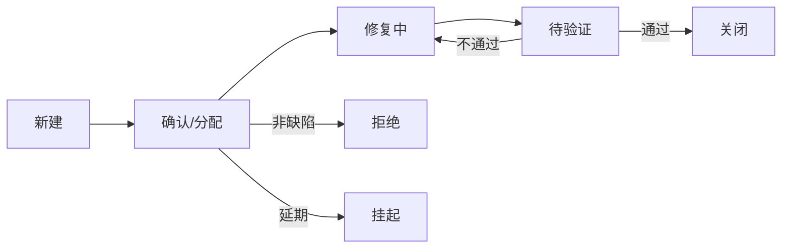

# 中来股份光伏电站全生命周期管理平台
## 测试方案与测试用例

| 项目 | 内容 |
|---|---|
| 文档编号 | ZL-VOLT-TEST-001 |
| 版本 | V1.0 |
| 状态 | 评审稿 |
| 编制日期 | 2026-11-14 |
| 关联文档 | `docs/01-spec.md` |
| 测试对象 | ZL-Volt 光伏电站全生命周期管理平台 |
| 测试范围 | 功能、接口、业务流程、IoT、性能、安全、数据一致性 |

### 文档修订记录

| 版本 | 日期 | 修订人 | 修订说明 |
|---|---|---|---|
| V1.0 | 2026-11-14 | ZL-Volt 项目组 | 首版：测试策略、用例、假数据、手把手验证 |

---

## 1. 测试目标与范围

### 1.1 测试目标

1. 验证 Spec 第 5 章 P0 功能全部可用，P1 功能主流程可用。
2. 验证 L2C、P2P、项目交付、项目结算、运维告警五条主链路端到端闭环。
3. 验证供应链—财务—资金的数据一致性：采购订单、收货、对账、发票、应付、付款金额可追溯。
4. 验证 IoT 假数据可以通过 MQTT 接入，落 Kafka/ClickHouse，触发告警和工单。
5. 验证权限、数据隔离、幂等、并发、异常场景。
6. 提供一套可以照着执行的手把手验证手册，解决“没有测试数据”的问题。

### 1.2 测试范围

| 范围 | 说明 |
|---|---|
| 功能测试 | 系统管理、CRM、PM、OA、SRM、库存、财务、资金、运维、IoT、报表 |
| 接口测试 | REST API、审批回调、消息事件、MQTT 报文 |
| 数据测试 | 金额/数量一致性、状态机、幂等、并发、库存负库存 |
| 集成测试 | 服务间 Feign/Dubbo、RocketMQ、Kafka、ES、ClickHouse、Redis |
| 非功能测试 | 性能基线、安全、权限、可用性、可观测性 |
| 不包含 | 真实银行扣款、税务查验、完整总账、原生 App |

### 1.3 测试准入与准出

**准入条件**

- Spec 评审通过，接口契约冻结。
- 数据库 schema、假数据脚本可执行。
- 被测服务部署成功，健康检查通过。
- 测试账号、权限、中间件就绪。

**准出条件**

- P0 用例执行率 100%，通过率 100%。
- P1 用例执行率 ≥ 95%，通过率 ≥ 95%。
- 无 P0/P1 缺陷；P2 缺陷有明确处理计划。
- 核心链路 E2E 用例连续执行 3 次通过。
- 性能、安全基线达标。

---

## 2. 测试策略

### 2.1 测试金字塔

| 层级 | 占比 | 工具 | 重点 |
|---|---|---|---|
| 单元测试 | 50% | JUnit 5 + Mockito | 金额计算、状态机、规则引擎、工具类 |
| 集成测试 | 30% | Spring Boot Test + Testcontainers |  Repository、MQ、Redis、Feign |
| 接口/契约测试 | 15% | REST Assured / Postman / Newman |  API 入参、出参、错误码、幂等 |
| E2E/UI 测试 | 5% | Playwright / 手工 | 主流程、审批、权限、页面交互 |

### 2.2 测试类型

| 类型 | 说明 | 触发时机 |
|---|---|---|
| 冒烟测试 | 登录、菜单、核心列表、健康检查 | 每次部署 |
| 功能测试 | 按模块用例执行 | 迭代提测 |
| 接口测试 | Swagger/Postman 集合，自动断言 | 每日构建 |
| 业务链路测试 | P2P、L2C、O&M 端到端 | 版本提测、回归 |
| 数据一致性测试 | 金额/数量/状态对账 SQL | 每轮回归 |
| 性能测试 | JMeter/k6 基线 | 版本后期 |
| 安全测试 | 越权、注入、敏感数据、重放 | 版本后期 |
| IoT 测试 | MQTT 模拟器 + 时序查询 + 告警 | 每轮回归 |
| 兼容性测试 | Chrome/Edge、1366/1920 | 版本后期 |

### 2.3 缺陷分级

| 级别 | 定义 | 示例 |
|---|---|---|
| P0 致命 | 主流程阻断、资金/库存错误、数据丢失 | 付款重复扣款、库存负库存、无法登录 |
| P1 严重 | 核心功能不可用、无绕行方案 | 对账无法确认、审批回调失败 |
| P2 一般 | 功能缺陷但有绕行方案 | 报表筛选错误、导出格式问题 |
| P3 轻微 | UI/文案/体验问题 | 字段对齐、提示语不准确 |

---

## 3. 测试环境

### 3.1 组件与端口

| 组件 | 版本 | 端口 | 用途 |
|---|---|---|---|
| MySQL | 8.0 | 3306 | 业务库 |
| Redis | 7.2 | 6379 | 缓存/锁/幂等 |
| ZooKeeper | 3.8 | 2181 | 注册/协调 |
| RocketMQ Namesrv | 5.x | 9876 | 业务消息 |
| RocketMQ Broker | 5.x | 10909/10911 | 业务消息 |
| RocketMQ Dashboard | 最新 | 8180 | 消息观测 |
| Kafka | 3.7 | 9092 | IoT 遥测 |
| Elasticsearch | 8.13 | 9200 | 搜索 |
| Kibana | 8.13 | 5601 | ES 可视化（可选） |
| ClickHouse | 24.3 | 8123/9000 | 时序/报表 |
| EMQX | 5.6 | 1883/8883/18083 | MQTT |
| MinIO | 最新 | 9002/9001 | 附件 |
| zl-gateway | - | 8080 | API 网关 |
| zl-auth | - | 8101 | 认证 |
| zl-system | - | 8102 | 系统管理 |
| zl-crm | - | 8103 | CRM |
| zl-pm | - | 8104 | 项目管理 |
| zl-oa | - | 8105 | 审批 |
| zl-srm | - | 8106 | 供应商/采购 |
| zl-inv | - | 8107 | 库存 |
| zl-fin | - | 8108 | 财务结算 |
| zl-fund | - | 8109 | 资金 |
| zl-om | - | 8110 | 运维 |
| zl-iot | - | 8111 | IoT |
| zl-report | - | 8112 | 报表/搜索 |
| zl-config | - | 8888 | 配置中心 |
| zl-volt-demo（演示版） | - | 18080 | 单体应用 + UI + API |
| 内置 MQTT（演示版） | Moquette | 1884 | 本地 MQTT Broker |

### 3.2 资源建议

| 模式 | 启动组件 | 最低内存 | 适用 |
|---|---|---|---|
| 轻量模式 | MySQL、Redis、ZK、RocketMQ、EMQX | 8GB | 功能/接口测试 |
| 完整模式 | 轻量 + Kafka、ES、ClickHouse、MinIO | 16GB | 全链路/IoT/报表 |

### 3.3 测试账号

| 账号 | 密码 | 角色 | 用途 |
|---|---|---|---|
| admin | Admin@123 | ADMIN | 系统管理、全量权限 |
| gm01 | Test@123 | GM | 大额审批 |
| sales01 | Test@123 | SALES | 客户/合同 |
| pm01 | Test@123 | PM | 项目/成本 |
| buyer01 | Test@123 | BUYER | 采购/供应商 |
| wh01 | Test@123 | WAREHOUSE | 收货/入库 |
| fin01 | Test@123 | FINANCE | 对账/发票/应付 |
| fund01 | Test@123 | FUND | 付款/资金 |
| om01 | Test@123 | OM | 告警/工单 |
| supplier01 | Test@123 | SUPPLIER | 供应商门户（供应商 1） |

> 假数据中的密码为 `{noop}` 明文前缀，仅用于本地开发；生产必须使用 BCrypt 并强制修改初始密码。

---

## 4. 假数据方案

### 4.1 设计原则

1. **可追溯**：每条业务数据都能沿单据链找到上下游，不生成孤立数据。
2. **金额自洽**：订单行金额 = 数量 × 单价；收货金额 ≤ 订单金额；发票金额 = 对账金额；付款 ≤ 应付可用余额。
3. **状态自洽**：已付款的应付余额为 0；已收货订单的已收数量等于订单数量；已关闭工单有处理结果。
4. **可重复**：固定主键、固定单号、固定日期，重复初始化结果一致。
5. **可扩展**：IoT 遥测用模拟器实时生成，不写死历史数据。
6. **开发专用**：假数据仅用于本地/测试环境，密码使用 `{noop}` 前缀，生产禁用。

### 4.2 数据规模

| 数据域 | 数量 | 说明 |
|---|---|---|
| 部门 | 7 | 集团、事业部、供应链、财务、运维、项目管理、销售 |
| 用户 | 10 | 覆盖 10 个角色 |
| 角色 | 10 | ADMIN/GM/SALES/PM/BUYER/WAREHOUSE/FINANCE/FUND/OM/SUPPLIER |
| 客户 | 8 | EPC、投资商、屋顶业主 |
| 联系人 | 8 | 每客户 1 个主联系人 |
| 线索 | 8 | 6 个已转化，2 个跟进中 |
| 商机 | 8 | 6 个赢单，2 个跟进中 |
| 投标 | 6 | 5 个中标，1 个失标 |
| 销售合同 | 6 | EPC/运维合同 |
| 项目 | 6 | 4 个 EPC 在建/并网，1 个屋顶并网，1 个运维 |
| WBS | 5 | 主项目 1 的 5 个 WBS |
| 里程碑 | 6 | 主项目 1 的里程碑 |
| 变更签证 | 2 | 1 个已审批，1 个审批中 |
| 成本明细 | 4 | 材料/分包/人工/其他 |
| 供应商 | 8 | 组件、逆变器、线缆、支架、施工、汇流箱、监测、运维 |
| 物料 | 12 | 组件、逆变器、支架、线缆、汇流箱、箱变、网关、气象站、熔断器 |
| 采购订单 | 6 | 主项目 3 个，其他项目 3 个 |
| 采购订单行 | 9 | 多物料 |
| 发货单 | 3 | 主项目 3 个订单各 1 个 |
| 收货单 | 6 | 主项目 3 个，其他项目 3 个 |
| 收货明细 | 9 | 与订单行对应 |
| 仓库 | 3 | 中心仓、项目仓、备件仓 |
| 库存 | 10 | 主项目剩余物料 + 中心仓 + 备件仓 |
| 出库单 | 1 | 主项目领料 |
| 出库明细 | 6 | 与库存流水对应 |
| 库存流水 | 16 | 入库/出库/期初 |
| 对账单 | 6 | 主项目 3 个已关闭，其他 3 个不同状态 |
| 对账明细 | 9 | 与收货明细对应 |
| 发票 | 6 | 主项目 3 张已匹配，其他 3 张待处理 |
| 应付 | 6 | 主项目 3 个已付清，其他 3 个未付/部分付 |
| 付款申请 | 6 | 3 个已支付，1 个审批中，1 个草稿，1 个部分支付 |
| 付款记录 | 4 | 3 个小额 + 1 个大额 |
| 付款核销 | 4 | 与付款记录对应 |
| 资金账户 | 3 | 基本户、一般户、项目专户 |
| 资金计划 | 3 | 2026-11 三个月度计划 |
| 电站 | 4 | 主项目、在建项目、屋顶项目、运维项目 |
| 设备 | 20 | 每站 5 台（逆变器×2、电表、汇流箱、气象站） |
| 告警 | 8 | 不同级别和状态 |
| 工单 | 6 | 不同状态和优先级 |
| 告警规则 | 5 | 温度、停机、电压、通讯、支路电流 |

### 4.3 主数据清单

**组织与用户**

| ID | 名称 | 说明 |
|---|---|---|
| 1 | 中来股份（集团） | 根组织 |
| 2 | 新能源事业部 | 业务主体 |
| 3 | 供应链中心 | 采购/仓库 |
| 4 | 财务中心 | 财务/资金 |
| 5 | 运维中心 | 运维 |
| 6 | 项目管理部 | 项目经理 |
| 7 | 销售部 | 销售 |

**客户**

| ID | 客户名称 | 类型 | 区域 |
|---|---|---|---|
| 1 | 苏州工业园区蓝湾智能制造有限公司 | ROOFTOP_OWNER | 江苏苏州 |
| 2 | 江苏鑫远新能源投资有限公司 | INVESTOR | 江苏南京 |
| 3 | 浙江绿筑工程有限公司 | EPC | 浙江杭州 |
| 4 | 安徽光合能源科技有限公司 | EPC | 安徽合肥 |
| 5 | 上海临港智造园区管理有限公司 | ROOFTOP_OWNER | 上海 |
| 6 | 山东鲁南新能源开发有限公司 | INVESTOR | 山东临沂 |
| 7 | 广东粤电综合能源有限公司 | INVESTOR | 广东广州 |
| 8 | 河南中原智造产业园有限公司 | ROOFTOP_OWNER | 河南郑州 |

**供应商**

| ID | 供应商名称 | 类型 | 状态 |
|---|---|---|---|
| 1 | 江苏曦光新能源科技有限公司 | 组件 | QUALIFIED |
| 2 | 苏州恒晟逆变器有限公司 | 逆变器 | QUALIFIED |
| 3 | 上海联缆线缆有限公司 | 线缆 | QUALIFIED |
| 4 | 浙江锐达支架有限公司 | 支架 | QUALIFIED |
| 5 | 安徽筑能电力工程有限公司 | 施工分包 | QUALIFIED |
| 6 | 常州瑞光电气有限公司 | 汇流箱/箱变 | QUALIFIED |
| 7 | 南京智维监测技术有限公司 | 监测/网关 | QUALIFIED |
| 8 | 山东鲁能运维服务有限公司 | 运维服务 | SUSPENDED |

**物料**

| ID | 编码 | 名称 | 分类 | 单位 |
|---|---|---|---|---|
| 1 | MAT-MOD-555 | N型TOPCon组件 555W | MODULE | 块 |
| 2 | MAT-MOD-580 | N型TOPCon组件 580W | MODULE | 块 |
| 3 | MAT-INV-110 | 组串式逆变器 110kW | INVERTER | 台 |
| 4 | MAT-INV-225 | 组串式逆变器 225kW | INVERTER | 台 |
| 5 | MAT-BRK-001 | 光伏支架 Q235B 热镀锌 | BRACKET | 套 |
| 6 | MAT-CAB-DC | 光伏直流电缆 1×4mm² | CABLE | 米 |
| 7 | MAT-CAB-AC | 交流电缆 YJV-0.6/1kV 4×95 | CABLE | 米 |
| 8 | MAT-CMB-16 | 智能汇流箱 16路 | COMBINER | 台 |
| 9 | MAT-TRF-1250 | 箱式变压器 1250kVA | TRANSFORMER | 台 |
| 10 | MAT-MON-GW | 数据采集网关 | OTHER | 台 |
| 11 | MAT-WS-001 | 气象站 | OTHER | 套 |
| 12 | MAT-FUSE-15 | 熔断器 15A | OTHER | 个 |

### 4.4 主业务链假数据（英雄项目）

选择项目 `PRJ-2026-0001`（蓝湾智造 1MW 屋顶分布式 EPC）作为 E2E 验证主数据：

| 单据 | 单号 | 金额（元） | 状态 |
|---|---|---|---|
| 销售合同 | CT-20260915-0001 | 4,200,000.00 | EFFECTIVE |
| 项目 | PRJ-2026-0001 | 预算 3,200,000.00 | GRID_CONNECTED |
| 采购订单 1（组件+支架） | PO-20260925-0001 | 2,170,000.00 | RECEIVED |
| 采购订单 2（逆变器+网关） | PO-20260928-0002 | 56,000.00 | RECEIVED |
| 采购订单 3（线缆） | PO-20261008-0003 | 146,000.00 | RECEIVED |
| 收货单 1 | GRN-20261015-0001 | 2,170,000.00 | STORED |
| 收货单 2 | GRN-20261018-0002 | 56,000.00 | STORED |
| 收货单 3 | GRN-20261020-0003 | 146,000.00 | STORED |
| 出库单 | ISSUE-20261025-0001 | 2,311,250.00 | CONFIRMED |
| 对账单 1 | REC-202610-0001 | 2,170,000.00 | CLOSED |
| 对账单 2 | REC-202610-0002 | 56,000.00 | CLOSED |
| 对账单 3 | REC-202610-0003 | 146,000.00 | CLOSED |
| 发票 1 | INV-20261102-0001 | 2,170,000.00 | MATCHED |
| 发票 2 | INV-20261102-0002 | 56,000.00 | MATCHED |
| 发票 3 | INV-20261103-0003 | 146,000.00 | MATCHED |
| 应付 1 | AP-20261102-0001 | 2,170,000.00 | PAID |
| 应付 2 | AP-20261102-0002 | 56,000.00 | PAID |
| 应付 3 | AP-20261103-0003 | 146,000.00 | PAID |
| 付款申请 1 | PAY-20261105-0001 | 1,410,500.00 | RECONCILED |
| 付款申请 2 | PAY-20261105-0002 | 36,400.00 | RECONCILED |
| 付款申请 3 | PAY-20261106-0003 | 94,900.00 | RECONCILED |
| 付款记录 1 | PMT-20261106-0001 | 1,410,500.00 | SUCCESS |
| 付款记录 2 | PMT-20261106-0002 | 36,400.00 | SUCCESS |
| 付款记录 3 | PMT-20261107-0003 | 94,900.00 | SUCCESS |

金额校验：

```text
订单总额 = 2,170,000 + 56,000 + 146,000 = 2,372,000.00
预付款(30%) = 711,600.00
质保金(5%) = 118,600.00
实际付款 = 2,372,000 - 711,600 - 118,600 = 1,541,800.00
           = 1,410,500 + 36,400 + 94,900 = 1,541,800.00
项目材料成本 = 2,311,250.00
项目总成本 = 2,311,250 + 350,000(人工) + 280,000(分包) + 50,000(其他) = 2,991,250.00
项目预算 = 3,200,000.00，预算执行率 = 93.48%
合同额 = 4,200,000.00，毛利 = 1,208,750.00，毛利率 = 28.78%
```

### 4.5 数据一致性规则

| 规则 | 校验 SQL 思路 |
|---|---|
| 订单行金额 | `amount = qty * unit_price` |
| 订单总金额 | `total_amount = SUM(line.amount)` |
| 已收数量 | `received_qty <= qty` |
| 收货金额 | `receipt.total_amount <= po.total_amount` |
| 对账金额 | `reconciliation.total_amount = SUM(line.amount)` |
| 发票金额 | `invoice.amount <= reconciliation.total_amount` |
| 应付余额 | `available_amount = amount - paid_amount - prepaid_offset - retention_amount` |
| 付款金额 | `payment.amount <= payable.available_amount + 本次核销` |
| 库存 | `stock.qty >= 0`；`stock.qty = 入库 - 出库` |
| 工单 | `status = CLOSED` 时 `actual_end IS NOT NULL` |

### 4.6 假数据生成方式

| 方式 | 文件 | 说明 |
|---|---|---|
| MySQL DDL | `db/mysql/01_schema.sql` | 创建 9 个业务库、41 张核心表 |
| MySQL Seed | `db/mysql/02_seed.sql` | 插入固定 ID 的主数据与业务链数据 |
| ClickHouse DDL | `db/clickhouse/01_schema.sql` | 遥测原始表、5 分钟聚合、日发电量 |
| MQTT 模拟器 | `scripts/iot/mqtt-device-simulator.js` | Node.js 实时生成遥测/告警数据 |
| Docker Compose | `deploy/docker-compose-dev.yml` | 一键启动中间件 |

### 4.7 数据初始化与重置

```powershell
# 首次初始化（MySQL 容器首次启动会自动执行 01_schema.sql / 02_seed.sql）
docker compose -f deploy/docker-compose-dev.yml up -d mysql

# 手动重新导入（会先删库重建，仅测试环境）
Get-Content db/mysql/01_schema.sql -Raw | docker exec -i zl-mysql mysql -uroot -proot123
Get-Content db/mysql/02_seed.sql -Raw | docker exec -i zl-mysql mysql -uroot -proot123

# ClickHouse 初始化
Get-Content db/clickhouse/01_schema.sql -Raw | docker exec -i zl-clickhouse clickhouse-client --multiquery
```

---

## 5. 功能测试用例

> 优先级：P0 必须通过；P1 主流程通过；P2 可后续补充。步骤中的接口均以网关 `http://localhost:8080` 为前缀。

### 5.1 认证与权限（TC-AUTH）

| 编号 | P | 用例 | 前置/步骤 | 预期结果 |
|---|---|---|---|---|
| TC-AUTH-001 | P0 | 正确账号密码登录 | POST `/api/v1/auth/login`，admin/Admin@123 | code=0，返回 accessToken/refreshToken，用户角色 ADMIN |
| TC-AUTH-002 | P0 | 错误密码登录 | 密码改为 wrong | code=40101 或 42201，提示用户名或密码错误，不泄露账号是否存在 |
| TC-AUTH-003 | P0 | 无 Token 访问受保护接口 | 不带 Authorization 请求 `/api/v1/crm/customers` | HTTP 401，code=40101 |
| TC-AUTH-004 | P0 | 过期 Token 访问 | 使用过期 accessToken | HTTP 401，提示刷新或重新登录 |
| TC-AUTH-005 | P0 | 刷新 Token | POST `/api/v1/auth/refresh` | 返回新 accessToken，旧 refreshToken 可按策略失效 |
| TC-AUTH-006 | P0 | 角色越权 | sales01 调用付款执行接口 | HTTP 403，code=40301 |
| TC-AUTH-007 | P0 | 数据权限-销售本人 | sales01 查询客户列表 | 只返回 owner_id=sales01 的客户 |
| TC-AUTH-008 | P0 | 数据权限-供应商隔离 | supplier01 查询订单 | 只返回 supplier_id=1 的订单 |
| TC-AUTH-009 | P0 | 退出登录 | POST `/api/v1/auth/logout` 后再访问 | 原 Token 失效或加入黑名单 |
| TC-AUTH-010 | P1 | 登录失败锁定 | 连续 5 次错误密码 | 账号锁定 15 分钟，提示剩余时间 |

### 5.2 CRM（TC-CRM）

| 编号 | P | 用例 | 前置/步骤 | 预期结果 |
|---|---|---|---|---|
| TC-CRM-001 | P0 | 新建客户 | sales01 登录，POST 客户，名称/类型/区域必填 | 返回客户编码 CUS-YYYYMMDD-XXXX，列表可查 |
| TC-CRM-002 | P0 | 客户编码唯一 | 用相同名称/信用代码重复创建 | 允许同名，但信用代码唯一校验；或按规则提示重复 |
| TC-CRM-003 | P0 | 新建联系人 | 给客户 1 新增联系人，设为主联系人 | 原主联系人自动取消，仅一个 is_primary=1 |
| TC-CRM-004 | P0 | 线索登记与分配 | 新建线索，分配给 sales01 | 线索状态 NEW，负责人 sales01 |
| TC-CRM-005 | P0 | 线索转商机 | 对线索 7 执行 convert | 生成商机，线索状态 CONVERTED，商机可查 |
| TC-CRM-006 | P0 | 商机阶段推进 | 商机 7 从 QUALIFYING 推进到 PROPOSAL | 阶段更新，操作日志留痕 |
| TC-CRM-007 | P0 | 投标登记 | 给商机 7 新增投标，金额 630 万 | 投标记录生成，商机可关联 |
| TC-CRM-008 | P0 | 合同创建与提交 | 新建合同，关联客户/商机，金额 420 万，提交审批 | 合同状态 APPROVING，生成审批实例 |
| TC-CRM-009 | P0 | 合同审批通过 | gm01 审批合同 | 合同状态 EFFECTIVE，发布 contract-signed 事件 |
| TC-CRM-010 | P1 | 客户 360 | 查询客户 1 的 360 视图 | 显示合同、项目、回款、工单汇总，金额一致 |
| TC-CRM-011 | P1 | 合同变更 | 对生效合同发起变更，金额 +10 万 | 生成变更记录，原合同不被覆盖 |
| TC-CRM-012 | P1 | 销售漏斗 | 按阶段统计商机 | 金额/数量与商机列表一致 |

### 5.3 PM（TC-PM）

| 编号 | P | 用例 | 前置/步骤 | 预期结果 |
|---|---|---|---|---|
| TC-PM-001 | P0 | 项目立项 | pm01 基于合同 1 立项，容量 1MW，预算 320 万 | 项目编码 PRJ-2026-XXXX，状态 APPROVING |
| TC-PM-002 | P0 | 立项审批通过 | gm01 审批 | 项目状态 IN_PROGRESS，自动创建默认 WBS |
| TC-PM-003 | P0 | WBS 预算汇总 | 新增 5 个 WBS，预算合计 320 万 | 父级汇总 = 子级之和，误差 ≤ 0.01 |
| TC-PM-004 | P0 | 进度填报 | 对 WBS 填报 40% | 进度记录生成，项目整体进度按权重计算 |
| TC-PM-005 | P0 | 进度超 100% | 填报 120% | 拒绝，code=42201 |
| TC-PM-006 | P0 | 变更签证审批 | 新增变更 +8 万，提交审批 | 审批通过后计入项目预算/成本预测 |
| TC-PM-007 | P0 | 未审批变更不计成本 | 变更处于 APPROVING | 项目成本不包含该变更 |
| TC-PM-008 | P0 | 并网登记 | 填写实际并网日期 2026-11-12 | 项目状态 GRID_CONNECTED，电站档案可生成 |
| TC-PM-009 | P0 | 成本汇总 | 查询项目 1 成本 | 材料 2,311,250 + 人工 350,000 + 分包 280,000 + 其他 50,000 = 2,991,250 |
| TC-PM-010 | P0 | 项目结算 | 发起结算，审批通过 | 项目状态 SETTLED，成本锁定，生成结算快照 |
| TC-PM-011 | P1 | 结算后改成本 | 尝试新增成本 | 拒绝，提示走结算调整 |
| TC-PM-012 | P1 | 项目看板 | 查询项目 1 看板 | 进度、成本、采购、回款与明细一致 |

### 5.4 OA（TC-OA）

| 编号 | P | 用例 | 前置/步骤 | 预期结果 |
|---|---|---|---|---|
| TC-OA-001 | P0 | 采购订单审批链 | 创建 60 万采购订单并提交 | 审批链：采购经理→采购总监→财务经理 |
| TC-OA-002 | P0 | 大额付款审批链 | 创建 120 万付款申请 | 审批链含财务总监、总经理 |
| TC-OA-003 | P0 | 审批同意 | 审批人同意 | 业务单据状态更新，待办消失 |
| TC-OA-004 | P0 | 审批驳回 | 审批人驳回并填写意见 | 单据回到 DRAFT/REJECTED，可修改重提 |
| TC-OA-005 | P1 | 加签/转办 | 审批人加签财务 | 被加签人收到待办，审批记录完整 |
| TC-OA-006 | P1 | 重复审批 | 对同一任务重复提交同意 | 幂等，不重复推进流程 |
| TC-OA-007 | P1 | 审批回调失败重试 | 模拟业务服务超时 | 消息重试，最终状态一致，不重复更新 |

### 5.5 SRM（TC-SRM）

| 编号 | P | 用例 | 前置/步骤 | 预期结果 |
|---|---|---|---|---|
| TC-SRM-001 | P0 | 供应商准入 | buyer01 新增供应商，提交准入，审批通过 | 状态 PENDING→QUALIFIED，可被订单引用 |
| TC-SRM-002 | P0 | 未准入供应商下单 | 用 PENDING 供应商创建 PO | 拒绝，code=42201 |
| TC-SRM-003 | P0 | 黑名单供应商下单 | 将供应商 8 设为 BLACKLIST，再创建 PO | 拒绝，提示供应商黑名单 |
| TC-SRM-004 | P0 | 物料编码唯一 | 新增重复编码物料 | 拒绝，唯一索引冲突 |
| TC-SRM-005 | P0 | 采购订单创建 | 项目 1 + 供应商 1，2 行物料 | 订单号 PO-YYYYMMDD-XXXX，总金额=行金额之和 |
| TC-SRM-006 | P0 | 采购订单审批 | 提交 217 万订单 | 按 BR-01 路由至总经理，审批通过后状态 APPROVED |
| TC-SRM-007 | P0 | 订单行金额校验 | 数量 1800 × 单价 850 | 行金额 1,530,000.00，与总金额一致 |
| TC-SRM-008 | P0 | 订单变更 | 已审批订单新增 100 块组件，提交变更 | 生成新版本，未审批前不生效 |
| TC-SRM-009 | P0 | 超订单发货 | ASN 数量 > 订单未发数量 | 拒绝，code=42201 |
| TC-SRM-010 | P0 | 正常发货 | 供应商对 PO 1 创建 ASN，数量 1800+200 | ASN 状态 SHIPPED，可被收货引用 |
| TC-SRM-011 | P0 | 供应商门户隔离 | supplier01 查询订单 | 仅返回供应商 1 的订单 |
| TC-SRM-012 | P1 | 供应商绩效 | 统计及时率/合格率 | 数据来自 ASN/收货/质检，口径一致 |
| TC-SRM-013 | P1 | 询比价 | 发起 3 家询价，录入报价 | 比价表按总价排序，定标生成 PO 草稿 |
| TC-SRM-014 | P1 | 订单取消 | 未发货订单取消 | 状态 CANCELLED，不可再收货 |

### 5.6 库存（TC-INV）

| 编号 | P | 用例 | 前置/步骤 | 预期结果 |
|---|---|---|---|---|
| TC-INV-001 | P0 | 创建收货单 | 基于 PO 1 创建收货单 | 带出订单行、未收数量、单价 |
| TC-INV-002 | P0 | 收货数量容差 | 收货数量 = 未收 × 1.006 | 超出 0.5% 容差，需审批或拒绝 |
| TC-INV-003 | P0 | 质检合格入库 | 合格 1800 块组件，入库 | 库存增加，生成入库流水，金额=1800×850 |
| TC-INV-004 | P0 | 不合格品处理 | 质检不合格 10 块 | 不计入可入库数量，进入退货/换货 |
| TC-INV-005 | P0 | 重复入库 | 对同一收货单重复执行 store | 幂等，不重复增加库存 |
| TC-INV-006 | P0 | 项目领料出库 | 项目 1 领用 1750 块组件 | 库存减少，项目材料成本增加 1,487,500 |
| TC-INV-007 | P0 | 超库存出库 | 领用数量 > 可用库存 | 拒绝，code=42202 |
| TC-INV-008 | P0 | 移动加权平均 | 两批不同单价入库后出库 | 出库单价 = (原金额+新金额)/(原数量+新数量) |
| TC-INV-009 | P0 | 库存台账 | 查询物料 1 库存 | 数量 = 入库 - 出库，金额 = 数量 × 平均单价 |
| TC-INV-010 | P1 | 盘点差异 | 盘亏 5 块，提交审批 | 审批后库存调整，生成盘亏流水 |
| TC-INV-011 | P1 | 批次追溯 | 按批次查收货/出库/项目 | 全链路可追溯 |
| TC-INV-012 | P1 | 安全库存预警 | 库存低于安全库存 | 生成预警，可订阅通知 |

### 5.7 财务结算（TC-FIN）

| 编号 | P | 用例 | 前置/步骤 | 预期结果 |
|---|---|---|---|---|
| TC-FIN-001 | P0 | 生成对账单 | 供应商 1 + 项目 1 + 2026-10 | 汇总 3 张收货单，金额 2,170,000 |
| TC-FIN-002 | P0 | 对账数量来源 | 核对对账行与收货行 | 数量 = 合格入库数量 - 退货数量 |
| TC-FIN-003 | P0 | 单价差异 | 手工把对账单价改为 860 | 生成差异行，金额差异 18,000，需处理 |
| TC-FIN-004 | P0 | 对账三级确认 | 供应商→采购→财务依次确认 | 状态 FINANCE_CONFIRMED，锁定不可改 |
| TC-FIN-005 | P0 | 对账确认后改数 | 尝试修改已确认对账单 | 拒绝，code=42205 |
| TC-FIN-006 | P0 | 对账确认生成应付 | 财务确认后 | 生成应付 AP-...，金额=对账金额 |
| TC-FIN-007 | P0 | 发票登记 | 登记发票号、金额、税额、税率 | 发票号唯一，重复登记被拒绝 |
| TC-FIN-008 | P0 | 三单匹配通过 | PO 2,170,000 / GRN 2,170,000 / INV 2,170,000 | MATCHED，生成/更新应付 |
| TC-FIN-009 | P0 | 三单匹配-金额容差 | 发票 2,180,000（差异 10,000，占 0.46%，在 0.5% 容差内）；再试 2,190,000（差异 0.92%） | 前者 MATCHED；后者 MISMATCH，阻断付款 |
| TC-FIN-010 | P0 | 三单匹配-数量超差 | 发票数量 > 对账数量 × 1.01 | MISMATCH，阻断付款 |
| TC-FIN-011 | P0 | 供应商不一致 | 发票供应商 ≠ PO 供应商 | MISMATCH，阻断 |
| TC-FIN-012 | P0 | 预付款核销 | 应付 2,170,000，预付款 651,000 | 核销后应付可用余额 = 2,170,000-651,000-108,500=1,410,500 |
| TC-FIN-013 | P0 | 预付款超核销 | 核销金额 > 预付款余额 | 拒绝，code=42203 |
| TC-FIN-014 | P0 | 质保金预留 | 合同质保金 5% | 应付预留 108,500，不参与普通付款 |
| TC-FIN-015 | P0 | 应付余额计算 | 查询应付 1 | available = amount - paid - prepaid - retention |
| TC-FIN-016 | P0 | 重复付款防护 | 对已付清应付再次付款 | 拒绝，code=42203/42205 |
| TC-FIN-017 | P0 | 项目成本归集 | 出库/分包/人工/其他 | 成本汇总 = 2,991,250，可按 WBS 下钻 |
| TC-FIN-018 | P0 | 项目结算 | 收入 4,200,000，成本 2,991,250 | 毛利 1,208,750，毛利率 28.78% |
| TC-FIN-019 | P1 | 应付账龄 | 按 30/60/90 天统计 | 金额与应付列表一致 |
| TC-FIN-020 | P1 | 红冲重开 | 对已确认对账单红冲 | 生成红字对账单，原单只读，应付冲销 |

### 5.8 资金管理（TC-FUND）

| 编号 | P | 用例 | 前置/步骤 | 预期结果 |
|---|---|---|---|---|
| TC-FUND-001 | P0 | 资金账户余额 | 查询账户 1 | 余额 = 期初 + 收款 - 付款 |
| TC-FUND-002 | P0 | 资金计划 | 创建 2026-11 项目 1 计划 300 万 | 状态 DRAFT/SUBMITTED/APPROVED |
| TC-FUND-003 | P0 | 付款申请关联应付 | 基于应付 1 创建付款申请 1,410,500 | 带出供应商、项目、可用余额 |
| TC-FUND-004 | P0 | 超应付余额付款 | 申请金额 > 可用余额 | 拒绝，code=42203 |
| TC-FUND-005 | P0 | 付款审批阈值 | 申请 120 万 | 审批链含资金主管→财务经理→财务总监→总经理 |
| TC-FUND-006 | P0 | 付款幂等 | 同一 X-Request-Id 提交两次 | 只生成一笔付款，第二次返回首次结果 |
| TC-FUND-007 | P0 | 付款执行成功 | 审批通过后执行付款 | 生成付款记录，状态 PAID，应付已付金额增加 |
| TC-FUND-008 | P0 | 付款失败重试 | 模拟银行失败 | 状态 FAILED，可重试，不重复扣款 |
| TC-FUND-009 | P0 | 银行流水匹配 | 导入流水，金额/账户/日期匹配 | 付款状态 RECONCILED，应付核销 |
| TC-FUND-010 | P0 | 资金计划超支 | 付款金额 > 计划可用额度 | 拒绝或需特批（按配置） |
| TC-FUND-011 | P1 | 预付款登记 | 采购订单预付 30% | 生成预付款台账，余额 711,600 |
| TC-FUND-012 | P1 | 质保金释放 | 质保期满，无质量问题 | 生成质保金应付，可发起付款 |
| TC-FUND-013 | P1 | 供应商账户变更 | 修改收款账户，走审批 | 未审批前付款仍用原账户；审批后生效 |
| TC-FUND-014 | P1 | 资金台账 | 查询账户收付款明细 | 期初/本期/期末余额勾稽一致 |

### 5.9 运维（TC-OM）

| 编号 | P | 用例 | 前置/步骤 | 预期结果 |
|---|---|---|---|---|
| TC-OM-001 | P0 | 电站档案 | 基于项目 1 创建电站，容量 1MW | 电站编码 ST-YYYY-XXXX，关联项目/客户 |
| TC-OM-002 | P0 | 设备台账 | 新增逆变器、电表、汇流箱、气象站 | 设备序列号唯一，状态 ONLINE/OFFLINE |
| TC-OM-003 | P0 | 告警列表 | 查询告警，按级别/状态/电站筛选 | 结果与假数据一致（8 条） |
| TC-OM-004 | P0 | 告警确认 | om01 确认告警 1 | 状态 ACKED，记录确认人和时间 |
| TC-OM-005 | P0 | 严重告警自动建单 | 模拟 CRITICAL 告警 | 自动生成工单，关联 alarm_id |
| TC-OM-006 | P0 | 工单派单 | 派给 om01 | 状态 ASSIGNED，处理人收到通知 |
| TC-OM-007 | P0 | 工单处理完成 | 填写处理结果、备件、照片 | 状态 COMPLETED，可验收 |
| TC-OM-008 | P0 | 工单关闭 | 验收通过关闭 | 状态 CLOSED，actual_end 非空，成本归集 |
| TC-OM-009 | P0 | 工单 SLA 超时 | 超过解决时限 | 标记超时，发送升级通知 |
| TC-OM-010 | P1 | 巡检计划 | 创建月度巡检，填写巡检项 | 生成巡检任务，缺陷可转工单 |
| TC-OM-011 | P1 | 备件领用 | 工单领用熔断器 2 个 | 备件库存减少，工单成本增加 |
| TC-OM-012 | P1 | 发电量统计 | 查询电站 1 日发电量 | 与电表遥测汇总一致 |

### 5.10 IoT（TC-IOT）

| 编号 | P | 用例 | 前置/步骤 | 预期结果 |
|---|---|---|---|---|
| TC-IOT-001 | P0 | 设备连接认证 | 用正确 clientId/username/password 连接 EMQX | 连接成功，ACL 允许发布自己的 Topic |
| TC-IOT-002 | P0 | 非法设备连接 | 错误密码或越权 Topic | 拒绝连接/拒绝发布 |
| TC-IOT-003 | P0 | 遥测上报 | 模拟器每 5 秒发布 telemetry | EMQX 收到，Kafka `iot.telemetry.raw` 有消息 |
| TC-IOT-004 | P0 | 遥测落库 | 消费服务写入 ClickHouse | `iot_telemetry` 行数增加，字段正确 |
| TC-IOT-005 | P0 | 重复消息 | 相同 msgId 发布两次 | 只落一条，幂等生效 |
| TC-IOT-006 | P0 | 乱序/缺失时间 | ts 乱序、缺少 metrics | 按规则丢弃或标记 quality=0，不阻塞其他消息 |
| TC-IOT-007 | P0 | 温度告警 | 模拟温度 90℃ 持续 5 分钟 | 生成 MAJOR 告警，规则命中 |
| TC-IOT-008 | P0 | 告警抑制 | 同设备同规则 30 分钟内重复越限 | 只生成一条告警 |
| TC-IOT-009 | P0 | 停机告警 | activePower=0、dcVoltage=0 且状态非 STANDBY（日间）持续 10 分钟 | 生成 CRITICAL 告警，自动建工单 |
| TC-IOT-010 | P0 | 离线判定 | 停止发布超过 3 个周期 | 设备状态 OFFLINE，可生成离线告警 |
| TC-IOT-011 | P1 | 时序查询 | 查询设备 7 天原始数据 | 返回按时间排序的数据，P95 < 2s |
| TC-IOT-012 | P1 | 聚合查询 | 查询电站 1 日发电量 | 与原始数据积分一致（误差 ≤ 1%） |
| TC-IOT-013 | P2 | 指令下发 | 下发限功率指令 | 设备收到 cmd，回复 cmd/reply，记录审计 |

### 5.11 报表与搜索（TC-RPT）

| 编号 | P | 用例 | 前置/步骤 | 预期结果 |
|---|---|---|---|---|
| TC-RPT-001 | P0 | 经营驾驶舱 | 查询 dashboard | 合同额、项目数、采购额、付款额、告警数与明细一致 |
| TC-RPT-002 | P0 | 项目成本报表 | 按项目 1 查询 | 预算 3,200,000，实际 2,991,250，偏差 -6.52% |
| TC-RPT-003 | P1 | 供应链报表 | 按供应商 1 查询 | 采购 2,170,000，已付 1,410,500，未付 0 |
| TC-RPT-004 | P1 | 资金报表 | 查询 2026-11 计划执行 | 计划/实际/执行率一致 |
| TC-RPT-005 | P1 | 运维报表 | 查询电站 1 | 告警数、工单数、SLA、发电量一致 |
| TC-RPT-006 | P1 | 全局搜索 | 搜索“蓝湾” | 返回客户、合同、项目、电站，相关性排序 |
| TC-RPT-007 | P1 | 搜索权限 | sales01 搜索其他销售客户 | 不返回无权数据 |
| TC-RPT-008 | P1 | 导出 | 导出应付账龄 Excel | 文件字段、金额、权限正确，记录审计 |

### 5.12 非功能与安全（TC-NFR）

| 编号 | P | 用例 | 前置/步骤 | 预期结果 |
|---|---|---|---|---|
| TC-NFR-001 | P0 | 接口性能基线 | JMeter 100 并发查询客户列表 | P95 < 300ms，错误率 < 0.1% |
| TC-NFR-002 | P0 | 写接口性能 | 100 并发创建线索 | P95 < 500ms，无重复单号 |
| TC-NFR-003 | P0 | 库存并发 | 100 并发领用同一物料 | 不超卖，库存 ≥ 0，失败请求明确提示 |
| TC-NFR-004 | P0 | 付款并发 | 同一应付并发提交两笔付款 | 只有一笔成功，另一笔幂等/余额不足 |
| TC-NFR-005 | P0 | SQL 注入 | 查询参数带 `' OR 1=1 --` | 参数化查询，不泄露数据 |
| TC-NFR-006 | P0 | XSS | 客户名称输入 `<script>` | 转义存储/展示，不执行脚本 |
| TC-NFR-007 | P0 | 敏感数据脱敏 | 非财务角色查看银行账号 | 显示 `**** **** **** 1234` |
| TC-NFR-008 | P1 | Token 重放 | 重复使用已注销 Token | 拒绝访问 |
| TC-NFR-009 | P1 | 文件上传 | 上传 exe/超大文件 | 拒绝，提示类型/大小限制 |
| TC-NFR-010 | P1 | 服务降级 | 停止 ES | 搜索不可用，核心交易不受影响 |
| TC-NFR-011 | P1 | 消息积压 | 消费端停止 10 分钟再恢复 | 消息不丢，最终一致 |
| TC-NFR-012 | P1 | 审计完整性 | 执行付款/导出/权限变更 | 审计日志包含操作人、IP、对象、结果 |

---

## 6. 端到端主流程用例

### TC-E2E-001 采购到付款 + 项目成本 + 运维告警

**目标**：从零验证“合同→项目→采购→收货→对账→开票→应付→付款→成本→告警→工单”全链路。

**前置条件**

- 中间件、微服务、数据库、假数据已按第 7 章启动。
- admin 已登录，或使用各角色账号依次操作。
- 供应商 1、项目 1、物料 1/5 已存在。

**步骤与预期**

| 步骤 | 操作 | 预期结果 |
|---|---|---|
| 1 | 创建采购订单：供应商 1、项目 1、组件 1800×850、支架 200×3200 | 订单 PO-...，总额 2,170,000，状态 DRAFT |
| 2 | 提交审批，gm01 审批 | 状态 APPROVED，发布 po-approved 事件 |
| 3 | buyer01 通知供应商发货，supplier01 创建 ASN | ASN 状态 SHIPPED，数量不超订单 |
| 4 | wh01 创建收货单，质检 1800+200 全部合格，入库 | 收货单 STORED，库存增加，发布 goods-received |
| 5 | fin01 生成 2026-10 对账单 | 对账金额 2,170,000，状态 DRAFT |
| 6 | supplier01 确认 → buyer01 确认 → fin01 确认 | 状态 FINANCE_CONFIRMED，锁定 |
| 7 | 登记发票 2,170,000，执行三单匹配 | MATCHED，生成应付 AP-... |
| 8 | 登记预付款 651,000（30%），核销应付 | 应付可用余额 1,410,500 |
| 9 | 创建付款申请 1,410,500，fund01 审批，执行付款 | 付款成功，应付 PAID，余额 0 |
| 10 | 项目 1 领料出库 2,311,250 | 库存减少，项目材料成本增加 |
| 11 | 查询项目成本 | 材料 2,311,250 + 人工 350,000 + 分包 280,000 + 其他 50,000 = 2,991,250 |
| 12 | 启动 MQTT 模拟器，制造逆变器温度 90℃ | 生成 MAJOR 告警，自动/手工生成工单 |
| 13 | om01 处理工单，领用备件，关闭 | 工单 CLOSED，备件成本归集 |
| 14 | 查询驾驶舱 | 采购额、付款额、项目成本、告警数一致 |

**通过标准**

- 每一步状态、金额、数量与预期一致；
- 重复执行步骤 9 不重复付款；
- 对账/发票/应付/付款金额可勾稽；
- 告警→工单→备件成本链路可追溯；
- 全链路 traceId 可查询。

---

## 7. 手把手验证手册（Windows）

> 目标：即使没有真实业务数据和 IoT 设备，也能从零把环境跑起来，并验证数据库、金额勾稽、MQTT 遥测链路。
>
> 当前仓库包含两套验证方式：
> - **演示版（推荐先跑）**：Spring Boot 模块化单体 + H2 内存库 + 内置 MQTT Broker，不需要 Docker/MySQL。启动后访问 http://localhost:18080。
> - **完整中间件版**：按 7.0~7.11 启动 MySQL/Redis/ZK/RocketMQ/Kafka/ES/ClickHouse/EMQX，模拟生产架构。

### 7.0 演示版快速启动（无需 Docker/MySQL）

前置：JDK 17、Maven 3.9、Node 20+（当前机器已具备）。

```powershell
cd c:\trae\ZLVoltManagement
mvn -DskipTests package
java -jar target\zl-volt-demo-1.0.0.jar
```

浏览器打开 http://localhost:18080，账号 `admin / Admin@123`。

演示版特性：

- H2 内存库，启动时自动执行 `db/mysql/01_schema.sql` + `02_seed.sql`；重启即重置，适合反复演示。
- 内置 MQTT Broker 监听 **1884**；Node 模拟器命令：
```powershell
cd scripts\iot
npm install
node mqtt-device-simulator.js --broker mqtt://localhost:1884 --stations 2 --devices 5 --interval 5000
```
- 页面左侧「一键演示」会自动跑通：客户→线索→商机→合同→立项→采购→收货→对账→发票→三单匹配→应付→付款→领料成本→人工/分包→并网→设备故障告警→工单处理→项目结算。
- API 前缀 `http://localhost:18080/api`；H2 控制台 `http://localhost:18080/h2-console`（JDBC URL `jdbc:h2:mem:zlvolt`，用户 `sa`，密码空）。
- 演示版用 H2 遥测表替代 ClickHouse、内置 MQTT 替代 EMQX；RocketMQ/Kafka/ES/Redis/ZK 在完整中间件版接入，不影响业务链演示。

### 7.0A 环境准备（完整中间件版）

| 软件 | 版本 | 检查命令 | 说明 |
|---|---|---|---|
| Docker Desktop | 最新稳定版 | `docker version` | 需开启 WSL2 后端 |
| JDK | 17 | `java -version` | 当前机器已安装 Temurin 17.0.20 |
| Maven | 3.9+ | `mvn -version` | 当前机器已安装 3.9.16 |
| Node.js | 20+ | `node -v` | 当前机器已安装 v24.19.0 |
| PowerShell | 5.1+ | `$PSVersionTable.PSVersion` | Windows 自带 |
| 浏览器 | Chrome/Edge | - | 访问 EMQX/RocketMQ Dashboard |

安装 Docker Desktop：

1. 下载并安装 Docker Desktop for Windows。
2. 安装时勾选 **Use WSL 2 instead of Hyper-V**。
3. 安装完成后重启，打开 Docker Desktop，等待左下角显示 Engine running。
4. 在 PowerShell 执行：

```powershell
docker version
docker compose version
```

预期：Client 和 Server 都有版本输出，`docker compose version` 显示 v2.x。

> 如果公司网络无法拉取镜像，配置 Docker Desktop → Settings → Docker Engine 的 registry-mirrors，或使用公司镜像仓库。

### 7.1 启动中间件

进入项目根目录 `c:\trae\ZLVoltManagement`。

**方式 A：轻量模式（推荐先跑通数据库 + MQTT）**

```powershell
docker compose -f deploy/docker-compose-dev.yml up -d
docker compose -f deploy/docker-compose-dev.yml ps
```

启动组件：MySQL、Redis、ZooKeeper、RocketMQ（Namesrv + Broker + Dashboard）、EMQX。

**方式 B：完整模式（再加 Kafka、ES、ClickHouse、MinIO）**

```powershell
docker compose -f deploy/docker-compose-dev.yml --profile full up -d
docker compose -f deploy/docker-compose-dev.yml ps
```

启动组件：轻量模式全部 + Kafka、Elasticsearch、Kibana、ClickHouse、MinIO。

**健康检查**

| 组件 | 地址/命令 | 预期 |
|---|---|---|
| MySQL | `docker exec zl-mysql mysqladmin ping -uroot -proot123` | `mysqld is alive` |
| Redis | `docker exec zl-redis redis-cli ping` | `PONG` |
| ZooKeeper | `docker exec zl-zookeeper zkServer.sh status` | `Mode: standalone` |
| RocketMQ | 打开 http://localhost:8180 | Dashboard 可访问 |
| Kafka | `docker exec zl-kafka /opt/kafka/bin/kafka-topics.sh --bootstrap-server localhost:9092 --list` | 可列出 topic（首次为空） |
| Elasticsearch | http://localhost:9200 | 返回 JSON，`cluster_name` 正常 |
| ClickHouse | http://localhost:8123/ping | `Ok.` |
| EMQX | http://localhost:18083 | 登录页，默认 admin/public |
| MinIO | http://localhost:9001 | 登录页，minioadmin/minioadmin123 |

### 7.2 初始化并验证 MySQL 假数据

**首次启动自动初始化**

MySQL 容器第一次启动时会自动执行 `db/mysql/01_schema.sql` 和 `02_seed.sql`（挂载到 `/docker-entrypoint-initdb.d`）。等待 20~60 秒后检查：

```powershell
docker exec -it zl-mysql mysql -uroot -proot123 -e "SHOW DATABASES;"
```

预期看到：

```text
zl_system
zl_crm
zl_pm
zl_srm
zl_inv
zl_fin
zl_fund
zl_om
zl_iot
```

**手动重新导入（容器已存在、数据卷已初始化时）**

```powershell
Get-Content db/mysql/01_schema.sql -Raw -Encoding UTF8 | docker exec -i zl-mysql mysql -uroot -proot123
Get-Content db/mysql/02_seed.sql -Raw -Encoding UTF8 | docker exec -i zl-mysql mysql -uroot -proot123
```

> `-Encoding UTF8` 必须加，否则 Windows PowerShell 5 可能把中文写成乱码。

**验证表数量与关键行数**

```powershell
docker exec -it zl-mysql mysql -uroot -proot123 -e @"
SELECT 'customers' AS item, COUNT(*) AS cnt FROM zl_crm.crm_customer
UNION ALL SELECT 'contracts', COUNT(*) FROM zl_crm.crm_contract
UNION ALL SELECT 'projects', COUNT(*) FROM zl_pm.pm_project
UNION ALL SELECT 'suppliers', COUNT(*) FROM zl_srm.srm_supplier
UNION ALL SELECT 'materials', COUNT(*) FROM zl_srm.srm_material
UNION ALL SELECT 'purchase_orders', COUNT(*) FROM zl_srm.srm_purchase_order
UNION ALL SELECT 'receipts', COUNT(*) FROM zl_inv.inv_receipt
UNION ALL SELECT 'reconciliations', COUNT(*) FROM zl_fin.fin_reconciliation
UNION ALL SELECT 'invoices', COUNT(*) FROM zl_fin.fin_invoice
UNION ALL SELECT 'payables', COUNT(*) FROM zl_fin.fin_payable
UNION ALL SELECT 'payment_requests', COUNT(*) FROM zl_fund.fund_payment_request
UNION ALL SELECT 'stations', COUNT(*) FROM zl_om.om_station
UNION ALL SELECT 'devices', COUNT(*) FROM zl_om.om_device
UNION ALL SELECT 'alarms', COUNT(*) FROM zl_om.om_alarm
UNION ALL SELECT 'work_orders', COUNT(*) FROM zl_om.om_work_order;
"@
```

预期关键行数：

| 数据 | 数量 |
|---|---|
| 客户 | 8 |
| 合同 | 6 |
| 项目 | 6 |
| 供应商 | 8 |
| 物料 | 12 |
| 采购订单 | 6 |
| 收货单 | 6 |
| 对账单 | 6 |
| 发票 | 6 |
| 应付 | 6 |
| 付款申请 | 6 |
| 电站 | 4 |
| 设备 | 20 |
| 告警 | 8 |
| 工单 | 6 |

**验证金额勾稽（最重要）**

1）采购订单总额 = 行金额之和：

```sql
SELECT po.code, po.total_amount, SUM(l.amount) AS line_sum
FROM zl_srm.srm_purchase_order po
JOIN zl_srm.srm_po_line l ON l.po_id = po.id
GROUP BY po.id, po.code, po.total_amount;
```

预期每行 `total_amount = line_sum`，英雄项目 3 个订单合计 `2,372,000.00`。

2）应付余额公式：

```sql
SELECT code, amount, paid_amount, prepaid_offset, retention_amount,
       (amount - paid_amount - prepaid_offset - retention_amount) AS calc_available,
       available_amount
FROM zl_fin.fin_payable
ORDER BY code;
```

预期每行 `calc_available = available_amount`，且 `available_amount >= 0`。

3）主项目应付已结清：

```sql
SELECT p.code, p.amount, p.paid_amount, p.prepaid_offset, p.retention_amount, p.available_amount, p.status
FROM zl_fin.fin_payable p
JOIN zl_pm.pm_project pr ON pr.id = p.project_id
WHERE pr.code = 'PRJ-2026-0001';
```

预期 3 条应付均为 `PAID`，`available_amount = 0.00`。

4）付款记录 = 付款核销：

```sql
SELECT
  (SELECT SUM(amount) FROM zl_fund.fund_payment_record) AS paid_total,
  (SELECT SUM(amount) FROM zl_fin.fin_payment_allocation) AS allocated_total;
```

预期 `paid_total = allocated_total = 3,541,800.00`（英雄项目 3 笔 1,541,800 + 鑫远项目 1 笔 2,000,000）。

按项目 1 校验已付、预抵、质保金：

```sql
SELECT
  (SELECT SUM(r.amount) FROM zl_fund.fund_payment_record r
     JOIN zl_fund.fund_payment_request q ON q.id = r.payment_request_id
     JOIN zl_fin.fin_payable p ON p.id = q.payable_id
     WHERE p.project_id = 1) AS paid_total,
  (SELECT SUM(p.paid_amount) FROM zl_fin.fin_payable p WHERE p.project_id = 1) AS payable_paid,
  (SELECT SUM(p.amount) FROM zl_fin.fin_payable p WHERE p.project_id = 1) AS payable_amount,
  (SELECT SUM(p.prepaid_offset + p.retention_amount) FROM zl_fin.fin_payable p WHERE p.project_id = 1) AS withheld_total;
```

预期：

```text
paid_total = payable_paid = 1,541,800.00
payable_amount = 2,372,000.00
withheld_total = 830,200.00（预付款 711,600 + 质保金 118,600）
paid_total + withheld_total = payable_amount
```

5）项目材料成本与出库金额一致：

```sql
SELECT
  (SELECT SUM(amount) FROM zl_pm.pm_cost_item WHERE project_id = 1 AND cost_type = 'MATERIAL') AS cost_material,
  (SELECT SUM(amount) FROM zl_inv.inv_stock_movement WHERE biz_type = 'ISSUE' AND biz_id = 1) AS issue_amount;
```

预期均为 `2,311,250.00`。

### 7.3 启动后端微服务（完整中间件版）

> 演示版只有一个 Spring Boot 进程，直接 `java -jar target\zl-volt-demo-1.0.0.jar` 即可，无需逐服务启动。下面是完整微服务版（Phase 1+）的启动顺序；先用 `mvn -q -DskipTests package` 构建。

| 顺序 | 服务 | 命令示例 | 健康检查 |
|---|---|---|---|
| 1 | zl-system | `mvn -pl zl-system spring-boot:run` | http://localhost:8102/actuator/health |
| 2 | zl-auth | `mvn -pl zl-auth spring-boot:run` | http://localhost:8101/actuator/health |
| 3 | zl-crm | `mvn -pl zl-crm spring-boot:run` | http://localhost:8103/actuator/health |
| 4 | zl-pm | `mvn -pl zl-pm spring-boot:run` | http://localhost:8104/actuator/health |
| 5 | zl-oa | `mvn -pl zl-oa spring-boot:run` | http://localhost:8105/actuator/health |
| 6 | zl-srm | `mvn -pl zl-srm spring-boot:run` | http://localhost:8106/actuator/health |
| 7 | zl-inv | `mvn -pl zl-inv spring-boot:run` | http://localhost:8107/actuator/health |
| 8 | zl-fin | `mvn -pl zl-fin spring-boot:run` | http://localhost:8108/actuator/health |
| 9 | zl-fund | `mvn -pl zl-fund spring-boot:run` | http://localhost:8109/actuator/health |
| 10 | zl-om | `mvn -pl zl-om spring-boot:run` | http://localhost:8110/actuator/health |
| 11 | zl-iot | `mvn -pl zl-iot spring-boot:run` | http://localhost:8111/actuator/health |
| 12 | zl-report | `mvn -pl zl-report spring-boot:run` | http://localhost:8112/actuator/health |
| 13 | zl-gateway | `mvn -pl zl-gateway spring-boot:run` | http://localhost:8080/actuator/health |

启动前确认 `application-dev.yml` 中：

```yaml
spring:
  datasource:
    url: jdbc:mysql://localhost:3306/zl_crm?useUnicode=true&characterEncoding=utf8&serverTimezone=Asia/Shanghai
    username: root
    password: root123
  data:
    redis:
      host: localhost
      port: 6379
  cloud:
    zookeeper:
      connect-string: localhost:2181
rocketmq:
  name-server: localhost:9876
```

### 7.4 登录并获取 Token（完整微服务版）

> 演示版登录见 7.5A，账号 admin / Admin@123。

```powershell
$loginBody = @{ username = 'admin'; password = 'Admin@123' } | ConvertTo-Json
$login = Invoke-RestMethod -Method Post `
  -Uri 'http://localhost:8080/api/v1/auth/login' `
  -ContentType 'application/json' `
  -Body $loginBody
$login | ConvertTo-Json -Depth 5
$token = $login.data.accessToken
$headers = @{ Authorization = "Bearer $token"; 'X-Request-Id' = [guid]::NewGuid().ToString() }
```

预期：

```json
{
  "code": 0,
  "message": "success",
  "data": {
    "accessToken": "eyJ...",
    "refreshToken": "eyJ...",
    "expiresIn": 7200,
    "user": { "username": "admin", "roles": ["ADMIN"] }
  }
}
```

> PowerShell 5 访问 HTTPS 自签证书时，可临时执行 `[Net.ServicePointManager]::SecurityProtocol = [Net.SecurityProtocolType]::Tls12`；本地 HTTP 不需要。

### 7.5 端到端 API 验证（完整微服务版）

> 演示版使用简化 API（`/api/**`），见 7.5A；本节 `/api/v1/**` 脚本用于完整微服务版，网关为 8080。

按 TC-E2E-001 依次执行。每一步检查 `code=0`，并记录关键 ID。

**Step 1：创建采购订单**

```powershell
$poBody = @{
  projectId = 1
  supplierId = 1
  orderDate = '2026-11-14'
  deliveryDate = '2026-11-30'
  paymentTerms = '30%预付款，65%到货后30天，5%质保金'
  lines = @(
    @{ materialId = 1; qty = 1800; unitPrice = 850.00; taxRate = 0.13; deliveryDate = '2026-11-25' },
    @{ materialId = 5; qty = 200;  unitPrice = 3200.00; taxRate = 0.13; deliveryDate = '2026-11-28' }
  )
} | ConvertTo-Json -Depth 5

$po = Invoke-RestMethod -Method Post -Uri 'http://localhost:8080/api/v1/srm/purchase-orders' `
  -Headers $headers -ContentType 'application/json' -Body $poBody
$po | ConvertTo-Json -Depth 5
$poId = $po.data.id
```

预期：`totalAmount = 2,170,000.00`，`status = DRAFT`。

**Step 2：提交并审批**

```powershell
Invoke-RestMethod -Method Post -Uri "http://localhost:8080/api/v1/srm/purchase-orders/$poId/submit" -Headers $headers
# 用 gm01 登录后查询待办并审批
$gmHeaders = @{ Authorization = "Bearer $gmToken" }
$todos = Invoke-RestMethod -Method Get -Uri 'http://localhost:8080/api/v1/oa/todos' -Headers $gmHeaders
$taskId = $todos.data.list[0].taskId
Invoke-RestMethod -Method Post -Uri "http://localhost:8080/api/v1/oa/tasks/$taskId/approve" `
  -Headers $gmHeaders -ContentType 'application/json' -Body '{"comment":"同意"}'
```

预期：订单 `status = APPROVED`。

**Step 3：收货入库**

```powershell
$receiptBody = @{
  poId = $poId
  warehouseId = 1
  receiptDate = '2026-11-15'
  lines = @(
    @{ poLineId = 1; qty = 1800; qualifiedQty = 1800 },
    @{ poLineId = 2; qty = 200;  qualifiedQty = 200 }
  )
} | ConvertTo-Json -Depth 5
$receipt = Invoke-RestMethod -Method Post -Uri 'http://localhost:8080/api/v1/inv/receipts' `
  -Headers $headers -ContentType 'application/json' -Body $receiptBody
$receiptId = $receipt.data.id
Invoke-RestMethod -Method Post -Uri "http://localhost:8080/api/v1/inv/receipts/$receiptId/store" -Headers $headers
```

预期：收货单 `status = STORED`，库存增加，`goods-received` 事件产生。

**Step 4：生成对账单并三级确认**

```powershell
$recBody = @{ supplierId = 1; projectId = 1; period = '2026-11' } | ConvertTo-Json
$rec = Invoke-RestMethod -Method Post -Uri 'http://localhost:8080/api/v1/fin/reconciliations/generate' `
  -Headers $headers -ContentType 'application/json' -Body $recBody
$recId = $rec.data.id
# 供应商确认
Invoke-RestMethod -Method Post -Uri "http://localhost:8080/api/v1/fin/reconciliations/$recId/confirm" -Headers $supplierHeaders
# 采购确认
Invoke-RestMethod -Method Post -Uri "http://localhost:8080/api/v1/fin/reconciliations/$recId/confirm" -Headers $buyerHeaders
# 财务确认
Invoke-RestMethod -Method Post -Uri "http://localhost:8080/api/v1/fin/reconciliations/$recId/confirm" -Headers $finHeaders
```

预期：对账金额 `2,170,000.00`，状态 `FINANCE_CONFIRMED`，生成应付。

**Step 5：发票登记 + 三单匹配**

```powershell
$invBody = @{
  invoiceNo = '32002511300012345678'
  invoiceType = 'VAT_SPECIAL'
  supplierId = 1
  reconciliationId = $recId
  invoiceDate = '2026-11-16'
  amount = 2170000.00
  taxAmount = 249646.02
  taxRate = 0.13
} | ConvertTo-Json
$invoice = Invoke-RestMethod -Method Post -Uri 'http://localhost:8080/api/v1/fin/invoices' `
  -Headers $headers -ContentType 'application/json' -Body $invBody
$invoiceId = $invoice.data.id
$match = Invoke-RestMethod -Method Post -Uri "http://localhost:8080/api/v1/fin/invoices/$invoiceId/match" -Headers $headers
```

预期：`matchResult = MATCHED`，应付可用余额正确。

**Step 6：付款申请 + 审批 + 执行**

```powershell
$payBody = @{
  payableId = 1
  amount = 1410500.00
  paymentType = 'PROGRESS'
  accountId = 1
  requestId = [guid]::NewGuid().ToString()
} | ConvertTo-Json
$pay = Invoke-RestMethod -Method Post -Uri 'http://localhost:8080/api/v1/fund/payment-requests' `
  -Headers $headers -ContentType 'application/json' -Body $payBody
$payId = $pay.data.id
Invoke-RestMethod -Method Post -Uri "http://localhost:8080/api/v1/fund/payment-requests/$payId/submit" -Headers $headers
# 审批通过后执行
Invoke-RestMethod -Method Post -Uri "http://localhost:8080/api/v1/fund/payment-requests/$payId/pay" -Headers $headers
```

预期：付款成功，应付 `available_amount = 0`，重复执行 `pay` 不重复扣款。

**Step 7：查询项目成本**

```powershell
Invoke-RestMethod -Method Get -Uri 'http://localhost:8080/api/v1/pm/projects/1/costs' -Headers $headers | ConvertTo-Json -Depth 6
```

预期：材料 2,311,250 + 人工 350,000 + 分包 280,000 + 其他 50,000 = 2,991,250。

### 7.5A 演示版 API 速查

演示版接口前缀 `http://localhost:18080/api`，登录后返回 Bearer Token。

```powershell
$base = 'http://localhost:18080'
$login = Invoke-RestMethod -Method Post -Uri "$base/api/auth/login" -ContentType 'application/json' -Body (@{username='admin';password='Admin@123'} | ConvertTo-Json)
$headers = @{ Authorization = "Bearer $($login.data.token)" }

# 驾驶舱
Invoke-RestMethod -Uri "$base/api/reports/dashboard" -Headers $headers | ConvertTo-Json -Depth 6

# 一键跑通全业务链
Invoke-RestMethod -Method Post -Uri "$base/api/demo/run" -Headers $headers | ConvertTo-Json -Depth 8

# IoT 故障模拟（会生成告警 + 工单）
Invoke-RestMethod -Method Post -Uri "$base/api/iot/simulate" -Headers $headers -ContentType 'application/json' -Body '{"mode":"fault"}' | ConvertTo-Json -Depth 8
```

演示版常用接口：

- `POST /api/auth/login`
- `GET /api/crm/customers|leads|opportunities|contracts`
- `GET /api/pm/projects`、`GET /api/pm/projects/{id}`
- `POST /api/pm/projects/from-contract/{contractId}`
- `GET /api/srm/purchase-orders`、`POST /api/srm/purchase-orders/{id}/approve`
- `POST /api/inv/receipts`、`POST /api/inv/issues`
- `POST /api/fin/reconciliations/generate`、`POST /api/fin/invoices/{id}/match`
- `POST /api/fund/payment-requests`、`POST /api/fund/payment-requests/{id}/pay`
- `POST /api/om/work-orders/{id}/complete`
- `GET /api/iot/status`、`POST /api/iot/simulate`

### 7.6 MQTT 假设备模拟器（演示版已支持）

> 演示版内置 Broker 端口 **1884**；完整中间件版 EMQX 端口 1883。以下命令以 1884 为例，若用 Docker EMQX，把 1884 改为 1883。

**安装依赖**

```powershell
cd c:\trae\ZLVoltManagement\scripts\iot
npm install
```

**启动模拟器**

```powershell
node mqtt-device-simulator.js `
  --broker mqtt://localhost:1884 `
  --stations 2 `
  --devices 5 `
  --interval 5000
```

参数说明：

| 参数 | 默认 | 说明 |
|---|---|---|
| `--broker` | mqtt://localhost:1884 | EMQX 地址 |
| `--stations` | 2 | 模拟电站数 |
| `--devices` | 5 | 每站设备数 |
| `--interval` | 5000 | 上报间隔毫秒 |
| `--fault-rate` | 0.02 | 每周期触发故障概率 |
| `--fault-duration` | 720 | 单次故障持续秒数，用于触发持续越限告警 |
| `--username` | simulator | MQTT 用户名（开发环境匿名可用） |
| `--password` | simulator | MQTT 密码 |

预期日志：

```text
[simulator] connected mqtt://localhost:1884
[simulator] stations=2 devicesPerStation=5 interval=5000ms
[ST-2026-0001/INV-0001] activePower=98.6 temp=46.8 energyToday=512.3
[ST-2026-0001/INV-0002] activePower=95.1 temp=47.2 energyToday=498.7
...
```

**另开一个 PowerShell 验证订阅**

```powershell
cd c:\trae\ZLVoltManagement\scripts\iot
node mqtt-device-simulator.js --broker mqtt://localhost:1884 --mode subscribe
```

预期持续打印收到的 Topic 和 JSON 报文，例如：

```text
[topic] pv/ST-2026-0001/INV-0001/telemetry
{"msgId":"...","stationCode":"ST-2026-0001","deviceCode":"INV-0001","metrics":{"activePower":98.6,...}}
```

**EMQX Dashboard 验证**

1. 打开 http://localhost:18083，登录 admin/public。
2. **Clients**：应看到模拟器连接，数量 = 电站数 × 设备数。
3. **Topics**：应看到 `pv/+/+/telemetry` 消息计数增长。
4. **WebSocket**：可用在线 MQTT 客户端订阅 `pv/#` 观察报文。

> 开发环境 EMQX 默认允许匿名连接；生产必须开启认证与 ACL。

### 7.7 MQTT → Kafka → ClickHouse 全链路（完整模式，现在即可验证）

如果只想验证 Java 服务之前的 IoT 数据管道，可用仓库自带的桥接脚本把 MQTT 消息写入 Kafka 和 ClickHouse，提前验证“假设备数据能落库”。

**1. 启动完整模式中间件**

```powershell
docker compose -f deploy/docker-compose-dev.yml --profile full up -d
```

**2. 初始化 ClickHouse**

```powershell
Get-Content db/clickhouse/01_schema.sql -Raw -Encoding UTF8 | docker exec -i zl-clickhouse clickhouse-client --multiquery
```

验证表：

```powershell
docker exec -it zl-clickhouse clickhouse-client --query "SHOW TABLES FROM zl_analytics"
```

预期：

```text
iot_telemetry
iot_telemetry_5m
iot_energy_daily
```

**3. 启动桥接脚本**

```powershell
cd c:\trae\ZLVoltManagement\scripts\iot
node mqtt-to-kafka-clickhouse.js `
  --broker mqtt://localhost:1884 `
  --kafka localhost:9092 `
  --clickhouse http://localhost:8123 `
  --topic iot.telemetry.raw
```

预期日志：

```text
[bridge] mqtt connected
[bridge] kafka producer connected
[bridge] subscribed pv/+/+/telemetry
[bridge] 5 msgs -> kafka + clickhouse
```

**4. 验证 Kafka**

```powershell
docker exec -it zl-kafka /opt/kafka/bin/kafka-console-consumer.sh `
  --bootstrap-server localhost:9092 `
  --topic iot.telemetry.raw `
  --from-beginning `
  --max-messages 3
```

预期看到 JSON 遥测报文。

**5. 验证 ClickHouse**

```powershell
docker exec -it zl-clickhouse clickhouse-client --query @"
SELECT station_id, device_id, count() AS cnt, max(ts) AS last_ts
FROM zl_analytics.iot_telemetry
GROUP BY station_id, device_id
ORDER BY station_id, device_id
LIMIT 10
"@
```

预期：每个模拟设备有持续增长的行数；运行 1 分钟后约 12 条/设备（5 秒一条）。

**6. 验证 5 分钟聚合**

```powershell
docker exec -it zl-clickhouse clickhouse-client --query @"
SELECT station_id, device_id, window_start, round(avg(active_power),2) AS avg_power
FROM zl_analytics.iot_telemetry_5m
ORDER BY window_start DESC
LIMIT 10
"@
```

预期：聚合行随模拟器运行出现，`avg_power` 在合理范围（0~110kW/台）。

**7. 验证告警规则（可选，代码落地后）**

模拟器温度超过 85℃ 或功率为 0 持续 10 分钟时，zl-iot 服务应生成 `om_alarm` 并发布 `alarm-raised` 事件；当前可先用 SQL 检查模拟数据是否包含越限值：

```sql
-- 在 ClickHouse 中查最近 10 分钟高温设备
SELECT station_id, device_id, max(temperature) AS max_temp
FROM zl_analytics.iot_telemetry
WHERE ts >= now() - INTERVAL 10 MINUTE
GROUP BY station_id, device_id
HAVING max_temp > 85;
```

### 7.8 Redis / Elasticsearch / RocketMQ 验证（完整中间件版）

> 演示版未启用 Redis/ES/RocketMQ，可跳过本节；完整中间件版按以下命令验证。

**Redis**

```powershell
docker exec -it zl-redis redis-cli KEYS "zl:*"
docker exec -it zl-redis redis-cli GET "zl:cache:material:1"
docker exec -it zl-redis redis-cli TTL "zl:cache:material:1"
```

预期：登录/权限/物料缓存 Key 存在；付款幂等 Key 形如 `zl:idem:pay:{requestId}`。

**Elasticsearch**

```powershell
Invoke-RestMethod http://localhost:9200/_cluster/health | ConvertTo-Json
Invoke-RestMethod http://localhost:9200/_cat/indices?v
Invoke-RestMethod "http://localhost:9200/zl_project/_search?q=蓝湾" | ConvertTo-Json -Depth 5
```

预期：集群 status 为 green/yellow；索引 `zl_customer`、`zl_project`、`zl_contract` 存在；搜索“蓝湾”命中项目 1。

**RocketMQ**

1. 打开 http://localhost:8180。
2. Topic 页面查看 `zl:inv:goods-received`、`zl:fin:reconciliation-confirmed`、`zl:fund:payment-succeeded`。
3. 消息详情查看 `eventId`、`bizKey`、消费状态。
4. 也可用命令：

```powershell
docker exec -it zl-rocketmq-broker sh -c `
  "./mqadmin topicList -n rocketmq-namesrv:9876"
```

### 7.9 报表验证（演示版已支持）

> 演示版支持 `/api/reports/dashboard`、`/api/reports/project-cost`、`/api/search`；完整中间件版还支持 ES 搜索与 ClickHouse 报表。

> 以下用演示版接口；先按 7.5A 登录获取 `$headers`。

```powershell
# 经营驾驶舱
Invoke-RestMethod -Method Get -Uri 'http://localhost:18080/api/reports/dashboard' -Headers $headers | ConvertTo-Json -Depth 6

# 项目成本报表
Invoke-RestMethod -Method Get -Uri 'http://localhost:18080/api/reports/project-cost?projectId=1' -Headers $headers | ConvertTo-Json -Depth 6

# 全局搜索
Invoke-RestMethod -Method Get -Uri 'http://localhost:18080/api/search?keyword=蓝湾' -Headers $headers | ConvertTo-Json -Depth 6
```

预期：

- 驾驶舱合同额、采购额、付款额、告警数与数据库一致；
- 项目 1 成本 2,991,250，预算 3,200,000，执行率 93.48%；
- 搜索“蓝湾”返回客户、合同、项目、电站。

### 7.10 一键停止与重置

**演示版**：在运行 `java -jar` 的窗口按 `Ctrl+C` 停止；重启进程后 H2 内存库自动重置为种子数据。

**完整中间件版**：

**停止（保留数据）**

```powershell
docker compose -f deploy/docker-compose-dev.yml stop
```

**停止并删除容器/数据卷（会清空所有测试数据）**

```powershell
docker compose -f deploy/docker-compose-dev.yml --profile full down -v
```

**重新初始化**

```powershell
docker compose -f deploy/docker-compose-dev.yml --profile full up -d
# 等待 MySQL 初始化完成后执行 7.2 的校验
```

> `down -v` 是破坏性操作，只允许在本地开发环境执行。

### 7.11 常见问题排查

| 现象 | 原因 | 处理 |
|---|---|---|
| `docker` 不是命令 | Docker Desktop 未安装/未启动 | 安装并启动 Docker Desktop，重开 PowerShell |
| 端口 3306 被占用 | 本机已装 MySQL | 改 compose 映射为 `3307:3306`，同步改应用配置 |
| MySQL 中文乱码 | 导入时编码不对 | 使用 `Get-Content -Encoding UTF8`；库表 utf8mb4 |
| MySQL 容器启动后没有表 | 数据卷已存在，init 脚本不会重复执行 | 手动导入 7.2 的 SQL，或 `down -v` 重建 |
| EMQX 连接被拒绝 | 容器未启动/端口未映射 | `docker ps` 检查 `zl-emqx`，确认 1883 映射 |
| 演示版 MQTT 1884 连接被拒 | 端口被占用/内置 Broker 未启动 | 查看启动日志 `Embedded MQTT broker started`，或修改 `zl.mqtt.port` |
| MQTT 模拟器 401/Not authorized | 生产开启了认证 | 开发环境确认匿名；生产配置用户名密码/证书 |
| Kafka 消费不到消息 | advertised listener 配置不对 | 确认 `KAFKA_ADVERTISED_LISTENERS=PLAINTEXT://localhost:9092` |
| ClickHouse 插入失败 | 表未初始化/字段不匹配 | 执行 7.7 的 ClickHouse 初始化，检查 JSONEachRow 字段 |
| RocketMQ Dashboard 打不开 | Namesrv/Broker 未就绪 | 等 30 秒，检查 `docker logs zl-rocketmq-broker` |
| PowerShell 调 API 报 TLS 错误 | 本地 HTTPS 自签 | 用 HTTP 或临时设置 TLS 1.2 |
| 金额出现浮点误差 | 使用了 double/float | 后端统一 BigDecimal，数据库 DECIMAL，接口传字符串 |
| 付款重复 | 未传 X-Request-Id 或幂等未实现 | 按 BR-18 实现 Redis+唯一索引幂等 |

---

## 8. 缺陷管理

### 8.1 缺陷生命周期



### 8.2 缺陷单必填字段

| 字段 | 说明 |
|---|---|
| 标题 | 一句话描述现象 |
| 环境 | 本地/测试/预发，版本号 |
| 前置条件 | 账号、数据、配置 |
| 复现步骤 | 1/2/3，附请求/响应 |
| 实际结果 | 现象、错误码、traceId |
| 预期结果 | 对照 Spec 编号 |
| 影响范围 | 资金/库存/权限/报表 |
| 附件 | 截图、日志、SQL 结果 |

### 8.3 缺陷修复验证

- 修复必须附带回归用例编号。
- 资金、库存、权限类缺陷必须补充自动化测试。
- 关闭前由测试复测，不接受“开发自测通过”。

---

## 9. 测试执行与报告

### 9.1 每轮测试记录

| 轮次 | 范围 | 用例数 | 通过 | 失败 | 阻塞 | 结论 |
|---|---|---|---|---|---|---|
| R1 | 冒烟 + P0 | - | - | - | - | 待执行 |
| R2 | 全量功能 | - | - | - | - | 待执行 |
| R3 | 回归 + E2E | - | - | - | - | 待执行 |
| R4 | 性能/安全 | - | - | - | - | 待执行 |

### 9.2 测试报告模板

1. 测试范围与环境；
2. 用例执行统计（按模块/优先级）；
3. 缺陷统计（按级别/模块/状态）；
4. 核心链路验证结果（附金额勾稽 SQL）；
5. 性能/安全结果；
6. 遗留风险与上线建议；
7. 附件（日志、截图、traceId、SQL）。

---

## 10. 附录

### 10.1 需求—用例追踪矩阵（摘要）

| 需求 | 用例 |
|---|---|
| FR-SYS-001~010 | TC-AUTH-001~010、TC-NFR-007/012 |
| FR-CRM-001~009 | TC-CRM-001~012 |
| FR-PM-001~010 | TC-PM-001~012、TC-E2E-001 |
| FR-OA-001~007 | TC-OA-001~007 |
| FR-SRM-001~012 | TC-SRM-001~014、TC-E2E-001 |
| FR-INV-001~008 | TC-INV-001~012 |
| FR-FIN-001~012 | TC-FIN-001~020、TC-E2E-001 |
| FR-FUND-001~008 | TC-FUND-001~014、TC-E2E-001 |
| FR-OM-001~008 | TC-OM-001~012 |
| FR-IOT-001~007 | TC-IOT-001~013 |
| FR-RPT-001~007 | TC-RPT-001~008 |
| FR-INT-001~006 | TC-OA-007、TC-NFR-010/011 |

### 10.2 核心验证 SQL 速查

```sql
-- 1. 订单总额与行金额
SELECT po.code, po.total_amount, SUM(l.amount) line_sum
FROM zl_srm.srm_purchase_order po
JOIN zl_srm.srm_po_line l ON l.po_id = po.id
GROUP BY po.id, po.code, po.total_amount
HAVING ABS(po.total_amount - SUM(l.amount)) > 0.01;

-- 2. 超收检查
SELECT po.code, l.qty, l.received_qty
FROM zl_srm.srm_po_line l
JOIN zl_srm.srm_purchase_order po ON po.id = l.po_id
WHERE l.received_qty > l.qty;

-- 3. 应付余额检查
SELECT code, amount, paid_amount, prepaid_offset, retention_amount, available_amount,
       (amount - paid_amount - prepaid_offset - retention_amount) AS calc
FROM zl_fin.fin_payable
WHERE ABS(available_amount - (amount - paid_amount - prepaid_offset - retention_amount)) > 0.01;

-- 4. 项目成本汇总
SELECT p.code, p.budget_amount,
       SUM(CASE WHEN c.cost_type='MATERIAL' THEN c.amount ELSE 0 END) material,
       SUM(CASE WHEN c.cost_type='LABOR' THEN c.amount ELSE 0 END) labor,
       SUM(CASE WHEN c.cost_type='SUBCONTRACT' THEN c.amount ELSE 0 END) subcontract,
       SUM(CASE WHEN c.cost_type='OTHER' THEN c.amount ELSE 0 END) other,
       SUM(c.amount) total_cost
FROM zl_pm.pm_project p
LEFT JOIN zl_pm.pm_cost_item c ON c.project_id = p.id
WHERE p.code = 'PRJ-2026-0001'
GROUP BY p.id, p.code, p.budget_amount;

-- 5. 库存非负检查
SELECT warehouse_id, material_id, qty, locked_qty
FROM zl_inv.inv_stock
WHERE qty < 0 OR locked_qty < 0 OR qty < locked_qty;

-- 6. 收货金额与订单行金额
SELECT r.code, r.total_amount, SUM(rl.amount) line_sum
FROM zl_inv.inv_receipt r
JOIN zl_inv.inv_receipt_line rl ON rl.receipt_id = r.id
GROUP BY r.id, r.code, r.total_amount
HAVING ABS(r.total_amount - SUM(rl.amount)) > 0.01;

-- 7. 对账金额与明细
SELECT rc.code, rc.total_amount, SUM(rl.amount) line_sum
FROM zl_fin.fin_reconciliation rc
JOIN zl_fin.fin_reconciliation_line rl ON rl.reconciliation_id = rc.id
GROUP BY rc.id, rc.code, rc.total_amount
HAVING ABS(rc.total_amount - SUM(rl.amount)) > 0.01;

-- 8. 付款不超过应付可用余额（历史核销后）
SELECT p.code, p.amount, p.paid_amount, p.prepaid_offset, p.retention_amount,
       p.available_amount, p.status
FROM zl_fin.fin_payable p
WHERE p.available_amount < 0;
```

### 10.3 常用命令速查

```powershell
# 启动轻量/完整环境
docker compose -f deploy/docker-compose-dev.yml up -d
docker compose -f deploy/docker-compose-dev.yml --profile full up -d

# 查看状态/日志
docker compose -f deploy/docker-compose-dev.yml ps
docker logs -f zl-mysql
docker logs -f zl-emqx

# MySQL
docker exec -it zl-mysql mysql -uroot -proot123

# Redis
docker exec -it zl-redis redis-cli

# ClickHouse
docker exec -it zl-clickhouse clickhouse-client

# Kafka topic 列表
docker exec -it zl-kafka /opt/kafka/bin/kafka-topics.sh --bootstrap-server localhost:9092 --list

# MQTT 模拟器
cd scripts/iot
npm install
node mqtt-device-simulator.js --broker mqtt://localhost:1884 --stations 2 --devices 5 --interval 5000

# MQTT -> Kafka -> ClickHouse 桥接（完整模式）
node mqtt-to-kafka-clickhouse.js --broker mqtt://localhost:1884 --kafka localhost:9092 --clickhouse http://localhost:8123

# 停止并清空数据（仅开发）
docker compose -f deploy/docker-compose-dev.yml --profile full down -v
```

### 10.4 测试数据字典（关键枚举）

| 字段 | 可选值 |
|---|---|
| 项目状态 | INITIATED / APPROVING / IN_PROGRESS / GRID_CONNECTED / SETTLING / SETTLED / CLOSED |
| 采购订单状态 | DRAFT / APPROVING / APPROVED / PARTIAL_RECEIVED / RECEIVED / CLOSED / CANCELLED |
| 对账单状态 | DRAFT / SUPPLIER_CONFIRMED / BUYER_CONFIRMED / FINANCE_CONFIRMED / INVOICED / CLOSED / VOID / DISPUTED |
| 发票状态 | PENDING / MATCHED / MISMATCH / VERIFIED / VOID |
| 应付状态 | OPEN / PARTIAL / PAID / FROZEN / CLOSED |
| 付款状态 | DRAFT / APPROVING / APPROVED / REJECTED / PAYING / PAID / FAILED / RECONCILED |
| 告警级别 | CRITICAL / MAJOR / MINOR / WARNING |
| 告警状态 | OPEN / ACKED / CLEARED |
| 工单状态 | CREATED / ASSIGNED / PROCESSING / COMPLETED / CLOSED / CANCELLED |

---

**文档结束**


