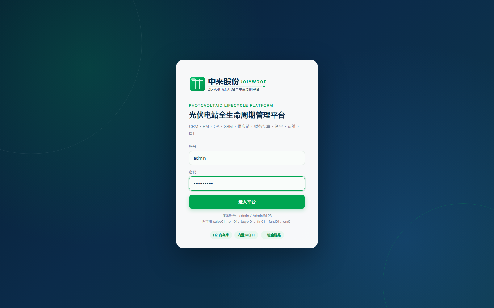
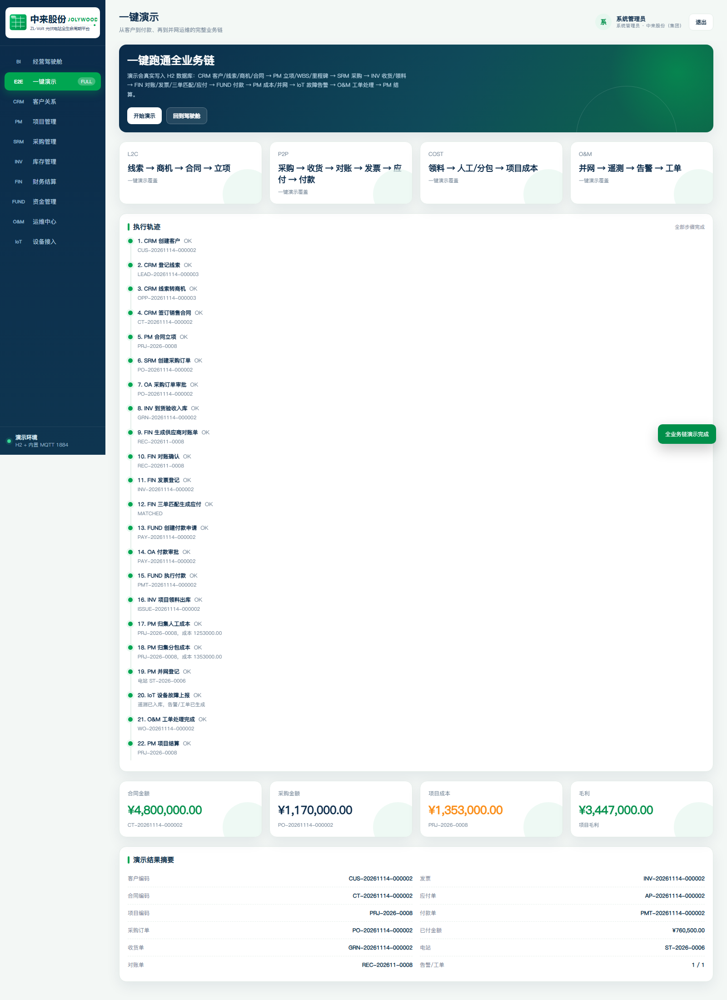

# ZL-Volt 网页手工验证手册

| 项目 | 内容 |
|---|---|
| 文档编号 | ZL-VOLT-MANUAL-001 |
| 版本 | V1.0 |
| 编制日期 | 2026-11-14 |
| 适用对象 | 产品、测试、实施、面试演示 |
| 验证方式 | 纯浏览器操作，不写代码 |
| 关联文档 | `docs/01-spec.md`、`docs/02-test-plan.md` |

本手册只做一件事：告诉你**在网页上点哪里、填什么、看到什么算通过**，重点覆盖五条业务链：

```text
L2C  客户 → 线索 → 商机 → 合同 → 立项
P2P  采购 → 发货 → 收货 → 对账 → 发票 → 三单匹配 → 应付 → 付款
COST 领料 → 材料成本；人工/分包 → 成本归集
O&M  并网 → 遥测 → 告警 → 工单 → 完工 → 关闭
FIN  项目结算 → 毛利复核
```

---

## 1. 验证前准备

### 1.1 启动应用

```powershell
cd c:\trae\ZLVoltManagement
mvn clean package -DskipTests
java -jar target\zl-volt-demo-1.0.0.jar
```

看到日志中出现 `Started ZlVoltApplication` 即启动成功。访问：

| 入口 | 地址 |
|---|---|
| 平台 | http://localhost:18080 |
| H2 控制台 | http://localhost:18080/h2-console |

H2 控制台连接参数：

```text
JDBC URL : jdbc:h2:mem:zlvolt
User Name: sa
Password :（留空）
```

### 1.2 重置数据

演示版使用 **H2 内存库**，每次启动都会重建并重新加载 `db/mysql/01_schema.sql` 与 `02_seed.sql`。

> 想让页面回到“干净种子数据”，按 `Ctrl + C` 停掉应用，再执行一次启动命令即可。页面刷新后所有手工新增的单据都会消失。

### 1.3 登录

打开 http://localhost:18080 ，使用：

| 账号 | 密码 | 说明 |
|---|---|---|
| admin | Admin@123 | 建议全程使用，权限最全 |

点击「进入平台」，看到顶部标题「经营驾驶舱」、左侧 10 个菜单、8 张指标卡，即登录成功。



### 1.4 认识页面

| 区域 | 说明 |
|---|---|
| 左侧导航 | 经营驾驶舱、一键演示、客户关系、项目管理、采购管理、库存管理、财务结算、资金管理、运维中心、设备接入 |
| 顶部 | 当前页面标题、当前用户、退出按钮 |
| 内容区 | 指标卡、表格、操作按钮 |
| 右上角浮层 | Toast 提示（约 3 秒消失），**每次操作后先看这里** |
| 弹窗 | 新建/确认类操作都在弹窗里完成，底部「取消 / 确认」 |

### 1.5 验证方法

每一步都按同一个套路判断：

1. **看 Toast**：是否出现成功提示，还是红色错误提示。
2. **看表格状态列**：状态徽标是否从“草稿”变成“已审批”，从“待处理”变成“已匹配”。
3. **看金额**：新单据金额是否等于预期值。
4. **看上下游**：上一步的单号是否出现在下一步的表格里（例如采购订单号出现在收货单、对账单中）。

> 页面金额统一显示为 `¥1,234,567.00`，核对时以数字为准，不要被千分位干扰。

---

## 2. 第一轮：冒烟验证（约 5 分钟）

目的：确认每个页面都能打开、种子数据都在。

| 序号 | 操作 | 预期结果 |
|---|---|---|
| 2.1 | 打开「经营驾驶舱」 | 8 张指标卡有值；最近项目、最近采购订单两表有数据 |
| 2.2 | 点「客户关系」 | 客户 8 个、线索 8 条、商机 8 个、合同 6 份 |
| 2.3 | 点「项目管理」 | 项目 7 个；点任意行「查看」，下方出现项目预算/累计成本/合同金额/项目毛利、WBS 与预算、里程碑、成本明细、变更签证 |
| 2.4 | 点「采购管理」 | 采购订单 6 张；供应商 8 家；物料 12 个 |
| 2.5 | 点「库存管理」 | 库存台账 10 条；收货单 6 张；库存流水至少 16 条 |
| 2.6 | 点「财务结算」 | 对账单 6 张；发票 6 张；应付 6 条 |
| 2.7 | 点「资金管理」 | 资金账户 3 张卡片（余额 1250 万 / 860 万 / 520 万）；付款申请 6 笔；付款记录 4 笔 |
| 2.8 | 点「运维中心」 | 电站 4 个；告警 8 条；工单 6 张；设备台账 20 台 |
| 2.9 | 点「设备接入」 | MQTT Broker 显示「运行中 / 内置端口 1884」；接入设备 20；遥测数据有值 |

以上全部符合，说明环境、种子数据、页面渲染均正常，可以进入业务链验证。

---

## 3. 第二轮：一键演示（最快看全链路）

### 3.1 操作

1. 左侧点「一键演示」。
2. 点击「开始演示」按钮，按钮变为「演示执行中...」。
3. 等待约 3~10 秒，页面出现「执行轨迹」22 条步骤，全部为绿色 `OK`。
4. 页面下方出现「演示结果摘要」。

### 3.2 预期结果

| 检查点 | 预期 |
|---|---|
| 执行轨迹 | 1 ~ 22 步全部 `OK`，右上角显示「全部步骤完成」 |
| 合同金额 | ¥4,800,000.00 |
| 采购金额 | ¥1,170,000.00 |
| 项目成本 | ¥1,353,000.00 |
| 毛利 | ¥3,447,000.00 |
| 摘要单号 | 客户 CUS-…、合同 CT-…、项目 PRJ-…、采购 PO-…、收货 GRN-…、对账 REC-…、发票 INV-…、应付 AP-…、付款 PMT-… 全部非空 |
| 告警 / 工单 | 1 / 1 |



### 3.3 交叉验证

| 去哪看 | 应看到 |
|---|---|
| 经营驾驶舱 | 合同总额、采购总额、已付款均增加；业务链累计出现新数字 |
| 客户关系 | 最新一行是刚创建的「演示客户-…」 |
| 项目管理 | 最新项目「演示 1MW 屋顶光伏 EPC 合同-… 项目」，状态「已并网」，成本 ¥1,353,000.00 |
| 采购管理 | 最新采购订单金额 ¥1,170,000.00，状态「已收货」 |
| 库存管理 | 出现新的入库流水和出库流水 |
| 财务结算 | 对账单金额 ¥1,170,000.00；应付状态「已付款」 |
| 资金管理 | 新的付款申请「已付款」，付款记录「成功」 |
| 运维中心 | 新增一条设备故障告警 + 一张已完工/已关闭工单 |

> 一键演示可以重复点击，每次都会新建一套客户/合同/项目。想对比金额时，请以最新一行为准；想回到干净数据，重启应用。

---

## 4. 第三轮：手工 L2C（客户到立项）

> 建议先重启应用，按种子数据走，便于核对数量。

### 4.1 新建客户

1. 进入「客户关系」。
2. 右上角点「新建客户」。
3. 弹窗中保持默认值即可（客户名称 `演示客户-时间戳`、类型 `屋顶业主`、区域 `江苏苏州`）。
4. 点「确认」。

**预期**

- Toast：`客户创建成功`
- 客户档案表首行出现新客户，编码以 `CUS-` 开头，状态「生效」
- 客户数量从 8 变为 9

### 4.2 登记线索

1. 点「登记线索」。
2. 「关联客户」选择刚创建的客户。
3. 其余保持默认（预估金额 4,200,000）。
4. 点「确认」。

**预期**

- Toast：`线索登记成功`
- 线索表新增一行，阶段为「待处理」，操作列出现「转商机」

### 4.3 线索转商机

1. 在新线索所在行点「转商机」。

**预期**

- Toast：`线索已转商机`
- 该线索阶段变为「已转化」，操作列变为「已转化」
- 右侧商机表新增一条商机，阶段「赢单」，金额 4,200,000.00

> 对同一条线索再次点「转商机」是点不到的（按钮已消失）；若用接口重复调用，会返回「该线索已转商机」，这是幂等保护。

### 4.4 新建销售合同

1. 在「销售合同」卡片右上角点「新建合同」。
2. 客户选择刚创建的客户；关联商机选择刚生成的商机。
3. 合同金额填 `4800000`。
4. 点「确认」。

**预期**

- Toast：`合同创建成功`
- 合同表新增一行，编码 `CT-…`，金额 ¥4,800,000.00，状态「已生效」
- 项目列为「未立项」，操作列为「合同立项」

### 4.5 合同立项

1. 在新合同行点「合同立项」。

**预期**

- Toast：`项目立项成功：PRJ-2026-00xx`
- 自动跳转到「项目管理 PM」并展开项目详情
- 项目预算 **¥3,600,000.00**（合同额的 75%）
- 合同金额 ¥4,800,000.00
- 当前进度 **17%**（6 个里程碑中「开工」已完成）
- WBS 与预算 5 行：设备采购 2,160,000.00、土建工程 360,000.00、安装工程 540,000.00、电气调试 360,000.00、并网及其他 180,000.00
- 里程碑 6 行：开工「已完成」，其余「待处理」

> 重复点同一合同「合同立项」不会重复建项目，系统会直接返回已存在的项目。

---

## 5. 第四轮：手工 P2P（采购到付款，核心链路）

### 5.1 新建采购订单

1. 进入「采购管理」。
2. 点「新建采购订单」。
3. 按下表填写：

| 字段 | 填写值 |
|---|---|
| 项目 | 刚立项的项目（名称以「… EPC 合同-… 项目」结尾） |
| 供应商 | 江苏曦光新能源科技有限公司 |
| 物料 | N型TOPCon组件 555W（块） |
| 数量 | 1000 |
| 含税单价 | 850 |
| 要求到货日期 | 默认即可 |

4. 点「确认」。

**预期**

- Toast：`采购订单已创建：PO-20261114-00xxxx`
- 新订单金额 **¥850,000.00**
- 状态「草稿」，操作列出现「审批」

### 5.2 审批采购订单

1. 在新订单行点「审批」。

**预期**

- Toast：`采购订单已审批`
- 状态变为「已审批」
- 操作列变为「发货」「收货」

### 5.3 供应商发货

1. 点「发货」。

**预期**

- Toast：`供应商已发货：SHP-…`
- 状态仍为「已审批」，但发货单已生成（可在接口 `/api/srm/purchase-orders/{id}` 或日志中看到）
- 操作列仍为「发货」「收货」

### 5.4 收货入库

1. 点「收货」。

**预期**

- Toast：`收货入库成功：GRN-20261114-00xxxx`
- 订单状态变为「已收货」
- 进入「库存管理」：
  - 库存台账中「蓝湾项目仓 · N型TOPCon组件 555W」数量增加 1000
  - 收货单列表新增一张，金额 ¥850,000.00，状态「已入库」
  - 库存流水最新一条类型为 `RECEIPT`，数量 +1000，金额 ¥850,000.00

> 如果订单是部分收货，状态会是「部分收货」，操作列出现「继续收货」。本演示一次性全部收货，所以直接「已收货」。

### 5.5 生成供应商对账单

1. 进入「财务结算」。
2. 点「生成对账单」。
3. 供应商选「江苏曦光新能源科技有限公司」，项目选刚立项的项目，期间保持默认 `2026-11`。
4. 点「确认」。

**预期**

- Toast：`对账单已生成：REC-202611-00xx`
- 新对账单金额 **¥850,000.00**，状态「草稿」
- 操作列出现「确认」

> 关键规则：对账单只统计**该供应商 + 该项目 + 该期间内状态为 STORED 的收货单**。种子数据的收货单在 2026-10，所以默认 2026-11 时不会被带出来；如果你改了期间却对不上，先检查收货日期。

### 5.6 对账确认

1. 在对账单行点「确认」。

**预期**

- Toast：`对账单已确认`
- 状态变为「财务已确认」
- 操作列变为 `-`（已确认的对账单不再重复确认）

### 5.7 登记发票

1. 在「发票与三单匹配」卡片点「登记发票」。
2. 关联对账单选择刚生成的对账单。
3. 发票号码保持默认 `FP时间戳`。
4. 发票金额**留空**（留空即取对账金额）。
5. 点「确认」。

**预期**

- Toast：`发票登记成功：INV-20261114-00xxxx`
- 发票表新增一行，金额 **¥850,000.00**，状态「待处理」
- 操作列出现「三单匹配」

### 5.8 三单匹配

1. 在发票行点「三单匹配」。

**预期**

- Toast：`三单匹配通过，已生成应付账款`
- 发票状态变为「已匹配」
- 下方应付账款表新增一行：
  - 应付金额 ¥850,000.00
  - 已付 ¥0.00
  - 可用 **¥552,500.00**
  - 状态「待付款」
  - 操作列出现「付款」

金额来源：

```text
预付款抵扣 30% = 850,000 × 30% = 255,000.00
质保金预留  5% = 850,000 ×  5% =  42,500.00
可用金额        = 850,000 - 255,000 - 42,500 = 552,500.00
```

### 5.9 付款

1. 在应付行点「付款」。

> 这是页面上的**快捷通道**：自动完成「创建付款申请 → 审批 → 付款执行」。

**预期**

- Toast：`付款成功：PMT-20261114-00xxxx`
- 应付金额：已付 **¥552,500.00**、可用 **¥0.00**、状态「已付款」
- 进入「资金管理」：
  - 付款申请新增一笔，金额 ¥552,500.00，状态「已付款」
  - 付款记录新增一笔，金额 ¥552,500.00，状态「成功」，银行流水号以 `BK` 开头
  - 招商银行基本户余额从 ¥12,500,000.00 变为 **¥11,947,500.00**

> 若想逐步验证“申请 → 审批 → 付款”的状态机，不要用应付行的「付款」，而是先用种子数据里的「审批中」申请：资金管理页找到 `PAY-20261110-0005`（审批中），点「审批」→ 状态变「已审批」→ 再点「付款」→ 状态变「已付款」，账户余额同步减少。

### 5.10 全链路核对

| 核对项 | 应满足 |
|---|---|
| 订单金额 | 1000 × 850 = ¥850,000.00 |
| 收货金额 | 等于订单金额 ¥850,000.00 |
| 对账金额 | 等于收货金额 ¥850,000.00 |
| 发票金额 | 等于对账金额 ¥850,000.00 |
| 应付可用 | 应付 − 预抵 30% − 质保 5% = ¥552,500.00 |
| 已付金额 | 等于本次付款 ¥552,500.00 |
| 应付余额 | ¥0.00 |

---

## 6. 第五轮：领料与成本归集

### 6.1 项目领料

1. 进入「库存管理」。
2. 点「项目领料」。
3. 按下表填写：

| 字段 | 填写值 |
|---|---|
| 项目 | 刚立项的项目 |
| 出库仓库 | 蓝湾项目仓 |
| 物料 | N型TOPCon组件 555W（块） |
| 领用数量 | 100 |

4. 点「确认」。

**预期**

- Toast：`领料出库成功：ISSUE-20261114-00xxxx`
- 库存台账中该物料数量减少 100
- 库存流水最新一条类型为 `ISSUE`，数量 -100，金额 -85,000.00（100 × 平均单价 850）
- 出库单成本 ¥85,000.00

> 如果提示「仓库无该物料库存」或「库存不足」，说明收货入库还没做，或收货仓库不是「蓝湾项目仓」。

### 6.2 验证材料成本已进入项目

1. 进入「项目管理」。
2. 找到刚立项的项目，点「查看」。
3. 看「成本明细」。

**预期**

- 新增一行：类型「材料」、金额 ¥85,000.00、备注包含领料单号
- 「累计成本」指标变为 ¥85,000.00
- 毛利率约 98.23%

### 6.3 归集人工成本

1. 在项目详情点「归集成本」。
2. 成本类型选「人工成本」，金额填 `100000`，备注默认。
3. 点「确认」。

**预期**

- Toast：`成本已归集`
- 成本明细新增「人工 ¥100,000.00」
- 累计成本变为 ¥185,000.00
- 项目毛利变为 ¥4,615,000.00

### 6.4 变更签证

1. 在项目详情点「变更签证」。
2. 类型选 `DESIGN`，金额增减填 `80000`，工期影响填 `2`，原因默认。
3. 点「确认」。

**预期**

- Toast：`变更签证已审批生效`
- 「变更签证」表新增一行：金额增减 ¥80,000.00、工期 2 天、状态「已审批」
- 成本明细新增「其他 ¥80,000.00」（来源为变更签证）
- 项目预算从 ¥3,600,000.00 变为 **¥3,680,000.00**
- 累计成本变为 ¥265,000.00
- 项目毛利变为 **¥4,535,000.00**，毛利率 94.48%

### 6.5 进度更新

1. 在项目详情点「进度 +10%」。

**预期**

- Toast：`项目进度更新为 27%`（每次递增 10%，上限 100%）
- 进度条同步变化
- 里程碑中前 2 个变为「已完成」，其余「待处理」

> 进度是按里程碑完成比例反推的：27% 取整后对应 2/6 ≈ 33%。如果数字与预期略有差异，以里程碑状态为准。

---

## 7. 第六轮：并网、IoT、告警与工单

### 7.1 并网登记

1. 在项目详情点「并网登记」。

**预期**

- Toast：`并网登记成功，电站：ST-2026-00xx`
- 项目状态变为「已并网」
- 项目详情中的「并网登记」按钮变为不可点击的「已并网」，不会重复登记
- 里程碑「并网」自动变为「已完成」，实际日期等于并网日期
- 进入「运维中心」：电站卡片多出一个新电站，设备数 5，未处理告警 0
- 设备台账新增 5 台设备（逆变器 2、电表、汇流箱、气象站）

### 7.2 模拟设备故障

1. 进入「设备接入」。
2. 确认第一张卡片「MQTT Broker」显示「运行中 / 内置端口 1884」。
3. 点「模拟故障上报」。

**预期**

- Toast：`故障上报成功，已生成告警 ALM-… 与工单`
- 遥测表最新一条：温度 90.00 ℃、功率 0.00 kW、状态「故障」、故障码 `E-TEMP-001`
- 未处理告警数量 +1

### 7.3 告警与工单

1. 进入「运维中心」。
2. 告警列表最新一条：级别「严重」、内容 `… 故障停机`、状态「未处理」、工单列显示 `#id`。
3. 在该告警行点「确认」。

**预期**

- Toast：`告警已确认`
- 告警状态变为「已确认」

> 故障上报会**自动创建工单**，并默认派给张强（运维工程师），所以告警行的「建工单」按钮不会出现。这是设计行为，不是按钮丢失。

### 7.4 工单处理闭环

1. 在「运维工单」表找到刚生成的工单，状态「已派单」。
2. 点「完工」，处理结果与工单成本保持默认（2800 元），点「确认」。

**预期**

- Toast：`工单已完工，告警自动清除`
- 工单状态变为「已完工」，处理人显示「张强」
- 对应告警状态变为「已清除」
- 未处理告警数量 -1

3. 在该工单行点「关闭」。

**预期**

- Toast：`工单已关闭`
- 工单状态变为「已关闭」
- 操作列变为 `-`

### 7.5 恢复运行

1. 回到「设备接入」，点「模拟正常运行」。

**预期**

- Toast：`遥测上报成功：DEV-…`
- 遥测表新增一条：功率 98.60 kW、温度 46.80 ℃、状态「运行」
- 设备在线状态中该设备变为「在线」

> 同一设备同一告警类型在 30 分钟内重复故障，系统只会复用已有告警，不会再新建告警和工单，用于防止告警风暴。这是正常的幂等行为。

### 7.6 MQTT 外部接入（可选，加分项）

```powershell
cd scripts\iot
npm install
node mqtt-device-simulator.js --broker mqtt://localhost:1884 --stations 2 --devices 5
```

预期：

- 模拟器控制台持续打印 publish 成功日志
- 「设备接入」页面遥测数据持续增加
- 高温/故障数据会自动生成告警与工单
- 再开一个窗口执行 `node mqtt-device-simulator.js --mode subscribe --broker mqtt://localhost:1884`，可看到平台收到的主题 `pv/{station}/{device}/telemetry`

---

## 8. 第七轮：项目结算与经营复核

### 8.1 项目结算

1. 进入「项目管理」，打开刚立项的项目。
2. 点「项目结算」。

**预期**

- Toast：`项目已结算`
- 项目状态变为「已结算」
- 项目仍保留全部 WBS、里程碑、成本明细、变更签证

### 8.2 驾驶舱复核

1. 进入「经营驾驶舱」。

**预期**

- 合同总额增加 ¥4,800,000.00
- 项目数量增加 1
- 采购总额增加 ¥850,000.00
- 已付款增加 ¥552,500.00
- 应付余额不含本笔（已付清）
- 最近项目首行是刚立项的项目，状态「已结算」，成本 ¥265,000.00
- 项目成本结构：材料、人工、其他三类金额与项目详情一致
- 业务链累计中的 L2C、P2P、对账、资金、运维告警数字均增加

---

## 9. 用 H2 控制台做金额勾稽

访问 http://localhost:18080/h2-console ，使用 `jdbc:h2:mem:zlvolt` / `sa` / 空密码连接，执行以下 SQL 核对。

### 9.1 应付金额勾稽

```sql
SELECT code, amount, paid_amount, prepaid_offset, retention_amount,
       available_amount, status
FROM fin_payable
ORDER BY id DESC
LIMIT 5;
```

通过标准：`available_amount = amount - paid_amount - prepaid_offset - retention_amount`。

### 9.2 库存勾稽

```sql
SELECT s.warehouse_id, m.name, s.qty, s.locked_qty, s.avg_cost, s.amount
FROM inv_stock s
JOIN srm_material m ON m.id = s.material_id
ORDER BY s.id DESC
LIMIT 10;
```

通过标准：`qty >= locked_qty >= 0`，`amount ≈ qty × avg_cost`。

### 9.3 库存流水勾稽

```sql
SELECT biz_type, biz_code, qty_delta, unit_cost, amount, occurred_at
FROM inv_stock_movement
ORDER BY id DESC
LIMIT 10;
```

通过标准：`RECEIPT` 为正数、`ISSUE` 为负数；同一物料的累计净额等于库存数量。

### 9.4 项目成本勾稽

```sql
SELECT p.code, p.budget_amount, p.status,
       COALESCE(SUM(c.amount), 0) AS cost_total
FROM pm_project p
LEFT JOIN pm_cost_item c ON c.project_id = p.id
GROUP BY p.code, p.budget_amount, p.status
ORDER BY p.code DESC
LIMIT 5;
```

通过标准：页面「累计成本」等于 `cost_total`；毛利 = 合同金额 − `cost_total`。

### 9.5 付款与账户勾稽

```sql
SELECT r.code AS payment_code, r.amount, a.name AS account_name, a.balance
FROM fund_payment_record r
JOIN fund_account a ON a.id = r.account_id
ORDER BY r.id DESC
LIMIT 5;
```

通过标准：每笔付款都能在 `fund_payment_record` 找到；账户余额 = 初始余额 − 该账户所有成功付款之和。

---

## 10. 异常与边界验证

这些是“故意点错”的用例，用来证明系统不是只会跑顺利路径。

| 编号 | 操作 | 预期提示 / 结果 |
|---|---|---|
| N-01 | 登录时密码输错 | Toast：`用户名或密码错误`，停留在登录页 |
| N-02 | 未登录直接访问 http://localhost:18080/api/reports/dashboard | 返回 `code=40101`，页面自动回到登录页 |
| N-03 | 对草稿状态的采购订单直接点「收货」 | 没有「收货」按钮；接口调用会返回「只有已审批采购订单可以收货」 |
| N-04 | 对已全部收货的订单再点「收货」 | 按钮已变为「已完成」；接口返回「该采购订单已全部收货」 |
| N-05 | 期间选 2026-10，但供应商/项目选本次新建的组合，点「生成对账单」 | Toast：`该供应商/项目在 2026-10 没有可对账的收货单` |
| N-06 | 同一供应商 + 项目 + 期间再生成一次对账单 | 不报错，直接返回已存在的对账单（幂等），不会重复生成 |
| N-07 | 登记发票时使用已存在的发票号码 | Toast：`发票号码已登记: FP…` |
| N-08 | 登记发票时金额填 800000（对账 850000）后点「三单匹配」 | Toast：`发票金额与对账金额差异超容差，已转异常处理`；发票状态「匹配异常」，不生成应付 |
| N-09 | 对同一应付重复点「付款」 | 付款按钮消失（可用为 0）；接口返回「该应付账款已结清」 |
| N-10 | 领料数量填 999999 | Toast：`库存不足，可用 …，申请 999999`，库存不变 |
| N-11 | 领料时选择从未收货的物料 | Toast：`仓库无该物料库存: …` |
| N-12 | 30 分钟内对同一设备重复「模拟故障上报」 | 不新增告警，复用已有告警；工单也不重复创建 |
| N-13 | 已关闭的工单再点操作 | 操作列为 `-`；接口返回「工单不存在」或状态不允许 |
| N-14 | 同一合同重复点「合同立项」 | 不重复建项目，直接返回已有项目并跳转 |

---

## 11. 常见问题

| 现象 | 原因 | 处理 |
|---|---|---|
| 页面打不开 | 应用未启动或端口被占用 | 看日志是否有 `Started ZlVoltApplication`；18080 被占用时改 `server.port` |
| 页面一直「正在加载业务数据...」 | 后端启动失败或接口 500 | 看控制台日志；按 F12 看 Network 中哪个接口失败 |
| 数据越点越多 | 每次操作都会真实写入 H2 | 正常现象；重启应用即可重置 |
| 对账单生成不了 | 期间内没有该供应商/项目的已入库收货单 | 确认收货日期在所选期间；期间默认是当前月 |
| 领料提示库存不足 | 没收货，或收货仓库不是领料仓库 | 先在「库存管理」确认该仓库有库存 |
| 付款按钮点不了 | 应付已结清或状态不对 | 应付状态需为「待付款 / 部分付款」且可用金额大于 0 |
| 故障上报没有新告警 | 30 分钟内同设备同类型告警已存在 | 换一台设备，或等 30 分钟后重试 |
| MQTT 连不上 | 端口被占用 | 演示版用 1884；确认日志出现 `MQTT broker started on port 1884` |
| 中文在 PowerShell 里乱码 | 终端编码问题 | 用浏览器页面或 Postman 验证，不影响数据 |
| 一键演示第二次报单号冲突 | 旧版本遗留问题 | 当前版本单号已改为 6 位序号，重启后重新执行即可 |

---

## 12. 验收清单

复制下表，逐项打勾。全部通过即可认为“业务链可展示”。

| # | 验证项 | 通过标准 | 结果 |
|---|---|---|---|
| 1 | 登录 | admin 能进入驾驶舱 | ☐ |
| 2 | 驾驶舱 | 8 张指标卡有值 | ☐ |
| 3 | CRM 新建客户 | 列表新增、Toast 成功 | ☐ |
| 4 | CRM 线索转商机 | 线索已转化、商机新增 | ☐ |
| 5 | CRM 合同立项 | 自动生成项目、WBS、里程碑 | ☐ |
| 6 | SRM 新建订单 | 金额 = 数量 × 单价 | ☐ |
| 7 | SRM 审批 | 状态变「已审批」 | ☐ |
| 8 | SRM 发货 | 生成发货单 | ☐ |
| 9 | INV 收货 | 库存增加、流水增加 | ☐ |
| 10 | FIN 对账 | 金额 = 收货金额 | ☐ |
| 11 | FIN 对账确认 | 状态「财务已确认」 | ☐ |
| 12 | FIN 发票登记 | 状态「待处理」 | ☐ |
| 13 | FIN 三单匹配 | 状态「已匹配」，自动生成应付 | ☐ |
| 14 | FIN 应付金额 | 可用 = 应付 − 30% − 5% | ☐ |
| 15 | FUND 付款 | 付款成功、账户余额减少 | ☐ |
| 16 | INV 领料 | 库存减少、项目材料成本增加 | ☐ |
| 17 | PM 成本归集 | 人工/分包计入累计成本 | ☐ |
| 18 | PM 变更签证 | 预算与成本同步调整 | ☐ |
| 19 | PM 并网 | 项目「已并网」、电站与设备生成 | ☐ |
| 20 | IoT 故障 | 遥测落库、告警与工单自动生成 | ☐ |
| 21 | O&M 工单闭环 | 确认 → 完工 → 关闭，告警清除 | ☐ |
| 22 | PM 结算 | 项目「已结算」 | ☐ |
| 23 | 金额勾稽 | 第 9 章 SQL 全部成立 | ☐ |
| 24 | 异常用例 | 第 10 章提示与预期一致 | ☐ |

---

## 13. 演示建议（面试 / 汇报）

如果只有 5 分钟：

1. 登录后先讲驾驶舱：合同额、项目数、采购额、已付款、应付余额、告警与工单，说明这是一套“业财一体”的视角。
2. 打开「一键演示」点一次，让 22 步自动跑完，停在结果摘要讲金额勾稽。
3. 切到「项目管理」打开刚生成的项目，讲 WBS、里程碑、成本明细、毛利。
4. 切到「财务结算」讲三单匹配和应付的 30% 预抵、5% 质保金。
5. 切到「设备接入」点一次「模拟故障上报」，再到「运维中心」讲告警自动转工单、完工自动清告警。

如果时间充足，再按第 4 ~ 8 章手工走一遍完整 P2P，并在 H2 控制台执行第 9 章的 SQL 做金额证明。
